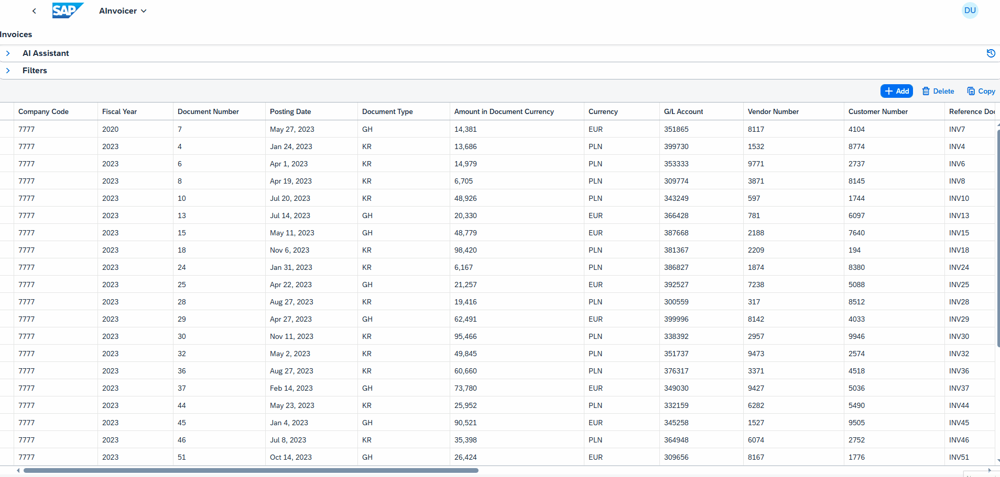
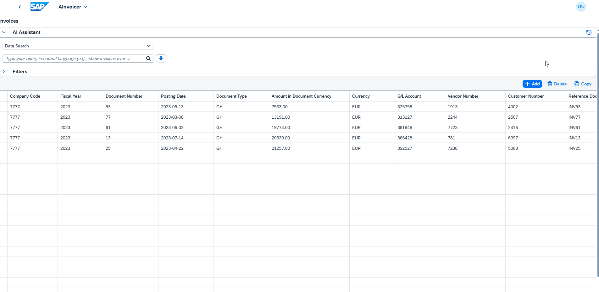
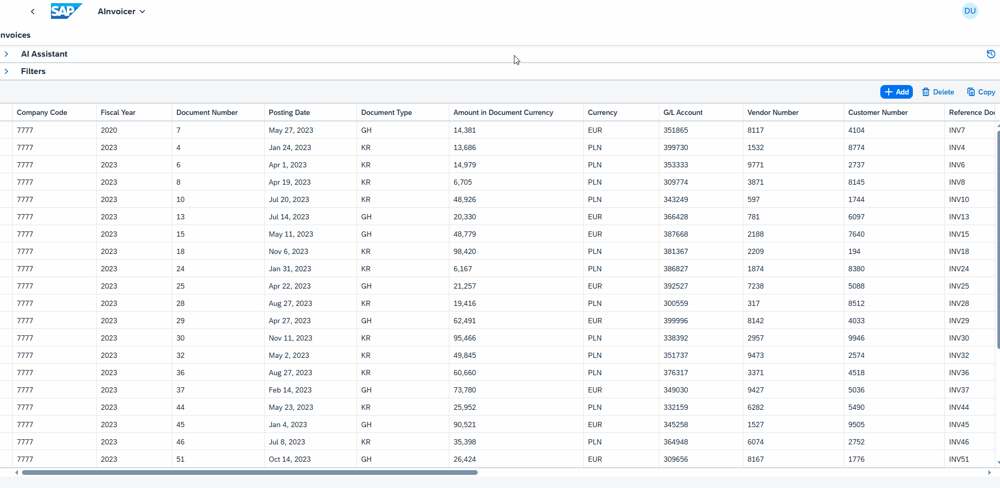

# 🧠 AInvoicer

**AInvoicer** is a fullstack SAP-based invoice processing application that merges traditional finance logic with modern AI capabilities. The repository contains SAPUI5, AI services, an ABAP Cloud RAP simulation model, and a CAP Java backend under development for KSeF 2.0. Project status and architecture notes: [Project Knowledge Base](docs/README.md).

Aktualny stan rozwoju CAP Java i KSeF, roadmapa, dziennik oraz decyzje architektoniczne: [baza wiedzy projektu](docs/README.md). Folder `docs/` można otworzyć jako Obsidian Vault.

---

## 💡 Overview

The application enables:

- Connecting SAPUI5 frontend with ABAP RAP and OData v4 backend
- Simulating invoice data in the custom ABAP tables `ZAINV_INV_H`, `ZAINV_INV_I`, and `ZAINV_INV_REF` (runtime RAP OData V4 confirmed Header/Items/References; local abapGit export may lag the live H01 state)
- Scanning and analyzing invoices with AI (OCR + NLP)
- Smart filtering using natural language queries
- Tracking AI queries and prompts with Langfuse

---

## 🚀 Key Features

- 🔍 **Natural Language Filtering (Langfuse-tracked)**  
  Using OpenAI and Langfuse, user queries in natural language are translated into OData filters. Example: “Show documents over 5000 EUR from 2024”.

**Voice mode**:

- 📄 **OCR Invoice Scanner**  
  Node.js microservice + OpenAI analyzes uploaded invoices (PDF/JPG/PNG) and extracts structured invoice data for the existing application workflow.
  

- 📊 **Dynamic Table (sap.ui.table)**  
  With features such as:  
  → OData v4 binding  
  → Sorting, filtering, pagination  
  → `limit` support using temporary JSON models  
  → Human-readable filter descriptions

- 🤖 **Field Value Prediction**  
  Python microservice + OpenAI predicts invoice fields based on historical data.

- 🗣️ **Voice Playback with OpenAI GPT-4o TTS (Text-to-Speech)**  
The application allows users to convert any text (e.g., AI-generated responses) into natural-sounding voice using OpenAI's gpt-4o-mini-tts model.  
→ Flask-based Python microservice generates audio/mpeg  
→ SAPUI5 frontend fetches and plays the audio dynamically via HTML5 <audio> API  
→ Voices (e.g., shimmer) and speed are customizable  

- 🧠 **Langfuse Observability**  
  Each AI interaction (prompt, response, model, tokens) is tracked with Langfuse:  
  → `trace` for the user query  
  → `span` for each prompt run  
  → full communication log with metadata (model, tokens, temperature)
---

## 🛠️ Technologies Used

| Layer         | Technology                                                    |
|---------------|---------------------------------------------------------------|
| Backend       | ABAP Cloud RAP simulation model; CAP Java + Spring Boot is under development for KSeF |
| Frontend      | SAPUI5 (Freestyle, sap.ui.table, mdc.FilterBar)               |
| AI Services   | Python (Flask), Node.js (Express), OpenAI SDK                 |
| Integration   | OData v4 (SAPUI5 ↔ ABAP), REST (SAPUI5 ↔ AI)                  |
| AI Monitoring | Langfuse (tracking prompts, results, tokens, models)          |
| Hosting       | SAP BTP (ABAP Env + Cloud Foundry for AI microservices)       |
| Database      | SAP HANA Cloud (optional – cache or AI training layer)        |

---

## 📚 Additional Topics Covered

- 🧾 Custom ABAP invoice simulation model (`ZAINV_INV_H/I/REF`); runtime RAP OData V4 confirmed Header/Items/References; local abapGit export may lag the live H01 state
- 🧠 Prompt engineering with predefined rules and examples
- 🧮 `$top` simulation in UI5 via model slicing
- 🧪 Postman endpoint testing
- 🌐 Cross-tech orchestration of SAP ↔ AI workflows
- 📜 Conversational AI interaction history in the UI

---

## 📦 Deployment

- AI microservices (Python & Node.js) deployed on SAP BTP Cloud Foundry
- ABAP backend logic (RAP + OData v4) runs on SAP BTP ABAP Environment
- SAPUI5 frontend as a BSP app or standalone deployment

---

## 📈 Future Enhancements

- 🔐 Authorization and role-based access (e.g., finance analyst, manager)
- 📊 Charts and visualizations (VizFrame integration)
- 🧠 Custom AI model training using historical invoice data
- 📉 Prompt quality metrics and dashboards in Langfuse

---

# 🧠 AInvoicer

**AInvoicer** to pełnostackowa aplikacja SAP do przetwarzania faktur, łącząca logikę finansową z możliwościami AI. Repozytorium zawiera SAPUI5, usługi AI, symulacyjny model ABAP Cloud RAP oraz rozwijany backend CAP Java dla integracji KSeF 2.0. Stan i architekturę opisuje [baza wiedzy projektu](docs/README.md).

---

## 💡 Overview

Aplikacja umożliwia:

- Łączenie SAPUI5 z ABAP RAP i OData v4
- Symulacja danych faktur w tabelach ABAP `ZAINV_INV_H`, `ZAINV_INV_I` i `ZAINV_INV_REF` (runtime OData V4 potwierdził Header/Items/References; lokalny eksport abapGit może być starszy od H01)
- Skanowanie i analizę faktur z użyciem AI (OCR + NLP)
- Inteligentne filtrowanie danych z użyciem języka naturalnego
- Monitorowanie zapytań i promptów z wykorzystaniem Langfuse

---

## 🚀 Key Features

- 🔍 **Natural Language Filtering (Langfuse-tracked)**  
  Dzięki OpenAI i Langfuse, zapytania użytkownika w języku naturalnym są przekształcane w filtry OData. Przykład: „Pokaż dokumenty powyżej 5000 EUR z 2024”.

- 📄 **OCR Invoice Scanner**  
  Mikrousługa Node.js + OpenAI analizuje przesłane faktury (PDF/JPG/PNG) i wyodrębnia dane strukturalne na potrzeby istniejącego przepływu aplikacji.

- 📊 **Dynamiczna Tabela (sap.ui.table)**  
  Z funkcjami:  
  → OData v4 binding  
  → Sortowanie, filtrowanie, paginacja  
  → Obsługa `limit` z wykorzystaniem modelu tymczasowego  
  → Opis aktywnych filtrów w języku naturalnym

- 🤖 **Predykcja wartości pól faktury**  
  Mikrousługa Python + OpenAI przewiduje pola faktury na podstawie danych historycznych.
  
- **🗣️ Odtwarzanie Głosu z OpenAI GPT-4o TTS(Text-to-Speech)**  
Aplikacja umożliwia konwersję dowolnego tekstu (np. odpowiedzi AI) na głos o naturalnym brzmieniu dzięki modelowi gpt-4o-mini-tts.  
→ Mikrousługa w Pythonie (Flask) generuje audio/mpeg  
→ Frontend SAPUI5 pobiera i odtwarza dźwięk dynamicznie z użyciem <audio> w HTML5  
→ Możliwość konfiguracji głosu (shimmer) i prędkości mowy  

- 🧠 **Langfuse Observability**  
  Każda interakcja z AI (zapytanie, odpowiedź, model, tokeny) jest śledzona w Langfuse:  
  → `trace` dla zapytania użytkownika  
  → `span` dla konkretnego promptu  
  → pełny zapis komunikacji + metadanych (model, tokeny, temperatura)

---

## 🛠️ Technologies Used

| Warstwa       | Technologia                                                  |
|---------------|--------------------------------------------------------------|
| Backend       | Symulacyjny model ABAP Cloud RAP; CAP Java + Spring Boot jest rozwijany dla KSeF |
| Frontend      | SAPUI5 (Freestyle, sap.ui.table, mdc.FilterBar)              |
| AI Services   | Python (Flask), Node.js (Express), OpenAI SDK                |
| Integracja    | OData v4 (SAPUI5 ↔ ABAP), REST (SAPUI5 ↔ AI)                 |
| Monitoring AI | Langfuse (śledzenie promptów, wyników, tokenów, modeli)      |
| Hosting       | SAP BTP (ABAP Env + Cloud Foundry dla AI)                    |
| Baza danych   | SAP HANA Cloud (opcjonalnie – cache lub baza uczenia AI)     |

---

## 📚 Additional Topics Covered

- 🧾 Własny model symulacyjnych faktur ABAP (`ZAINV_INV_H/I/REF`); runtime OData V4 potwierdził Header/Items/References, a lokalny eksport abapGit może być starszy od H01
- 🧠 Prompt engineering z predefiniowanymi regułami i przykładami
- 🧮 Symulacja `$top` w UI5 przez model slicing
- 🧪 Testowanie endpointów z Postmanem
- 🌐 Orkiestracja SAP ↔ AI w wielu językach
- 📜 Historia interakcji z AI dostępna z poziomu aplikacji

---

## 📦 Deployment

- Mikrousługi AI (Python i Node.js) hostowane w SAP BTP Cloud Foundry
- Backend ABAP (RAP + OData v4) w SAP BTP ABAP Environment
- Frontend SAPUI5 jako aplikacja BSP lub standalone

---

## 📈 Future Enhancements

- 🔐 Autoryzacja i role użytkowników (np. analityk finansowy, manager)
- 📊 Integracja wykresów z VizFrame (trend, porównania)
- 🧠 Trening własnego modelu AI na danych historycznych
- 📉 Statystyki i metryki jakości promptów w Langfuse Dashboard
