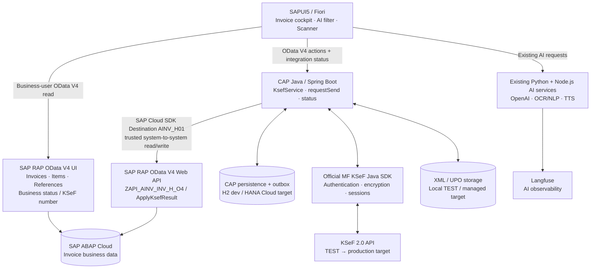

# AInvoicer

**AI-assisted SAP Fiori invoice cockpit and KSeF 2.0 integration platform.**

AInvoicer combines **SAP ABAP Cloud / RAP**, **SAPUI5**, **CAP Java / Spring Boot**, the **official Polish Ministry of Finance KSeF Java SDK**, and existing **AI services** into one extensible invoice workflow. It is designed to support both **accounts payable (incoming/purchase invoices)** and **accounts receivable (outgoing/sales invoices)**—from document discovery and validation to electronic exchange, reconciliation, and auditability.

> **Project maturity:** active engineering / integration testing. The KSeF TEST authentication and submission flow has been demonstrated using a synthetic SDK fixture; the complete SAPUI5 → SAP RAP → CAP → KSeF → SAP writeback flow has **not yet** been verified live. This is **not a production-ready KSeF connector**. See [current status](docs/STATUS.md) and [roadmap](docs/ROADMAP.md).

**Documentation:** [Project knowledge base](docs/README.md) · [Architecture decision ADR-0005](docs/decisions/ADR-0005-rap-business-status-cap-integration-status.md) · [KSeF SDK integration](docs/guides/KSEF_JAVA_SDK_INTEGRATION.md) · [SAPUI5 cockpit](docs/guides/SAPUI5_KSEF_COCKPIT.md)

<details>
<summary><strong>🇵🇱 Po polsku — czym jest AInvoicer?</strong></summary>

AInvoicer to rozwijana platforma SAP Fiori do obsługi faktur zakupowych i sprzedażowych z wykorzystaniem **AI i KSeF 2.0**. **SAP RAP** przechowuje dokumenty i potwierdzony biznesowy wynik KSeF; **CAP Java** obsługuje uwierzytelnianie, wysyłkę, odbiór, statusy techniczne, ponowienia i UPO. Istniejący **SAPUI5** zachowuje filtrowanie w języku naturalnym, skanowanie faktur, obsługę głosową i widok SAP FI.

Celem jest rozwiązanie integracyjne odporne na duplikaty i awarie, możliwe do rozwinięcia o wiele NIP-ów, procesy FI/MM/SD, faktury zakupowe, korekty, DMS i wdrożenie na SAP BTP. Aktualny kod jest na `main`, a archiwum pierwotnej wersji znajduje się na [archive/original-ainvoicer-2026-10-29](https://github.com/scaamp/AInvoicer/tree/archive/original-ainvoicer-2026-10-29).

</details>

## Product vision & business scope

The goal is a **single Fiori workspace** for finance teams and KSeF operators, while keeping invoice ownership and ERP-specific logic inside SAP.

| Business capability | Target experience |
| --- | --- |
| **Incoming invoices — AP / MM** | Synchronize invoice metadata from KSeF, retrieve FA(3) XML, detect duplicates, review and match to FI/MM documents and purchase orders, and support controlled posting and archiving. |
| **Outgoing invoices — AR / SD** | Select a sales invoice from SAP, validate the business data, generate FA(3), send it to KSeF, follow the acceptance status, persist the KSeF number in SAP and obtain UPO. |
| **SAP invoice cockpit** | Search and filter by invoice number, company code, NIP, date, direction, process, amount and status; inspect headers, items, references and integration history. |
| **AI assistance** | Search invoices using natural language or voice, analyze uploaded PDF/JPG/PNG invoices, assist with field extraction and preserve a conversational interaction history. |
| **Operations & compliance** | Trace each submission, distinguish business results from technical processing, reconcile ambiguous outcomes, prevent double submission, control access by legal entity and retain XML/UPO evidence. |

**Scope note:** The current vertical slice focuses on **outgoing invoices in KSeF TEST**. The inbound flow, accounting automation, corrections and production deployment are roadmap items—not completed functionality.

## AI capabilities — original AInvoicer experience

The existing SAPUI5 application and its original media assets are retained as part of the evolving cockpit.

### Natural-language invoice filtering

Natural-language queries are interpreted by the existing AI service and translated into controlled application filters. The current implementation also preserves query history and Langfuse-based AI observability. The newer KSeF cockpit is being connected to the RAP OData V4 model without replacing the original FI/AI workflows.


**Voice-assisted search**


### AI invoice scanning

The existing invoice-scanning flow accepts **PDF, JPG and PNG** files and uses a **Node.js + OpenAI** service to extract structured invoice data. The preview and entry flow remains available in the SAPUI5 application.


Additional existing AI features include field-value suggestions, conversational history, voice playback through the Python service / OpenAI TTS, and **Langfuse** traces for supported AI interactions. AI is an **assistant**, not an authorization boundary or an autonomous posting authority. Generated filters, extracted data and proposed changes require controlled validation before affecting SAP documents.

## Fiori cockpit

The UI is a **freestyle SAPUI5** application (including `sap.ui.table`), retaining its established layout, AI Assistant, Scanner, voice input and legacy SAP FI screen. The evolving KSeF cockpit adds:

- **All / Purchase / Sales / SAP FI (Legacy)** views;
- a configurable invoice table with company code, invoice type/direction, origin process (FI_AP, FI_AR, MM_IV, SD_BILL), parties/NIP, amount/currency, SAP status, KSeF number and integration state;
- detail views for header, items, references and available operation history;
- server-side RAP paging, filtering and sorting for invoice fields, with CAP status retrieval restricted to the visible invoice identifiers;
- context-sensitive actions such as **Send to KSeF**, status check and (when implemented) XML/UPO access and inbound synchronization.

The interface must **not** infer that an invoice was never sent simply because its KSeF number has not yet been written back to SAP. If CAP is unavailable or the operation history is incomplete, a new Send request is disabled (fail closed). Backend authorization and idempotency remain mandatory regardless of button state.

## Architecture

**Key design decision:** **RAP is the system of record for invoice business data and the persisted KSeF business result; CAP owns integration execution, technical status and synchronization.** SAPUI5 reads invoices **directly from RAP OData V4**, rather than routing ordinary invoice-list requests through a CAP proxy.



### Component responsibilities

| Component | Owns | Interface / implementation |
| --- | --- | --- |
| **SAP ABAP Cloud / RAP** | Invoice headers, items, references, SAP document status, confirmed KSeF number and business-user authorizations | RAP CDS + behavior; OData V4 UI for invoice reads; separate OData V4 Web API for trusted CAP integration |
| **SAPUI5 / Fiori** | Presentation, invoice selection/filtering, AI/scanner experience, triggering authorized actions | Named RAP OData V4 model; CAP KSeF status/action API; existing AI REST services |
| **CAP Java** | KSeF authentication and sessions, FA(3) preparation, submission, polling, UPO, operation history, retries, recovery and SAP writeback | CAP CDS/Event Handlers + Spring Boot; official SDK; SAP Cloud SDK RemoteService / Destination |
| **CAP persistence** | Idempotency reservations, immutable submission snapshots, operation/submission history, outbox commands and SAP writeback state | H2 for development/tests; **SAP HANA Cloud target** |
| **Document storage** | Exact XML payloads and UPO artifacts with controlled retrieval and retention | Local test store today; durable managed storage and retention policy required for deployment |
| **AI services** | NLP invoice filters, invoice scan/extraction, field suggestions, TTS and AI telemetry | Existing Python/Flask, Node.js/Express, OpenAI APIs and Langfuse |

The current ABAP Environment uses **custom simulated invoice tables** (`ZAINV_INV_H`, `ZAINV_INV_I`, `ZAINV_INV_REF`). It is not an implementation against standard S/4HANA FI/MM/SD posting APIs yet. The target architecture supports mapping those business processes through released SAP APIs rather than direct access to SAP database tables from CAP.

### Status ownership and eventual consistency

| Domain | Source of truth | Example |
| --- | --- | --- |
| **SAP document state** | RAP: `InvoiceStatus` | ERP invoice workflow / accounting state (defined separately from KSeF) |
| **Confirmed KSeF business result in SAP** | RAP: `KsefNumber`, `KsefEnvironment`, `KsefRecordedAt`, `KsefWriteRequestId` | KSeF accepted and SAP has recorded the confirmed result |
| **KSeF integration execution** | CAP: `KsefOperations` / `KsefSubmissions` | QUEUED, SUBMITTED, ACCEPTED, REJECTED, RECONCILIATION_REQUIRED, waiting for UPO |
| **SAP result synchronization** | CAP: `SapResultWrites` | PENDING, PROCESSING, SUCCEEDED, RETRY_EXHAUSTED, RECONCILIATION_REQUIRED |

**Acceptance by KSeF is not the same event as SAP writeback, and neither is equivalent to UPO retrieval.** CAP persists the confirmed acceptance before enqueueing a separate SAP writeback transaction. A persistent outbox and reconciliation sweeper recover incomplete delivery without repeating the KSeF submission. Once SAP acknowledges the result, the KSeF business number shown by the cockpit comes from RAP. See [ADR-0005](docs/decisions/ADR-0005-rap-business-status-cap-integration-status.md).

## Outgoing invoice workflow — target vertical slice

1. **Select** a sales invoice in SAPUI5; read the header, items and references from RAP.
2. **Request submission** through CAP `KsefService.requestSend(invoiceUUID)`. CAP re-reads RAP, checks the caller's authorized NIP/company code and rejects an already accepted or unresolved submission.
3. **Prepare evidence:** map SAP data and configured party data into **FA(3)** XML, validate the domain rules and official XSD, retain the exact bytes, SHA-256 hash and immutable SAP snapshot/version.
4. **Reserve and enqueue** the attempt atomically in CAP persistence. Only after commit does the worker perform network operations; the action result `QUEUED` is **not** KSeF acceptance.
5. **Authenticate and submit** using the official KSeF Java SDK (token/XAdES test support, encryption, online sessions and polling against KSeF 2.0).
6. **Reconcile the outcome:** verify business acceptance, KSeF number, invoice reference and payload hash; ambiguous outcomes require controlled read-only reconciliation, not blind resubmission.
7. **Synchronize to RAP:** persist ACCEPTED in CAP, enqueue an independent SAP writeback with a stable `WriteRequestId`, call RAP `ApplyKsefResult` and interpret APPLIED/ALREADY_APPLIED/conflicts.
8. **Complete independently:** close the KSeF session and obtain UPO; expose operational progress separately from the confirmed SAP business result.

**Incoming invoices (planned):** query/download metadata and XML from KSeF → validate FA(3) → deduplicate by KSeF identity and taxpayer context → review/match to FI/MM and purchase documents → post/park through authorized SAP operations → archive XML/PDF and retain traceable references. Corrections, multi-company/multi-NIP and scheduled synchronization are future extensions.

## APIs and integration points

| API / service | Purpose | State |
| --- | --- | --- |
| **RAP Web API:** `ZAPI_AINV_INV_H_O4/0001` | CAP → SAP: read invoices and invoke trusted `ApplyKsefResult` via OData V4 / Destination `AINV_H01` | Read verified in H01; real HTTP write not yet verified |
| **RAP UI:** `ZUI_AINV_INV_H_O4` | Business-user OData V4 list, details, paging and KSeF business result; read-only exposure | CDS/DCL/service definition active; **OData V4 UI service binding / IAM runtime tests still pending** |
| **CAP:** `/odata/v4/KsefService/` | `requestSend(invoiceUUID)`, `InvoiceIntegrationStatus`, scoped operation reads | Implemented; local HTTP/H2/mock tests passed |
| **KSeF 2.0 REST API** via [official Java SDK](https://github.com/CIRFMF/ksef-client-java) | Challenge/authentication, token redemption and refresh, encrypted invoice sessions, status, UPO | KSeF TEST flow demonstrated with one synthetic SDK fixture; full SAP-origin E2E pending |
| **Legacy SAP FI OData V4** | Existing invoice/document view and AI-assisted filtering | Preserved in SAPUI5 |
| **Existing AI REST APIs** | Natural-language filtering, invoice scan/field extraction, voice/TTS | Existing feature set retained; deployment/runtime dependencies are separate from KSeF |

The target is to keep KSeF-specific HTTP, crypto and credential handling **inside CAP**, not in the browser or ABAP RAP business model. KSeF environment separation (TEST/DEMO/PROD) and taxpayer context must be enforced server-side; the currently tested submission path targets **TEST**.

## Security, authorization & reliability

Security is part of the solution design, not a UI-only feature:

- **Business-user access:** SAP RAP UI service with IAM business roles and CDS DCL read restrictions by the **NIP + CompanyCode pair** (OUTBOUND seller / INBOUND buyer), including direct item/reference reads. The service must not expose `ApplyKsefResult`. **The actual IAM/binding permissions still require live validation.**
- **CAP access:** authenticated users, `KsefOperator` role and trusted `taxpayerNips` / `companyCodes` attributes, enforced on reads and actions. The CAP action accepts **only an InvoiceUUID** and derives NIP, company code, payload, environment and idempotency context on the server.
- **Trust boundaries:** separate business-user identity for RAP UI, trusted CAP-to-RAP communication via Destination, and KSeF tokens/certificates managed only in the backend. **IAS/XSUAA, approuter identity propagation and managed secret storage are deployment work.** Never embed credentials in UI source, Git or logs.
- **Duplicate prevention:** database-enforced reservation keyed by `(InvoiceUUID, Environment)`, compare-and-swap for controlled subsequent attempts, plus idempotency keys and immutable snapshots. Active, accepted or uncertain submissions block a new Send. Confirmed rejection permits retry only under an explicit policy; **automatic resend is disabled by default**.
- **Integrity:** XSD/domain validation, SHA-256 of the **exact XML bytes**, snapshot provenance (`SAP_RAP`), SAP header version and item fingerprint; KSeF acceptance evidence must match before SAP writeback. Standalone SDK test fixtures are never written back into SAP.
- **Recovery:** durable processing checkpoints, after-commit outbox, bounded retries/backoff, claim leases/CAS and a sweeper for accepted operations missing a SAP writeback. Network timeouts or unclear KSeF responses **must not trigger a second invoice POST**.
- **Conflict handling:** the RAP `ApplyKsefResult` action uses locking, optimistic concurrency and explicit outcomes (`APPLIED`, `ALREADY_APPLIED`, `VERSION_CONFLICT`, `RESULT_CONFLICT`, `IDEMPOTENCY_CONFLICT`). Conflicts require diagnosis; do not overwrite an already recorded KSeF number or bypass version controls.
- **Observability:** operation/submission/writeback history with safe error codes; Langfuse remains dedicated to supported AI traces. Financial records, prompts and extracted invoice content require appropriate redaction, access control and retention policies.

**Production hardening still required:** validated IAM/user propagation, managed KSeF credentials and certificates, SAP HANA Cloud persistence and migrations, durable object/document storage, monitoring/alerts, policy-driven retention, multi-instance/restart testing, CI security review and an authorized deployment strategy.

## Technology stack

| Area | Current technology | Target / planned |
| --- | --- | --- |
| SAP backend | ABAP Cloud, RAP, CDS, OData V4, ABAP Environment H01 | Authorized FI/MM/SD integration through released SAP APIs |
| Integration backend | **CAP Java 5.2**, **Spring Boot 4.1**, SAP Cloud SDK RemoteService, official **KSeF Java SDK 3.0.29** | Hardened, independently deployable integration service |
| SAP frontend | SAPUI5 freestyle, Fiori, OData V4 models, `sap.ui.table`, QUnit/OPA | Production cockpit with RAP/UI business-user access |
| Persistence | CAP CDS, H2 for local development/tests | **SAP HANA Cloud** |
| Security | CAP role/attribute checks, RAP behavior authorization and prepared DCL/IAM model | IAS/XSUAA, approuter, scoped user propagation, managed credentials |
| AI | Python/Flask, Node.js/Express, OpenAI APIs, Langfuse | Governed AI-assisted extraction, filtering and reconciliation |
| Hosting | SAP BTP ABAP Environment; local CAP Java development | SAP BTP Cloud Foundry for CAP and supporting services |
| Documents | Local test XML/UPO store | Durable document/object storage; optional SAP DMS integration |

## Verified progress vs. roadmap

The following evidence is scoped to the tests described; a successful build does not demonstrate a deployed production system.

| Capability | Evidence / current status |
| --- | --- |
| SAP RAP model and Web API | H01 OData V4 read demonstrated: **4 invoice headers, 9 items, 6 references** (synthetic data) |
| CAP Java submission & writeback logic | Local mock/H2 integration tests cover `requestSend`, concurrent reservation, exact FA(3) bytes, KSeF ACCEPTED, SAP writeback/recovery and UPO |
| KSeF TEST connectivity | Official Java SDK authenticated and processed **one synthetic fixture**, returning confirmed KSeF number and UPO; **not** a SAP-origin invoice |
| SAPUI5 cockpit | Existing AI/Scanner/Legacy preserved; RAP/CAP data adapter implemented; **KSeF cockpit still defaults to mock mode** |
| Latest recorded local regression | **178/178 Maven**, **59/59 QUnit**, **13/13 OPA**, UI5 build PASS (ABAP-05 report, 2026-10-29; not rerun for this README edit) |
| RAP UI business-user access | UI CDS/DCL/service definition observed active; OData V4 UI binding, IAM/user tests and real UI5-to-H01 routing **not yet verified** |
| SAP result writeback / full E2E | `ApplyKsefResult` logic exists; **HTTP WRITE to H01 and full SAPUI5 → KSeF TEST → RAP cycle not executed** |
| Cloud deployment | CAP Cloud Foundry + HANA/managed store and end-to-end identity configuration **not production-validated** |

**Next milestones:** publish and authorize the RAP V4 UI binding; connect the cockpit to real H01 invoices; validate controlled SAP HTTP writeback; perform one approved synthetic SAP-origin end-to-end KSeF TEST run; then advance incoming invoices, corrections, durable BTP deployment and multi-tenant operating controls.

For precise blockers, implementation evidence and decisions, read [STATUS](docs/STATUS.md), [ROADMAP](docs/ROADMAP.md), [ABAP-05 report](docs/journal/2026-10-29-abap-05-real-rap-ui.md), [CAP-05 audit](docs/audits/2026-10-29-cap-05-implementation-review.md), [RAP UI live runbook](docs/guides/RAP_UI_LIVE_CONNECTION.md) and [ADR-0005](docs/decisions/ADR-0005-rap-business-status-cap-integration-status.md).

## Run locally (development / demo)

> These commands exercise local builds and mocks. They do **not** submit any invoice to KSeF or update SAP H01.

**CAP Java**

```powershell
cd cap-java
mvn clean verify '-Dcds.cds.skipVersionCheck=true'
```

The repository pins the official SDK dependency; see [SDK integration guide](docs/guides/KSEF_JAVA_SDK_INTEGRATION.md) and `cap-java/tools/Install-KsefSdk.ps1` for reproducing its local Maven installation when the artifact is unavailable. Configuration such as `AINV_H01`, KSeF credentials and party data must be supplied through a trusted environment, **never committed**.

**SAPUI5**

```powershell
cd sapui5/ainvoicer
npm ci
npm run build
npm run serve-mock
```

Then, while the mock UI server is running (default port 8085), run in another terminal:

```powershell
cd sapui5/ainvoicer
npm run test:unit
npm run test:opa
```

The default cockpit configuration uses `dataMode: "mock"`. For **real RAP reads**, follow the [RAP UI live connection runbook](docs/guides/RAP_UI_LIVE_CONNECTION.md); do not switch to `rap` until a published UI binding, business-user IAM and appropriate routing have been verified.

## Repository map

```text
abap/                      ABAP Cloud RAP models, behavior and abapGit exports
cap-java/                  CAP Java, Spring Boot, KSeF SDK, CDS, outbox and tests
sapui5/ainvoicer/          Existing SAPUI5 Fiori application + KSeF cockpit
node/                      Invoice-scanning / AI Node.js services
python/                    NLP, voice and other Python AI services
gif/                       Original AI-filter, voice and OCR demonstrations
docs/                      Architecture decisions, audit reports, runbooks and project journal
.agents/skills/             Shared development skills for ABAP, CAP and KSeF
```

**Development workflow:** `main` is the integration/development branch. The historical original application is preserved at [`archive/original-ainvoicer-2026-10-29`](https://github.com/scaamp/AInvoicer/tree/archive/original-ainvoicer-2026-10-29); earlier work on `java-cap-ksef` has been promoted to `main`. See [branch-promotion journal](docs/journal/2026-10-29-main-promotion.md).

---

### Project principles

**SAP owns the invoice. CAP owns the integration. Fiori provides the workspace. AI assists the user.**

Design choices and safety guarantees should be verified against the implementation and current evidence, not assumed from the target architecture alone.
