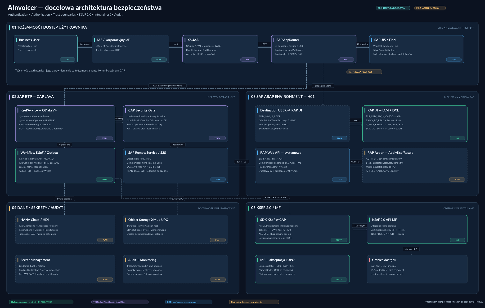
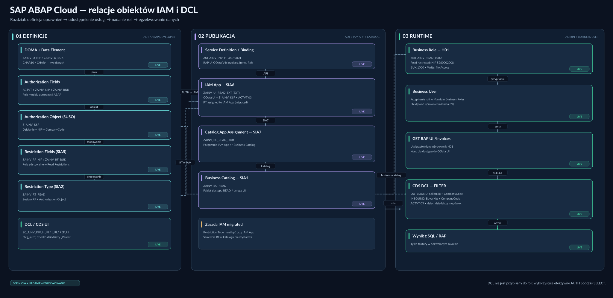

# AInvoicer — architektura bezpieczeństwa (target)

Dwa diagramy **SVG** przedstawiają docelową architekturę AInvoicer. Są wektorowe i można je powiększać bez utraty jakości. Obejmują komponenty działające, zaimplementowane i dopiero planowane. **Docelowy schemat nie oznacza, że wszystkie ścieżki zostały wdrożone i zweryfikowane.**

## 1. Architektura end-to-end: tożsamość, autoryzacja i integracja

[Otwórz SVG w pełnej rozdzielczości](AInvoicer_Security_Architecture_Target.svg)

**Granice zaufania (cztery konteksty):**

1. **Business user → CAP Java:** AppRouter, XSUAA JWT, `KsefOperator`, atrybuty NIP/CompanyCode i CAP CDS `@restrict`.
2. **Business user → RAP UI H01:** niezależna tożsamość użytkownika SAP, Business Role, IAM, DCL; docelowa propagacja przez `AINV_H01_UI_USER`.
3. **CAP Java → SAP Web API:** odrębny communication principal przez `AINV_H01`; READ oraz kontrolowana akcja `ApplyKsefResult` wymagają odpowiedniej autoryzacji SAP.
4. **CAP Java → KSeF 2.0:** osobny token/credential podatnika, challenge, JWT KSeF, szyfrowanie sesji i oficjalny Java SDK MF.

Dodatkowo diagram obejmuje persistent outbox, snapshoty i SHA-256, ochronę przed duplikacją, trwałą bazę i magazyn XML/UPO oraz zarządzanie sekretami.

## 2. SAP ABAP Cloud: relacje SUSO / RF / RT / IAM / katalog / rola / DCL

[Otwórz SVG w pełnej rozdzielczości](AInvoicer_SAP_IAM_DCL_Relations.svg)

Model AInvoicer:

- **SUSO:** `Z_AINV_KSF` z `ACTVT`, `ZAINV_NIP`, `ZAINV_BUK`.
- **Restriction Fields:** `ZAINV_RF_NIP` i `ZAINV_RF_BUK`.
- **Restriction Type:** `ZAINV_RT_READ` — dla modelu migrated przypisany do IAM App.
- **IAM App:** `ZAINV_UI_READ_EXT` z usługą `ZUI_AINV_INV_H_O4`.
- **Business Catalog / Assignment:** `ZAINV_BC_READ`, `ZAINV_BC_READ_0001`.
- **Business Role:** `ZBR_AINV_READ_1000` — zakres użytkownika SAP.
- **CDS DCL:** `ZC_AINV_INV_H_UI` i dzieci; odczyt filtrowany po NIP + CompanyCode w kontekście uprawnień `ACTVT=03`.

## Legenda stanów

| Oznaczenie | Znaczenie |
| --- | --- |
| **LIVE** | Konkretny przepływ potwierdzony w H01 lub osobnym teście KSeF TEST; nie oznacza pełnego E2E. |
| **TESTY** | Kod i testy lokalne/offline PASS; nie jest to dowód działania BTP/CF. |
| **KOD** | Artefakty są przygotowane, ale nie wdrożone w docelowym środowisku. |
| **PLAN** | Docelowy element do implementacji, konfiguracji lub weryfikacji. |

## Istotne ograniczenia (stan referencyjny: 2026-11-08)

- RAP UI business-user READ z IAM/DCL był potwierdzony na H01; nadal brakuje pełnej macierzy negatywnej A/B i poprawnego eksportu trzech UI DCL przez abapGit.
- CAP Java → SAP H01 READ działa; **LIVE HTTP WRITE z `ACTVT=16` nie został jeszcze potwierdzony**. Root DCL Web API zawiera obecnie `where TRUE`; prawa technicznego odczytu i ekspozycję Web API należy ograniczyć i przetestować.
- XSUAA/Identity/AppRouter opracowano na `feature/cap-07-btp-identity`, z testami JWT offline; **nie potwierdzono jeszcze prawdziwego logowania i propagacji użytkownika z BTP CF do H01**.
- Docelowe trwałe HANA Cloud/HDI, storage XML/UPO, retencja, sekret management i monitoring są nadal do wykonania.
- Uwierzytelnianie KSeF jest niezależne od XSUAA; ścieżka testowa SDK używa KSeF TEST. Pełny scenariusz faktura SAP → KSeF → SAP nie został wykonany.

## Powiązane dokumenty

- [IAM, Restriction Fields/Types i DCL](../guides/RAP_UI_IAM_MODEL.md)
- [ADR-0005: podział RAP / CAP i statusów](../decisions/ADR-0005-rap-business-status-cap-integration-status.md)
- [ADR-0002: autoryzacja akcji RAP `ApplyKsefResult`](../decisions/ADR-0002-sap-ksef-result-write-contract.md)
- [ADR-0003: persistent outbox i idempotencja writebacku](../decisions/ADR-0003-cap-sap-result-writeback.md)
- [Aktualny STATUS](../STATUS.md)
