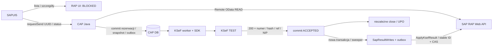

# CAP-05 — wynik audytu i uzupełnień

**Publikacja po audycie:** użytkownik osobno zlecił commit i push `feature/cap-05-integration` do origin. Opis niezacommitowanego stanu i braku publikacji poniżej dokumentuje moment zakończenia audytu, przed tym zleceniem. Publikacja nie obejmuje aktywacji SAP, LIVE SEND/WRITE ani merge do gałęzi integracyjnej. [Wpis publikacji](../journal/2026-10-29-cap-05-integration-review.md#publikacja-git-po-audycie).

[STATUS](../STATUS.md) · [ROADMAP](../ROADMAP.md) · [Dziennik](../journal/2026-10-29-cap-05-integration-review.md) · [ADR-0005](../decisions/ADR-0005-rap-business-status-cap-integration-status.md)

## Wniosek

**Rozwiązanie Claude Code było częściowe i zawierało błędy.** Merge oraz fundament backendu były poprawne, lecz UI5 pozostał niezacommitowany i niedokończony; dokumentacja nie opisywała CAP-05. Audyt uzupełnił lokalny przepływ RAP/mock → FA(3) → KSeF/mock → UPO → writeback/mock i poprawił ochronę bezpieczeństwa/duplikatów. **Nie jest to ukończony LIVE E2E.** RAP UI/IAM wymagają ADT i administratora; przygotowano źródła, bez aktywacji.

Nie wykonano nowej wysyłki KSeF, HTTP WRITE H01, nadania IAM, deploymentu, commit/push ani migracji istniejącej bazy.

## Ustalenia i naprawy

| Priorytet | Ustalenie w zastanym rozwiązaniu | Wynik |
| --- | --- | --- |
| P0 | Odczyt InvoiceIntegrationStatus/KsefOperations/KsefInvoices był filtrowany tylko po NIP; operator innej spółki tego samego NIP widział dane | Dodano CompanyCode do lokalnych metadanych operacji/faktur, filtrowanie obu atrybutów CDS i test HTTP odmowy; requestSend wyznacza spółkę z RAP. Rekord bez zakresu pozostaje niewidoczny |
| P0 | Historyczny SEND bez rezerwacji w stanie NEW/FAILED/nieznanym nie blokował nowej próby | Każdy nierozstrzygnięty SEND blokuje, także starszy od aktualnej rezerwacji. Historyczne odrzucenie bez rezerwacji wymaga decyzji; nie tworzy nowej próby samoistnie |
| P0 | Kod faktury 440 był zapisywany jako REJECTED; dopiero handler retry szukał sygnału duplikatu | Worker zatrzymuje w RECONCILIATION_REQUIRED, bez ponownego SEND i bez uznania za sukces. Nieznane statusy, m.in. 500, również nie otwierają retry |
| P0 | Dowód ACCEPTED sprawdzał hash/ref, ale nie format/NIP numeru KSeF; recovery polegało wyłącznie na findByHash | Dodano format i NIP numeru, ponowną kontrolę hash/ref w recovery oraz testy negatywne |
| P1 | Remote ServiceException był przekazywany z requestSend bez maskowania | Wyłącznie bezpieczny SAP_INVOICE_READ_FAILED (502), bez treści SAP/Destination; 404 pozostaje dla rzeczywiście nieznalezionej faktury |
| P1 | UI brało najwyżej 200 operacji i mogło potraktować ucięcie historii jako brak SEND | Kontrola count/nextLink, fail closed: dane RAP widoczne, IntegrationAvailable=false i Send zablokowany |
| P1 | „Load more” kumulowało listę w JSON, kliknięcie sortowania działało tylko lokalnie, pola CAP mogły trafić do RAP orderby | Jedna bieżąca strona, Previous/Next, server sort z tie-breaker InvoiceUUID, whitelist pól RAP; filtr statusu jawnie bieżącej strony |
| P1 | Pozostał działający wariant CAP proxy listy przez konfigurowalne invoiceListUrl | Zablokowano ten wariant i dodano test; named model rap czyta bezpośrednio usługę UI |
| P1 | Pierwsza partia błędnych rekordów sweepera mogła bez końca zajmować batch | Rotacja czasu technicznego sprawdzenia; test 51 wadliwych rekordów przed poprawnym |
| P1 | Worker A nadal aktualizował businessStatus/numer OUTBOUND w KsefInvoices | Dowód próby pozostaje wyłącznie w operacji, biznesowy wynik w RAP. Zachowano osobne XML/UPO refs; test powiązanej faktury CAP |
| P2 | Test mock RAP sortował stringi Decimal leksykalnie i FAIL; runner nie pokazywał expected/result | Numeryczne wartości fixture mockservera (mapper nadal obsługuje string Decimal), czytelny raport failed assertions |
| P2 | Dokumentacja/ADR nie odzwierciedlały zatwierdzonego promptu i faktycznej granicy transakcji | ADR-0005 zaakceptowany na podstawie promptu; aktualizacja AGENTS, STATUS, ROADMAP, README i przewodników |

## Co w backendzie Claude było poprawne

- `KsefSendReservations` z PK `(invoiceUUID, environment)` jako ostateczna atomowa bariera, nie sam SELECT. Kolejna próba przepina reservation przez CAS. Operacja, snapshot, submission i outbox commitują razem; rollback zwalnia niezacommitowaną rezerwację.
- `KsefAcceptedWriteback`: commit dowodu ACCEPTED poprzedza osobną transakcję enqueue. Enqueue wraz z SapResultOutbox atomowe; wyjątek nie cofa przyjęcia. Sweeper przy starcie i okresowo domyka okno awarii między commitami.
- `source=SAP_RAP` odróżnia powiązany dokument od standalone fixture SDK. Warunek dotyczy również bezpośredniego wewnętrznego writeback.enqueue.
- Stable WriteRequestId = operationId; SAP timeout/503 ponawia tylko to samo polecenie SAP. VERSION_CONFLICT nie zmienia ACCEPTED i nie jest automatycznie wznawiany.
- Publiczny CREATE SEND_INVOICE odrzucony; requestSend przyjmuje tylko UUID i sam odczytuje RAP, dane stron z konfiguracji backendu, generuje/waliduje FA(3).

## Git i zakres

| Gałąź | HEAD potwierdzony |
| --- | --- |
| feature/cap-05-integration (lokalny) | `2e0ee371d5e718457bcb07da3e5ab42aa1d0de1c` + niezacommitowane poprawki audytu |
| java-cap-ksef (lokalny i origin) | `f704fdde3200893c3fd8f3cf3d91d436fd6c9aed` |
| feature/ksef-auth | `2e1f33be8f87d88993b930297a8ef3c75f41584d` |
| feature/ksef-fa3 | `7075c0117ec828f92724b7eb087bafa8d4c584b9` |
| feature/ainvoicer-ui5-ksef | `732fa14e90f4d98b9f1879e9aff74a876873085e` |

Remote HEAD sprawdzono przez `git ls-remote --heads origin …`, bez fetch/pull. Branch integracyjny nie jest opublikowany. Zastane commity: `f49153b` merge auth z B, `0cd7440` przeniesienie runnera C, `2e0ee37` implementacja backendu Claude. Kod/zasoby generatora B porównano z `7075c01` — brak różnic. Nie scalano B drugi raz. Audyt nie tworzył nowych commitów ani konfliktów i zachował zastane UI5.

Zmiany audytu obejmują `cap-java/db/schema.cds`, `srv/ksef-service.cds`, KsefSendRequestHandler, KsefAcceptedWriteback, KsefSubmissionWorker, komentarz SapKsefResultWriteback, testy OData/requestSend/writeback/workera i atrybuty test users. UI5: adapter, mapper/reguły/kontrakt/filtry, mixin kontrolera, model rap i proxy/mock config, tabela/filtr, i18n, fixture RAP oraz testy/runner. Dokumenty: ten raport, dziennik, STATUS/ROADMAP/README/AGENTS, ADR-0004/5 i trzy przewodniki. Nowe źródła SAP wyłącznie w `docs/patches/cap05-rap-ui/`; brak zmian aktywnego SAP i eksportu `abap/src`.

## Architektura i transakcje

Lista/szczegóły nie mają proxy CAP. RAP `InvoiceStatus` pozostaje niezależny; `KsefBusinessStatus` nie dodano. CAP: trzy oddzielne domeny (operacja integracji, techniczny submission, SAP writeback). Błąd SAP nie jest odrzuceniem KSeF.

## Testy i dowody

Wersje: CAP 5.2.0, Spring Boot 4.1.1, Cloud SDK 5.33.0, SDK MF 3.0.29, JDK Microsoft 25.0.4.1, Maven 3.9.16; Node 24.13.0/npm 11.6.2, UI5 1.133.3, Chrome headless. Maven używa własnego Node 24.22.0. Tag SDK sprawdzono `git ls-remote`: v3.0.29 → `3c3a899541074aa4bd944636b25659aef7d23da7`; nie reinstalowano już dostępnej biblioteki.

| Test | Wynik | Zakres |
| --- | --- | --- |
| Baseline mvn clean verify | 163/163 PASS | zastany backend Claude, H2/mock |
| Końcowy mvn clean verify `-Dcds.cds.skipVersionCheck=true` | **173/173 PASS** | cała regresja, lokalne OData/Security/H2/outbox, SDK/SAP mock; live tagi wykluczone |
| npm ci | PASS po usunięciu blokady serwerów | 1135 pakietów; lockfile bez zmiany |
| npm run build | PASS | UI5 dist, bez deployu |
| npm run test:unit | **57/57 PASS, 260 asercji** | prawdziwy V4 ODataModel + mock RAP, fake CAP; mapper/reguły/filtry i legacy kontroler |
| npm run test:opa | **13/13 PASS, 80 asercji** | kokpit/AI/Scanner/Legacy, mock; dwa oczekiwane console.error TTS disabled |
| H01 resolve / normalized metadata / query | **LIVE READ PASS** | MCP OAuth, Web API HTTP200, 4/9/6; nie CAP Destination ani business user UI |
| Nowe RAP UI / DCL / IAM / ATC / ABAP Unit | **BLOCKED / NOT EXECUTED** | źródła lokalne, brak aktywacji i nadania |
| Patch testów mutacji dokumentu | git apply --check PASS | kontrola zastosowania patcha; nie ABAP Unit PASS |
| Nowy KSeF TEST SEND | **NOT EXECUTED** | historyczny wynik Agenta A nie jest wynikiem tego audytu |
| H01 HTTP WRITE / PROD / CF deploy | **NOT EXECUTED** | poza zleceniem |

Przepływ przekrojowy w `KsefSendRequestTest` wykonuje prawdziwy HTTP requestSend, Security, generator FA(3), snapshot, H2 i kod workerów; transporty zewnętrzne są mockami. Testuje APPLIED, ALREADY_APPLIED i VERSION_CONFLICT, identyczne bajty XML, UPO, odczyt statusu writeback i ponowny request drugiego użytkownika → 409. Pozostałe testy obejmują concurrent requests, rollback po rezerwacji, restart/checkpoint, enqueue failure, standalone fixture, SAP timeout/503, odzyskanie brakującego zlecenia i brak ponownego SEND.

Logi lokalne (ignorowane w Git): `cap-java/cap05-audit-final4-build.log`, `sapui5/ainvoicer/cap05-audit-final2-ui-build.log`, `cap05-audit-final2-browser.log`. `git diff --check` bez błędów whitespace. Sprawdzono dokumentację [transakcji CAP](https://cap.cloud.sap/docs/java/cqn-services/persistence-services), [Event Queues](https://cap.cloud.sap/docs/java/event-queues) i [wdrożony TEST OpenAPI](https://api-test.ksef.mf.gov.pl/docs/v2/openapi.json).

## Bezpieczeństwo i ograniczenia

- **Izolacja lokalna PASS:** rola KsefOperator, NIP i CompanyCode, brak dostępu anonimowego, obce zakresy nie czytają danych i nie wysyłają. IAS/XSUAA, trusted claims oraz faktyczni SAP business users pozostają NOT VERIFIED. Atrybuty testowe nie są nadaniem produkcyjnym.
- **Duplikaty PASS H2:** PK reservation + CAS retry i unikalny idempotency key. NEW/FAILED/nieznane/RECONCILIATION_REQUIRED oraz ACCEPTED blokują. Domyślne retry po odrzuceniu OFF; w testach jawnie ON/max2. HANA i wiele instancji CF nie były testowane.
- **Sekrety:** przegląd zmienionych plików względem f704fdd i nowych plików nie wykazał literalnych kluczy prywatnych, PAT ani JWT; śledzonych .env/PEM/P12/PFX/JKS brak. Nie jest to audyt całej historii Git. UI nie otrzymuje credentiali SAP/JWT KSeF; nie uruchamiano business-user proxy z communication userem.
- `npm ci` zgłasza **82 podatności zależności developerskich** (6 low/23 moderate/48 high/5 critical). `npm audit --omit=dev` wskazuje 0. Nie wykonano automatycznego force upgrade toolchainu; przed CI/release potrzebna osobna aktualizacja zależności i regresja.
- H01 root `where TRUE` pozostaje niebezpieczny dla publicznego UI; nie uznano go za izolację. Nowy projekt DCL chroni osobną usługę, także dzieci; brak dowodu runtime do czasu aktywacji/testów.
- UPO jest trwałym dokumentem workera, ale publiczne pobranie XML/UPO nie jest jeszcze API UI. Przyciski pozostają wyłączone. LocalTestDocumentStore/H2 nie oznaczają gotowości CF.
- Filtr statusu CAP i sortowanie pól pochodnych w UI dotyczą bieżącej strony; globalna dwufazowa selekcja jest osobnym rozszerzeniem. Duża/ucięta historia blokuje Send, zamiast zgadywać.
- Istniejąca baza wymaga migracji nowych pól/encji oraz zaufanego uzupełnienia CompanyCode i provenance; brak CompanyCode ukrywa historyczne rekordy. Nie wykonywano automatycznej migracji ani resetu bazy.
- Edycja/usunięcie faktury z numerem KSeF: brak blokady wynika z inspekcji aktywnego kodu; testy charakteryzacyjne przygotowano, ale **nie wykonano w SAP**. Nie dodano niezatwierdzonych ograniczeń księgowych. CAS nagłówka nie gwarantuje całej wersji pozycji.

## Macierz końcowej akceptacji

| Cel promptu | Wynik |
| --- | --- |
| Komponenty A/B/C na jednej gałęzi | PASS lokalnie; branch gotowy do przeglądu, bez nowego commita |
| Maven / UI5 build / QUnit / OPA | PASS |
| ACCEPTED → writeback, recovery, niezależne UPO | PASS H2/mock |
| requestSend / atomowa blokada / autoryzacja | PASS lokalne OData/H2/mock |
| RAP business result vs CAP integration/writeback | PASS kod/test lokalny |
| Named RAP model i zachowanie AI/Scanner/Legacy | PASS mock/browser |
| RAP UI V4 / DCL / IAM | BLOCKED, przygotowane źródła i instrukcje ADT |
| H01 LIVE WRITE / nowy KSeF LIVE SEND | NOT EXECUTED |

## Następny kontrolowany test LIVE — przygotowany, nieuruchomiony

1. ADT: aktywować read-only usługę UI i DCL, administrator zapewnia rolę ograniczoną ACTVT03/NIP/CompanyCode; test dwóch principalów i brak ApplyKsefResult w UI metadata. Ustawić rzeczywiste trasy/tożsamości RAP/CAP.
2. Przygotować jedną uzgodnioną syntetyczną fakturę RAP OUTBOUND z poprawnymi NIP/sumami i kompletnym PartyData; odczyt i walidacja FA(3) bez SEND. Ustalić trwałą testową DB i magazyn.
3. **Dopiero po osobnym zatwierdzeniu SEND i H01 WRITE:** uprawnienie ACTVT16 dla principala CAP, włączenie transportów dla uzgodnionego kontekstu TEST. UI business user wywołuje requestSend, zapisuje operationId/InvoiceUUID (bez tokenów).
4. Potwierdzić biznesowe 200, hash/ref/NIP/numer, niezależne UPO; SapResultWrites z tym samym WriteRequestId przechodzi APPLIED/SUCCEEDED. UI odczytuje numer z RAP; InvoiceStatus pozostaje bez zmian.
5. Drugi requestSend (także z drugiej karty/użytkownika) musi zwrócić 409; brak drugiego SEND KSeF. Sprawdzić wynik po restarcie i dostępność UPO w CAP.

Przy VERSION_CONFLICT zachować ACCEPTED i numer, nie zmieniać ExpectedVersion. Uruchomić wyłącznie read-only diagnose i pozostawić sprawę do decyzji. Szczegóły aktywacji i testów dokumentu: [RAP UI patch/runbook](../patches/cap05-rap-ui/README.md).
