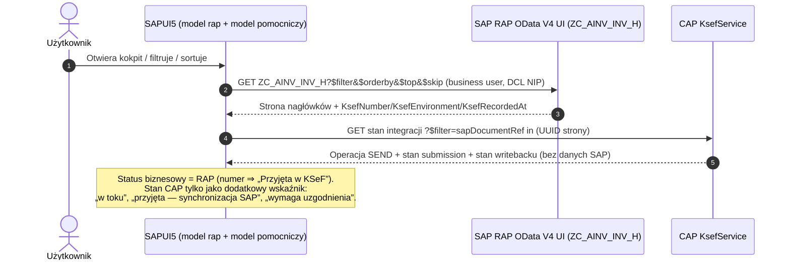
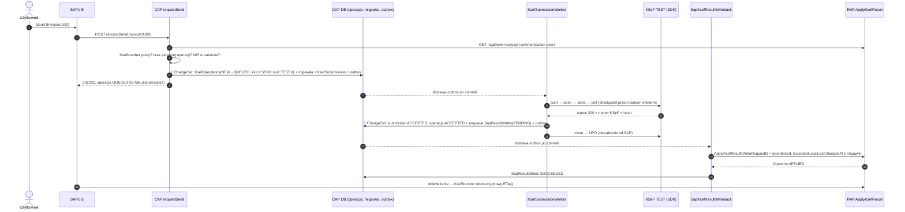
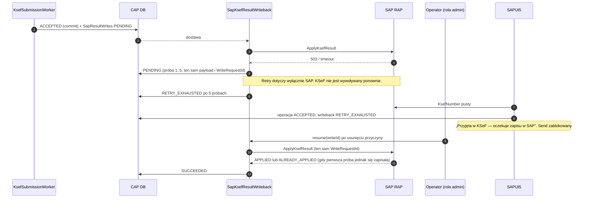

# Audyt: SAP RAP Business Status vs CAP Integration Status

[Project Home](../README.md) · [STATUS](../STATUS.md) · [Projekt ADR-0005](../decisions/ADR-0005-rap-business-status-cap-integration-status.md) · [ADR-0002](../decisions/ADR-0002-sap-ksef-result-write-contract.md) · [ADR-0003](../decisions/ADR-0003-cap-sap-result-writeback.md)

> **Tryb:** AUDIT-ONLY. Nie zmieniono kodu CAP/ABAP/UI5, persystencji, uprawnień ani branchy. Nie wysyłano faktur do KSeF i nie wykonano SAP WRITE. Nie uruchamiano buildów ani testów — wyniki testów cytowane niżej pochodzą z dzienników agentów i **nie zostały powtórzone** w tym audycie.

## 0. Punkt obserwacji i zakres dowodów

| Element | Stan (2026-10-29) |
| --- | --- |
| Branch audytu / HEAD | `java-cap-ksef` @ `03f5281`, drzewo czyste |
| `feature/ksef-auth` (A) | `2e1f33b`; 3 commity przed `java-cap-ksef`, 3 za; **NIE scalony** |
| `feature/ksef-fa3` (B) | `7075c01`; **NIE scalony osobno**, ale jego źródła są w A (`657c285`); `git diff 7075c01 2e1f33b -- …/ksef/fa3 …/resources/ksef` = pusty |
| `feature/ainvoicer-ui5-ksef` (C) | `732fa14`; UI (`e143425`, `088e61d`) **już jest** w `java-cap-ksef`; brakuje tylko `732fa14` (runner testów przeglądarkowych) |
| Worktrees `D:\AInvoicer-auth`, `-fa3`, `-ui5` | czyste (`git status --short` puste) |

Konsekwencja: **kod KSeF (SDK, `KsefSubmissionWorker`, FA(3), `KsefSubmissions`) istnieje wyłącznie na `feature/ksef-auth`.** Na `java-cap-ksef` jest writeback do SAP i UI, ale nie ma producenta potwierdzeń KSeF. Ten audyt analizuje oba stany; ścieżki z gałęzi A są oznaczone `[A]`.

Źródła dowodów:

- kod: `cap-java/` (`java-cap-ksef` i `[A]`), `abap/src/` (eksport Git), `sapui5/ainvoicer/webapp/`;
- SAP H01 przez MCP ABAP FS (**READ ONLY**, connection `h01`) — zakres opisany w sekcji „RAP Findings / H01”;
- dokumentacja: AGENTS, STATUS, ROADMAP, ADR-0001…0004, przewodniki, dzienniki A/B/C.

## 1. Executive Summary

**Czy obecna architektura spełnia przyjętą zasadę? — Nie w pełni.** Fundamenty są poprawne, ale trzy kluczowe połączenia nie istnieją, a UI odwraca priorytet źródeł.

Co jest zgodne z decyzją:

1. **RAP** przechowuje biznesowy wynik KSeF w czterech polach nagłówka (`KsefNumber`, `KsefEnvironment`, `KsefRecordedAt`, `KsefWriteRequestId`), które są `readonly` dla CRUD i zmieniane wyłącznie przez `ApplyKsefResult` z CAS, idempotencją i jawnym `Outcome`. `InvoiceStatus` nie jest dotykany przez integrację.
2. **CAP** ma trzy odrębne, trwałe maszyny stanów: wykonanie wysyłki (`KsefSubmissions` `[A]`), writeback (`SapResultWrites`) i — niestety mieszaną — operację (`KsefOperations`). Writeback nigdy nie zmienia statusu operacji KSeF, więc błąd SAP nie jest interpretowany jako odrzucenie przez KSeF.

Co jest niezgodne lub brakuje:

1. **P0 — brak połączenia KSeF ACCEPTED → writeback.** `KsefSubmissionWorker` nie wywołuje `SapKsefResultWriteback.enqueue()`; ADR-0004 mówi to wprost („Nie uruchamiamy automatycznie writeback do SAP”). Potwierdzone przyjęcie nigdy nie trafi do RAP.
2. **P0 — brak serwerowej ochrony przed drugą wysyłką tej samej faktury SAP.** Unikalność istnieje tylko dla `(taxpayerNip, idempotencyKey)` i dla `snapshotId`; nowy klucz lub nowy `DataWytworzeniaFa` daje nową operację i nową migawkę. Akcja `requestSend` (G-02) nie istnieje.
3. **P1 — SAPUI5 nadaje priorytet statusowi technicznemu CAP nad wynikiem RAP** (`deriveKsefStatus`), lista faktur działa wyłącznie na mock JSON, a przewodnik UI planuje proxy `KsefCockpitService.Invoices` w CAP — dokładnie to, czego nowa decyzja zabrania.
4. **P1 — bezpośredni odczyt RAP przez SAPUI5 wymaga pracy po stronie ABAP:** obecny binding jest **Web API** (`odata_v4_webapi`, ścieżka `srvd_a2x`), a DCL root ma `where TRUE` (brak izolacji odczytu per NIP/CompanyCode, brak czynności 03 w `Z_AINV_KSF`).

Najważniejsze odpowiedzi: nowe pole `KsefBusinessStatus` **nie jest potrzebne** dla pierwszego E2E; writeback powinien nastąpić **raz, po ACCEPTED**, niezależnie od UPO; UI może opierać status biznesowy wyłącznie na RAP, ale **blokada duplikatów musi być serwerowa w CAP** i uwzględniać okno „KSeF przyjął, SAP jeszcze nie wie”.

## 2. Current Architecture — As Implemented

```text
SAPUI5 (java-cap-ksef)
  ├─ model "" → /sap/opu/odata4/sap/zui_fi_acdoca_o4/…  (SAP FI Legacy, bez zmian)
  └─ KSeF cockpit: JSONModel + fetch()
        dataMode = "mock"  → localService/ksef/ZC_AINV_INV_H.json + KsefOperations.json
        dataMode = "cap"   → invoiceListUrl = null  → błąd G-01 (nieużywane)

CAP Java (java-cap-ksef)                         CAP Java [A] feature/ksef-auth (dodatkowo)
  KsefService (public, authenticated-user)        KsefSubmissionWorker + KsefSubmissionOutbox
    KsefOperations  CREATE/READ (NEW)               KsefInvoicePreparation (FA(3) + snapshot)
    KsefInvoices    READ                            KsefAuthentication / KsefOnlineSession (SDK 3.0.29)
  AinvoicerH01 (internal-user) → RAP Web API        KsefSubmissions / KsefSubmissionHistory
  SapKsefResultWriteback + SapResultOutbox
  SapKsefResultWriteRecovery (Java API only)       ✗ brak wywołania writeback po ACCEPTED

SAP H01 RAP
  ZAPI_AINV_INV_H_O4 (Web API, srvd_a2x, comm. scenario)
  ZC_AINV_INV_H / _I / _REF ; static action ApplyKsefResult → internal ApplyKsefLocked
```

Rzeczywiste przepływy:

| Przepływ | Stan |
| --- | --- |
| Lista faktur w UI | **mock JSON** (`manifest.json` `dataMode: "mock"`, `invoiceListUrl: null`) |
| CAP → RAP READ | LIVE PASS 2026-10-27 (lokalny CAP + env destination); nie powtarzano |
| UI → CAP requestSend | **nie istnieje** (G-02; `actions.send: null`, `capabilities.sendInvoice: false`) |
| CAP → KSeF TEST | `[A]` LIVE PASS dla jednej faktury z oficjalnego fixture (nie z H01, nie z generatora B) |
| KSeF ACCEPTED → writeback | **brak połączenia w kodzie** |
| CAP → RAP `ApplyKsefResult` HTTP | zaimplementowane, transport `ainv.sap-write.enabled=false`; LIVE WRITE NOT TESTED |

## 3. Status Ownership Matrix

Pięć niezależnych zbiorów statusów w kodzie. **Nie ma wspólnego enum** — te same nazwy (`ACCEPTED`, `REJECTED`, `RECONCILIATION_REQUIRED`) znaczą różne rzeczy w różnych encjach.

### 3.1 A. SAP Business Status (RAP, `ZAINV_INV_H`)

| Status / pole | Owner | Business meaning | Technical meaning | Persistence | UI representation | Terminal | Retry | Transition |
| --- | --- | --- | --- | --- | --- | --- | --- | --- |
| `InvoiceStatus` (CHAR12, wolny tekst; seed: `NEW`) | RAP | **niezdefiniowane** — brak domeny, wartości stałych, walidacji i determinacji | edytowalne standardowym UPDATE (02) | `ZAINV_INV_H-INVOICE_STATUS` | kolumna „Status SAP”, tekst bez interpretacji | — | — | dowolne przez UPDATE |
| `KsefNumber` puste i pozostałe 3 pola puste | RAP | faktura **nie ma potwierdzonego** wyniku KSeF w SAP (nie oznacza „nie wysłano”) | `ApplyKsefResult` dozwolona przy zgodnej wersji | 4 kolumny `KSEF_*` | „Brak w KSeF wg SAP” + ewentualny stan CAP | Nie | — | → wypełnione przez `APPLIED` |
| `KsefNumber` + `KsefEnvironment` + `KsefRecordedAt` + `KsefWriteRequestId` wypełnione | RAP | **KSeF przyjął fakturę w danym środowisku i SAP to zapisał** | dalsze wywołania: `ALREADY_APPLIED` / konflikty, bez mutacji | jw. | „Przyjęta w KSeF (TEST)” + numer | Tak (dla środowiska) | — | brak (readonly; nadpisanie zablokowane) |
| Akcja `Outcome` (`APPLIED`, `ALREADY_APPLIED`, `VERSION_CONFLICT`, `RESULT_CONFLICT`, `IDEMPOTENCY_CONFLICT`) | RAP (wynik akcji) | — | **nieutrwalany** wynik pojedynczego wywołania; utrwalany po stronie CAP w `SapResultWrites.outcome` | brak w SAP | nie dla użytkownika końcowego | — | — | — |

Odrzucenia KSeF RAP **nie modeluje** — patrz RAP Findings R-3.

### 3.2 B. CAP Integration Status

**B1. `KsefSubmissions.state` `[A]`** — wykonanie wysyłki (`cap-java/db/schema.cds:70-91`, `KsefSubmissionWorker.java`).

| Status | Business meaning | Technical meaning | UI | Terminal | Retry | Transition |
| --- | --- | --- | --- | --- | --- | --- |
| `PREPARED` | — | zlecenie + outbox zapisane atomowo | „W kolejce” | Nie | auto | → AUTHENTICATING |
| `AUTHENTICATING` | — | checkpoint przed auth (efekt) | „Wysyłanie” | Nie | **restart → RECONCILIATION_REQUIRED** | → OPENING |
| `OPENING` / `OPENED` | — | sesja online otwierana / otwarta | „Wysyłanie” | Nie | jw. | → SENDING |
| `SENDING` | — | checkpoint przed POST faktury | „Wysyłanie” | Nie | jw. | → POLLING |
| `POLLING` | — | wysłano, czekamy na status faktury | „Przetwarzanie w KSeF” | Nie | bezpieczne odczyty, backoff, max 10 | → ACCEPTED / INVOICE_REJECTED / READ_RETRY_EXHAUSTED |
| `ACCEPTED` | **przyjęta** (200 + numer + zgodny SHA-256) | krok przejściowy | — | Nie | — | → CLOSING |
| `INVOICE_REJECTED` | **odrzucona** (status ≠ 100/150/200) | krok przejściowy | — | Nie | — | → CLOSING |
| `CLOSING` | — | checkpoint przed close | — | Nie | restart → RECONCILIATION_REQUIRED | → WAITING_UPO / REJECTED |
| `WAITING_UPO` | przyjęta, UPO jeszcze brak | sesja zamknięta, odczyty UPO | „Przyjęta, oczekuje UPO” | Nie | odczyty, max 10 | → COMPLETED / READ_RETRY_EXHAUSTED |
| `COMPLETED` | przyjęta **i** UPO zapisane | koniec procesu | „Zakończona (UPO)” | Tak | — | — |
| `REJECTED` | odrzucona, sesja zamknięta | koniec procesu | „Odrzucona” | Tak | nowa operacja po korekcie | — |
| `RECONCILIATION_REQUIRED` | **nieznany** | utrata odpowiedzi na efekt / niespójny dowód | „Wymaga uzgodnienia” | Tak (`FINAL`) | tylko `reconcile(id)` (odczyty) | → POLLING / ACCEPTED→WAITING_UPO |
| `READ_RETRY_EXHAUSTED` | nieznany lub przyjęta bez UPO | wyczerpane odczyty | „Wymaga operatora” | Tak (`FINAL`) | `resumeReads(id)` | → POLLING / WAITING_UPO |

**B2. `KsefOperations.status`** — publiczna operacja (`schema.cds:45-65`; wartości ustawiane w `KsefOperationsHandler.java:251` i `[A] KsefSubmissionWorker.java:119,323-337`).

| Status | Znaczenie | Gdzie ustawiany | Uwagi |
| --- | --- | --- | --- |
| `NEW` | zarejestrowane żądanie | publiczny CREATE | **może utworzyć każdy `KsefOperator`** z dowolnym `sapDocumentRef` |
| `QUEUED` | zlecenie w outbox | `enqueue` | techniczny |
| `SUBMITTED` | faktura wysłana, polling | przejście do `POLLING` | techniczny |
| `ACCEPTED` | **przyjęta przez KSeF** | w tej samej transakcji co submission `ACCEPTED` | **biznesowy; pozostaje do końca**, także przy WAITING_UPO/COMPLETED |
| `REJECTED` | **odrzucona przez KSeF** | przy `INVOICE_REJECTED` | biznesowy |
| `RECONCILIATION_REQUIRED` | nieznany | przy submission `RECONCILIATION_REQUIRED` | **nie nadpisuje** ACCEPTED/REJECTED (`:331-334`) |

`KsefOperations` nigdy nie przechodzi w `COMPLETED`, `AUTHENTICATING`, `SENDING`, `POLLING`, `WAITING_UPO` — te stany są wyłącznie w `KsefSubmissions`.

**B3. `KsefInvoices.businessStatus`** — `UNCONFIRMED` (default), `ACCEPTED`, `REJECTED` (`[A] updateInvoice`, `:327,330`). **Żaden kod produkcyjny nie tworzy wiersza `KsefInvoices`** (inserty tylko w testach), więc aktualizacja jest pustą operacją w rzeczywistym przepływie.

### 3.3 C. CAP → SAP Writeback Status (`SapResultWrites.state`, `java-cap-ksef`)

| Status | Business meaning | Technical meaning | UI | Terminal | Retry | Transition |
| --- | --- | --- | --- | --- | --- | --- |
| `PENDING` | KSeF przyjął; SAP jeszcze nie zapisał | polecenie czeka na dostawę outbox | „Synchronizacja z SAP” | Nie | auto | → PROCESSING |
| `PROCESSING` | jw. | claim + lease 2 min, trwa HTTP | jw. | Nie | odzyskanie po wygaśnięciu lease | → SUCCEEDED / PENDING / RETRY_EXHAUSTED / RECONCILIATION_REQUIRED |
| `SUCCEEDED` (outcome `APPLIED`/`ALREADY_APPLIED`) | SAP potwierdził zapis | koniec | brak osobnej informacji — RAP pokazuje numer | Tak | — | — |
| `RECONCILIATION_REQUIRED` + outcome `VERSION_CONFLICT`/`RESULT_CONFLICT`/`IDEMPOTENCY_CONFLICT` | **konflikt danych SAP**, nie odrzucenie KSeF | `BUSINESS_CONFLICT`, `resume` zabroniony | „Konflikt zapisu w SAP — wymaga decyzji” | Tak | **brak ścieżki** | — |
| `RECONCILIATION_REQUIRED` + `SAP_HTTP_4xx`/`429`/`SAP_WRITE_DISABLED` | SAP niedostępny / odmówił | `SAP_AVAILABILITY`, resumable po `retryNotBefore` | „Synchronizacja wstrzymana” | Tak | `resume()` Java | → PENDING |
| `RECONCILIATION_REQUIRED` + `SAP_INVALID_RESULT` | nieznany | niespójna odpowiedź | „Wymaga uzgodnienia” | Tak | brak | — |
| `RETRY_EXHAUSTED` | jw. jak PENDING | 5 prób 408/5xx/IO | „Synchronizacja wstrzymana” | Tak | `resume()` Java | → PENDING |

### 3.4 Statusy wyłącznie w UI (`KsefContract.js:27-45`)

`RECORDED_IN_SAP`, `NO_OPERATION` (wyliczane) oraz katalog „anticipated”: `PROCESSING`, `FAILED`, `RECEIVED` — **nie istnieją** w żadnej encji CAP. Brakuje `RECONCILIATION_REQUIRED` (UI potraktuje go jako nieznany i zablokuje Send — bezpiecznie, ale bez opisu). `QUEUED`, `SUBMITTED`, `REJECTED` są oznaczone „anticipated”, a już istnieją w `[A]`.

## 4. RAP Findings

Dowody: `abap/src/zr_ainv_inv_h.bdef.asbdef`, `zr_ainv_inv_h.ddls.asddls`, `zc_ainv_inv_h.*`, `zbp_r_ainv_inv_h.clas.locals_imp.abap`, `za_ainv_ksf_req/res.ddls.asddls`, `zr_ainv_inv_h.dcls.asdcls`, `zapi_ainv_inv_h_o4.*`.

| # | Ustalenie | Dowód | Ocena | Minimalna zmiana |
| --- | --- | --- | --- | --- |
| R-1 | `InvoiceStatus` to wolny CHAR12 bez domeny/walidacji; seed ustawia tylko `NEW`; edytowalny UPDATE. **Nie dotyczy KSeF** — integracja go nie zmienia (ADR-0002) | `zainv_inv_h.tabl.xml` (CHAR 12), `zcl_ainv_test_data.clas.abap:54-75`, BDEF bez `readonly` dla pola | Zgodne z rozdziałem; semantyka nieokreślona | Decyzja: zdefiniować jako status dokumentu SAP (np. księgowanie). Poza zakresem KSeF |
| R-2 | Wynik KSeF = 4 pola readonly; zmiana tylko przez `ApplyKsefResult` → `ApplyKsefLocked` (blokada, CAS po `LocalLastChangedAt`, idempotencja po `WriteRequestId`) | BDEF `:12-29`; `locals_imp:141-260` | Zgodne | — |
| R-3 | `ApplyKsefResult` obsługuje **wyłącznie przyjęcie** (wymaga numeru `[0-9A-Za-z-]{1,50}`, `Environment = 'TEST'`, `Direction = 'OUTBOUND'`). Odrzucenia nie da się zapisać | `locals_imp:151-155, 213-215` | Świadome; patrz pytanie 7 | Brak zmiany dla E2E; odrzucenie zostaje w CAP |
| R-4 | Ochrona numeru: istniejący numer → `ALREADY_APPLIED` (ten sam numer/środowisko, także z innym request ID), `IDEMPOTENCY_CONFLICT` (ten sam request, inny wynik), `RESULT_CONFLICT` (inny numer lub niekompletne pola) — bez mutacji | `locals_imp:224-237` | Zgodne | — |
| R-5 | Brak numeru + niezgodna wersja → `VERSION_CONFLICT`. **Każda** zmiana nagłówka po przygotowaniu XML (także `InvoiceStatus`) blokuje trwale zapis przyjętej faktury; zmiany pozycji nie zmieniają wersji nagłówka (brak `total etag`) | `locals_imp:238-239`; BDEF `etag master LocalLastChangedAt` (`:8`); dzieci mają własny ETag (`:67,106`) | **Luka P1** — fakt zewnętrzny (przyjęcie) może nie dać się zapisać | Decyzja (Open Question Q3) |
| R-6 | ETag: `LocalLastChangedAt` ma `@Semantics.systemDateTime.localInstanceLastChangedAt`; zarządzany BO aktualizuje go przy UPDATE w LOCAL MODE, więc `APPLIED` **zmienia ETag**; `ALREADY_APPLIED`/konflikty — nie | `zr_ainv_inv_h.ddls.asddls:46-47`; `locals_imp:245-249` | Oczekiwane (ADR-0002: konsument pobiera nowy ETag). **LIVE NOT VERIFIED** (brak HTTP WRITE) | UI musi odświeżać rekord po writebacku |
| R-7 | Faktura z numerem KSeF pozostaje **edytowalna** (kwoty, NIP w zakresie praw) i **usuwalna** (`delete;` bez precheck) | BDEF `:25-27`; `precheck_update` sprawdza tylko zakres NIP/CompanyCode | Luka P2 — SAP może rozjechać się z dokumentem w KSeF | Validation/precheck „brak zmian treści i DELETE przy `KsefNumber` IS NOT INITIAL” (osobne zlecenie ABAP) |
| R-8 | Odczyt: DCL root `where TRUE`; `Z_AINV_KSF` sprawdzany dla 01/02/06/16, **nie dla 03** | `zr_ainv_inv_h.dcls.asdcls:4-5`; `locals_imp:43-53` | **P1 dla bezpośredniego odczytu przez UI** | DCL z `aspect pfcg_auth (Z_AINV_KSF, …, ACTVT='03')` — decyzja |
| R-9 | Binding to **OData V4 Web API** (`provider contracts odata_v4_webapi`, ścieżka `srvd_a2x`, comm. scenario `…_G4BA`). Jest to API A2X dla communication usera, nie usługa UI dla business usera z launchpada | `zapi_ainv_inv_h_o4.srvd.srvdsrv`, `.srvb.xml`, `.sco2.xml`; CAP `application.yaml` `…/srvd_a2x/…` | **P1** — bezpośredni odczyt z SAPUI5 w modelu ABAP Cloud wymaga osobnej usługi UI (`odata_v4_ui`) + IAM App/Business Catalog. Wniosek z modelu ABAP Cloud; **do potwierdzenia w H01** | Nowy SRVD/SRVB UI tylko do odczytu (bez akcji `ApplyKsefResult`) |
| R-10 | `KsefBusinessStatus` — **niepotrzebny** dla E2E OUTBOUND. Przyjęcie = `KsefNumber IS NOT INITIAL AND KsefEnvironment = <env>` (wszystkie 4 pola są zapisywane razem). Odrzucenie nie istnieje w KSeF jako dokument — jest wynikiem próby, więc należy do CAP | analiza R-2…R-4 | Rekomendacja | Brak nowej kolumny; ponowna ocena przy INBOUND (scenariusz 10) |

### H01 — stan rzeczywisty (MCP READ ONLY, 2026-10-29)

| Obiekt | Wynik |
| --- | --- |
| `ZR_AINV_INV_H` BDEF (active) | odczytano 50/134 linii; zgodne z Git (readonly 4 pól, `ApplyKsefResult`/`ApplyKsefLocked`, `etag master`, `authorization master(global, instance)`) |
| `ZC_AINV_INV_H` BDEF (active) | 32/32 linii, zgodne z Git (`use action ApplyKsefResult`, `use etag`) |
| `ZC_AINV_INV_H` DDLS (active) | 50/78 linii, zgodne z Git (4 pola KSeF, `InvoiceStatus`) |
| `ZA_AINV_KSF_RES` DDLS (active) | 10/10 linii, zgodne z Git |
| `ZBP_R_AINV_INV_H` handler `ApplyKsefLocked` | **NOT VERIFIED** — metoda w include `locals_imp` niedostępna przez `methodName` (zgodnie z wcześniejszym ograniczeniem MCP do include) |
| DCL, IAM, communication arrangement, aktywność runtime akcji, ETag po APPLIED | **NOT VERIFIED** |

Wniosek: wnioski RAP o handlerze opierają się na eksporcie Git `525e48d`; aktywna wersja implementacji nie została potwierdzona w tym audycie.

## 5. CAP Findings

| # | Ustalenie | Dowód | Ocena | Minimalna zmiana |
| --- | --- | --- | --- | --- |
| C-1 | **Brak wywołania writebacku.** Po `ACCEPTED` worker aktualizuje `KsefOperations` i `KsefInvoices`, ale nie `SapKsefResultWriteback.enqueue()`. Grep po `srv/src/main` `[A]`: jedyne wywołania `enqueue` to `KsefInvoicePreparation → KsefSubmissionWorker`. ADR-0004 i przewodnik SDK potwierdzają to jako świadome | `[A] KsefSubmissionWorker.java:316-346` (gałąź `ACCEPTED` `:323-327`); `[A] ADR-0004` „Consequences” | **P0** | W `save()` przy `ACCEPTED`, w tej samej transakcji: `writeback.enqueue(claim.id)` |
| C-2 | Warunki `enqueue` są spełnione przez worker: status `ACCEPTED`, `snapshot_ID` (ustawiane w `enqueue` workera, `:119`), `confirmedXmlSha256` = `xmlSha256` migawki (`:326`), `SEND_INVOICE/OUTBOUND/TEST`, system user + ChangeSet (`tx()` `:383-386`) | `SapKsefResultWriteback.java:117-146`; `[A] :80-125` | Połączenie wykonalne bez zmian kontraktu | — |
| C-3 | Ryzyko przy połączeniu: wyjątek z `enqueue` (np. `KSEF_NUMBER_ALREADY_ASSIGNED`, `WRITE_IDEMPOTENCY_CONFLICT`) wycofałby **zapis przyjęcia KSeF** w tej samej transakcji | `SapKsefResultWriteback.java:161-175` | Do rozwiązania w implementacji | Wywołać po zapisaniu ACCEPTED; błąd enqueue nie może wycofać ACCEPTED — patrz sekcja 9 |
| C-4 | **Brak ochrony przed drugą wysyłką tej samej faktury.** Unikalność: `(taxpayerNip, idempotencyKey)`, `KsefSubmissions.snapshotId`, migawka po `(invoiceUUID, env, nip, xmlSha256)`. `DataWytworzeniaFa` pochodzi od wywołującego (`PartyData.createdAt`) → nowy czas = nowe bajty = nowa migawka = nowe zlecenie. `enqueue` sprawdza tylko `NEW` tej operacji | `schema.cds:43,65,91`; `[A] SapInvoiceFa3Mapper.java` (PartyData); `[A] KsefSubmissionWorker.java:104` | **P0** | `requestSend` po stronie CAP: odczyt RAP, odmowa przy `KsefNumber`; deterministyczny klucz idempotencji `SEND:<InvoiceUUID>:<env>:<n>` liczony przez serwer (n rośnie tylko po `REJECTED`); istniejące UNIQUE wymusza jedną aktywną próbę |
| C-5 | Status KSeF `440` (duplikat — wg dokumentacji MF; **do potwierdzenia w aktualnym kontrakcie**) i każdy inny ≠ 200 trafia do `INVOICE_REJECTED` → operacja `REJECTED`. UI pozwala wtedy na ponowną wysyłkę | `[A] KsefSubmissionWorker.java:185-186`; `KsefActionRules.js:69` | P1 — „duplikat” wygląda jak odrzucenie do poprawy | Osobna klasyfikacja duplikatu → `RECONCILIATION_REQUIRED` |
| C-6 | `ACCEPTED` w `KsefOperations` i `KsefSubmissions` jest ustawiany w tej samej transakcji z tym samym dowodem. Różnica: operacja **zostaje** `ACCEPTED`; submission przechodzi dalej (`CLOSING…COMPLETED`). `COMPLETED` = koniec procesu z UPO, **nie** moment przyjęcia | `[A] :194, :323-327, :212` | Semantyka jasna w kodzie, niejasna w nazwach | Dokumentacja + UI: biznesowo czytać `KsefOperations`, technicznie `KsefSubmissions` |
| C-7 | `KsefOperations.status` miesza stany techniczne (`QUEUED`, `SUBMITTED`, `RECONCILIATION_REQUIRED`) z biznesowymi (`ACCEPTED`, `REJECTED`) | `[A] :119, :323-337` | Redundancja z `KsefSubmissions`; akceptowalna jako „publiczne podsumowanie” | Bez zmian w schemacie; dokumentować jako podsumowanie |
| C-8 | `KsefInvoices` — brak producenta w kodzie produkcyjnym; `businessStatus` i `ksefNumber` duplikują RAP i operację. Uzasadnione tylko dla przyszłego INBOUND (faktury spoza SAP) | grep `Insert.into` — tylko testy | P2 — dodatkowa, nieużywana synchronizacja | Nie usuwać; zamrozić dla OUTBOUND, przeznaczyć na INBOUND (decyzja) |
| C-9 | CAP nie przechowuje danych finansowych faktury (tylko NIP, korelacja, hash, wersja, numer) — zgodne z AGENTS §1.5 | `schema.cds` | Zgodne | — |
| C-10 | Utrwalenie sukcesu przy niedostępnym SAP: przyjęcie jest w `KsefOperations`/`KsefSubmissions` (commit przed jakimkolwiek SAP). Writeback niezależny, z retry ≤5, potem `RETRY_EXHAUSTED` | `[A] :316-346`; `SapKsefResultWriteback.java:317-356` | Zgodne (po C-1) | — |
| C-11 | Restart: checkpointy submission + `wakeAfterRestart`; writeback `resumePendingWrites`. **Brak** mechanizmu wykrywającego „operacja `ACCEPTED` bez `SapResultWrites`” | `[A] :135-144`; `SapKsefResultWriteback.java:92-101` | Luka po C-1 | Sweeper przy starcie/okresowo: ACCEPTED bez write → `enqueue` (idempotentne) |
| C-12 | Retry tylko writebacku bez KSeF: `SapKsefResultWriteRecovery.resume()` (ten sam payload/`WriteRequestId`) — **tylko API Java**, brak autoryzowanej akcji operatora; `VERSION_CONFLICT` nieresumowalny i bez ścieżki | `SapKsefResultWriteRecovery.java:98-161` | Działa technicznie; brak obsługi operacyjnej | Akcja CAP z rolą administratora (odrębna od `KsefOperator`) |
| C-13 | Publiczny `CREATE KsefOperations` pozwala zarejestrować dowolną operację `NEW` (np. `CHECK_STATUS`) dla dowolnego `sapDocumentRef` w obrębie NIP — wpływa na heurystyki UI (C/U-4) | `ksef-service.cds:5-9`; `KsefOperationsHandler.java:221-253` | P2 | Po G-02 zawęzić publiczny CREATE (decyzja) |

## 6. SAPUI5 Findings

| # | Pytanie | Odpowiedź z kodu | Dowód |
| --- | --- | --- | --- |
| U-1 | Czy tabela korzysta wyłącznie z mock JSON? | **Tak** w obecnej konfiguracji (`dataMode: "mock"`); tryb `cap` zwraca błąd G-01 | `manifest.json:64-91`; `KsefDataAdapter.js:88-104` |
| U-2 | Jak działa `loadInvoices()`? | `fetch()` dwóch kolekcji w całości (lista nagłówków + **wszystkie** `KsefOperations`), łączenie w przeglądarce, wynik do `JSONModel` — bez paginacji/sortowania/filtra serwerowego | `KsefDataAdapter.js:98-103`; `KsefCockpit.js:87-89,148` |
| U-3 | Jak działa `deriveKsefStatus()`? | **Priorytet: najnowsza operacja CAP → `KsefNumber` RAP → `NO_OPERATION`** | `KsefInvoiceMapper.js:71-79` |
| U-4 | Czy `KsefOperations.status` jest podstawowym statusem? | **Tak.** Dodatkowo „najnowsza” to dowolny typ operacji wg `modifiedAt`; `evaluateSend` sprawdza tylko, czy *najnowsza* jest `SEND_INVOICE` — późniejsza operacja innego typu ukrywa wysyłkę w toku | `KsefInvoiceMapper.js:60-63`; `KsefActionRules.js:34-37,54` |
| U-5 | Czy źródło statusu zależy od kolejności odpowiedzi API? | **Nie** od kolejności (`Promise.all`), ale **tak** od dostępności i zakresu CAP: brak operacji widocznych dla NIP operatora zmienia źródło na RAP; błąd CAP przerywa całe ładowanie listy | `KsefDataAdapter.js:98-103` |
| U-6 | Czy status techniczny CAP może nadpisać wynik RAP? | **Tak** — RAP z numerem i operacja `RECONCILIATION_REQUIRED`/`REJECTED` → UI pokaże stan CAP | `KsefInvoiceMapper.js:72-74` |
| U-7 | Czy `KsefNumber` z RAP ma priorytet? | Dla **numeru** tak (`oHeader.KsefNumber ||` op), dla **statusu** nie | `KsefInvoiceMapper.js:91` vs `:72` |
| U-8 | Czy Send zależy od operacji CAP, nie tylko od numeru? | Tak: blokada przy numerze (RAP lub CAP), przy `ACCEPTED`, `FAILED`, nieznanym i nieterminalnym statusie; po `REJECTED` dozwolone z ostrzeżeniem. Luki: U-4 oraz `REJECTED` po duplikacie (C-5). Ochrona przed podwójnym kliknięciem: modalne potwierdzenie + `BusyIndicator` — tylko w jednej karcie | `KsefActionRules.js:44-78`; `KsefCockpit.js:345-364,381-392` |
| U-9 | Zmiany dla odczytu `ZC_AINV_INV_H` przez named OData V4 model | Nowy `dataSource` RAP (usługa UI, R-9) + model `rap` (`operationMode: Server`, `autoExpandSelect`); tabela związana bezpośrednio z `rap>/ZC_AINV_INV_H`; status CAP dociągany dla widocznej strony (`$filter=sapDocumentRef in (…)`) do modelu pomocniczego; `deriveKsefStatus` z priorytetem RAP | — (propozycja) |
| U-10 | Zachowanie filtrowania/sortowania/paginacji | Pola RAP (`FilterableFields` poza `KsefStatus`) mapują się 1:1 na `$filter/$orderby`; `KsefStatus` jest wyliczany → nie da się filtrować serwerowo w RAP. Rozwiązanie: filtr „stan integracji” najpierw w CAP (lista UUID), potem `InvoiceUUID in (…)` w RAP, z limitem | `KsefContract.js` `FilterableFields` |
| U-11 | Czy AI Assistant nadal zadziała? | Tak, jeśli `KsefAiFilterAdapter` będzie generował `sap.ui.model.Filter` dla pól RAP (już to robi). Wymaga przeglądu: operatory na Edm.Decimal/Date w V4, `KsefStatus` jako filtr dwufazowy, `limit`→`$top`. Wywołania Python/Node pozostają bez zmian | `KsefCockpit.js:576-606`; `Main.controller.js:153,1061,1345` |
| U-12 | Czy Scanner i SAP FI Legacy pozostaną bez zmian? | Tak: Legacy używa domyślnego modelu `mainService` (`zui_fi_acdoca_o4`), kokpit — osobnych modeli `ksef*`. Zmiana dotyczy tylko kokpitu i nowego `dataSource` | `manifest.json:18-28,101-109` |

Proxy UI5: `ui5.yaml` / `ui5-local.yaml` / `ui5-mock.yaml` przekierowują `/sap` do H01 (destination BAS), **nie ma** ścieżki do CAP (`/odata/v4/KsefService`). Lokalnie potrzebna będzie dodatkowa trasa proxy do CAP; docelowo approuter z dwiema destynacjami.

## 7. Missing Integration Links

| # | Brakujące wywołanie / kontrakt | Gdzie | Priorytet |
| --- | --- | --- | --- |
| L-1 | Scalenie `feature/ksef-auth` (+ `732fa14`) do `java-cap-ksef` | Git | P0 (warunek wszystkiego) |
| L-2 | `KsefSubmissionWorker.save(ACCEPTED)` → `SapKsefResultWriteback.enqueue(operationId)` | `[A] KsefSubmissionWorker.java:323` | P0 |
| L-3 | Sweeper „ACCEPTED bez `SapResultWrites`” | nowa metoda w `SapKsefResultWriteRecovery` lub worker | P1 |
| L-4 | CAP `requestSend(InvoiceUUID)` (G-02): odczyt RAP → walidacja → PartyData → `KsefInvoicePreparation.enqueue` w jednym ChangeSet, z serwerowym kluczem idempotencji | `KsefService` | P0 |
| L-5 | Odczyt stanu integracji per faktura dla UI (operacja + skrót submission + stan writebacku), **bez** danych SAP | `KsefService` (projekcja/funkcja CAP) | P1 |
| L-6 | Usługa RAP UI read-only + IAM + DCL odczytu | ABAP | P1 |
| L-7 | Named model `rap` w UI5 + trasa proxy CAP + approuter | UI5 | P1 |
| L-8 | Autoryzowana akcja operatora: `resume` writebacku, `reconcile`/`resumeReads` submission | `KsefService` (rola admin) | P2 |
| L-9 | Źródło `PartyData` (adresy, JST/GV) i poprawne NIP-y seeda H01 | decyzja + ABAP seed | P0 dla E2E z H01 |
| L-10 | CAP-04D: nadanie ACTVT16 communication userowi + HTTP WRITE LIVE | H01 + CAP | P0 dla E2E |
| L-11 | Pobranie XML/UPO dla UI (G-05/G-06) z `KsefDocumentStore` | `KsefService` | P3 (poza minimalnym E2E) |

## 8. Risks

| ID | Priorytet | Ryzyko | Skutek |
| --- | --- | --- | --- |
| K-01 | **P0** | Writeback niepodłączony (C-1) | Przyjęte faktury nigdy nie pojawią się w RAP; E2E niemożliwe |
| K-02 | **P0** | Brak serwerowej ochrony przed drugą wysyłką (C-4, U-4) | Duplikat faktury w KSeF (zdarzenie prawne, nieodwracalne) |
| K-03 | **P0** | Kod KSeF tylko na niescalonej gałęzi; `STATUS.md` na `java-cap-ksef` nadal mówi „KSeF SDK — NOT IMPLEMENTED” | Rozbieżne źródła prawdy dla kolejnych agentów |
| K-04 | P1 | `VERSION_CONFLICT` po przyjęciu bez ścieżki rozwiązania (R-5) | Fakt przyjęcia trwale nieobecny w SAP |
| K-05 | P1 | UI: priorytet CAP nad RAP (U-3, U-6) | Sprzeczne komunikaty; „REJECTED” przy fakturze z numerem w SAP |
| K-06 | P1 | Bezpośredni odczyt RAP: Web API binding, DCL `where TRUE`, brak ACTVT 03 (R-8, R-9) | Brak technicznej możliwości lub nadmierny dostęp do danych innych NIP |
| K-07 | P1 | Duplikat KSeF klasyfikowany jako odrzucenie (C-5) | Użytkownik zachęcany do kolejnej wysyłki |
| K-08 | P1 | Dwa modele autoryzacji (RAP DCL/`Z_AINV_KSF` i CAP `$user.taxpayerNips`) muszą dawać ten sam zakres | UI widzi fakturę w RAP, a CAP odmawia akcji (lub odwrotnie) |
| K-09 | P2 | Faktura z numerem KSeF edytowalna/usuwalna w RAP (R-7) | Rozjazd SAP ↔ dokument w KSeF |
| K-10 | P2 | `KsefInvoices` bez producenta, `businessStatus` duplikuje RAP (C-8) | Dodatkowy stan do synchronizacji bez wartości |
| K-11 | P2 | Recovery tylko jako API Java (C-12) | Brak obsługi operacyjnej po `RETRY_EXHAUSTED`/`READ_RETRY_EXHAUSTED` |
| K-12 | P2 | Publiczny CREATE operacji wpływa na reguły UI (C-13) | Ukrycie wysyłki w toku / fałszywy „w toku” |
| K-13 | P2 | ETag zmienia się po `APPLIED` (R-6) | 412 przy równoległej edycji w UI — oczekiwane, wymaga odświeżenia |
| K-14 | P3 | Katalog statusów UI nieaktualny (3.4) | Mylące etykiety |
| K-15 | P3 | Lista w UI bez paginacji serwerowej (U-2) | Skalowanie przy wielu fakturach/NIP |
| K-16 | P3 | `ApplyKsefResult` tylko TEST/OUTBOUND | Wymagana rozbudowa przed PROD/INBOUND |

## 9. Proposed Target Architecture

Oceniana propozycja (SAPUI5 → RAP dla danych i wyniku biznesowego; SAPUI5 → CAP dla akcji i stanu integracji; CAP → SDK; CAP → outbox → RAP) jest **zgodna z istniejącym kodem w ok. 80%** i wymaga raczej połączeń niż nowych komponentów.

| Kryterium | Ocena |
| --- | --- |
| Zgodność z kodem | Wysoka: writeback, outbox, `ApplyKsefResult`, worker KSeF, mapper RAP w UI już istnieją |
| Ilość zmian | CAP: 2 połączenia + `requestSend` + odczyt stanu; ABAP: usługa UI + DCL; UI5: model `rap` + reguły statusu |
| Duplikacja stanu | Minimalna: numer KSeF w CAP (dowód procesu) i w RAP (fakt biznesowy) — **celowa**; `KsefInvoices.businessStatus` zbędne dla OUTBOUND |
| Opóźnienie synchronizacji | Sekundy (outbox po commit); okno „przyjęta w KSeF, brak w SAP” musi być widoczne w UI przez stan CAP |
| Autoryzacja | Dwa kanały: business user → RAP (UI binding, DCL), business user → CAP (XSUAA/IAS), CAP → RAP (communication user, ACTVT16). Wymaga spójnej definicji zakresu NIP/CompanyCode (K-08) |
| ABAP Cloud | Zgodne: released mechanizmy RAP, osobna usługa UI i Web API to standardowy wzorzec |
| Idempotencja | Poprawna dla writebacku; dla wysyłki wymaga L-4 |
| Odporność | Dobra dzięki niezależnym maszynom stanów; brak sweepera i ścieżki `VERSION_CONFLICT` |
| Wiele NIP / CompanyCode | Model danych gotowy (NIP w każdej encji); konfiguracja credentiali KSeF obecnie jeden NIP (`ainv.ksef.nip`) |
| Zakupy (INBOUND) | Wymaga rozszerzenia `ApplyKsefResult` lub nowej akcji tworzenia faktury z numerem KSeF; `InvoiceStatus` przejmuje „niezaksięgowana” |

**Odstępstwo wymagające decyzji:** jeśli w BTP Trial nie da się szybko udostępnić usługi RAP UI z IAM, tymczasowym wariantem jest **read-only projekcja w CAP nad istniejącym Web API** (dotychczasowe G-01). To łamie zasadę „bez proxy”, ale daje izolację NIP po stronie CAP. Rekomendacja: nie wybierać jej domyślnie; traktować jako fallback z datą wygaśnięcia.

Minimalny mechanizm eventual consistency (do implementacji w kolejnym sprincie):

1. **Atomowe zlecenie przy ACCEPTED** — w transakcji, która utrwala przyjęcie, `enqueue` writebacku. Gdy `enqueue` zgłosi naruszenie warunku, przyjęcie **musi** zostać zatwierdzone mimo to (osobna, wcześniejsza transakcja dla ACCEPTED albo przechwycenie walidacji przed jakimkolwiek zapisem write i zapis kodu blokady w historii submission).
2. **Sweeper** przy starcie i okresowo: `KsefOperations.status = ACCEPTED` bez `SapResultWrites` → `enqueue` (idempotentne).
3. **RAP jako potwierdzenie** — po `SUCCEEDED` jedynym źródłem dla UI jest odczyt RAP; CAP nie odtwarza statusu biznesowego.
4. **Polityka `VERSION_CONFLICT`** (decyzja Q3) i autoryzowane `resume` operatora.
5. **Serwerowa blokada wysyłki** — `requestSend` odrzuca, gdy RAP ma numer **lub** istnieje operacja `SEND_INVOICE` w stanie `NEW/QUEUED/SUBMITTED/ACCEPTED/RECONCILIATION_REQUIRED` dla tej faktury i środowiska; deterministyczny klucz wymusza to na poziomie UNIQUE.

### 9.1 Wyświetlanie listy faktur



### 9.2 Wysłanie faktury i zapis potwierdzenia w RAP



### 9.3 Awaria SAP writeback po przyjęciu przez KSeF



### 9.4 Scenariusze szczególne

| # | Scenariusz | Stan dziś (kod) | Co zobaczy użytkownik (cel) | Rozstrzyga |
| --- | --- | --- | --- | --- |
| 1 | Nigdy nie wysłana | RAP pusty; brak operacji → `NO_OPERATION` | „Nie wysłano” | RAP + brak operacji CAP |
| 2 | W trakcie wysyłki | submission `PREPARED…POLLING`, operacja `QUEUED`/`SUBMITTED`; UI: „w toku”, Send zablokowany (o ile najnowsza operacja to SEND — U-4) | „Wysyłanie do KSeF” | CAP |
| 3 | Przyjęta, SAP jeszcze nie zaktualizowany | dziś: SAP **nigdy** nie zostanie zaktualizowany (C-1); UI: status CAP `ACCEPTED`, numer z CAP | „Przyjęta w KSeF — synchronizacja z SAP” | Fakt: CAP; stan docelowy po writebacku: RAP |
| 4 | Odrzucona | submission `REJECTED`, operacja `REJECTED`; RAP bez zmian; UI pozwala ponowić z ostrzeżeniem | „Odrzucona — popraw dane i wyślij ponownie” (z kodem błędu bez danych wrażliwych) | CAP |
| 5 | Przyjęta, bez UPO | submission `WAITING_UPO`, operacja `ACCEPTED`; z L-2 writeback już w toku | „Przyjęta w KSeF” (+ „UPO w przygotowaniu”) | RAP (po writebacku); UPO — CAP |
| 6 | UPO pobrane, writeback `VERSION_CONFLICT` | `SapResultWrites` `RECONCILIATION_REQUIRED`, `BUSINESS_CONFLICT`, `resume` zabroniony; brak ścieżki | „Przyjęta w KSeF — konflikt zapisu w SAP (dokument zmieniony po wysyłce)”; Send zablokowany | CAP (fakt), decyzja Q3 |
| 7 | Restart po send, przed odpowiedzią | checkpoint `SENDING` → `RECONCILIATION_REQUIRED`; `reconcile(id)` szuka po hashu, bez ponownej wysyłki | „Wymaga uzgodnienia” — Send zablokowany | CAP (+ odczyt KSeF) |
| 8 | Podwójne kliknięcie Send | UI: potwierdzenie + `BusyIndicator` w jednej karcie; serwer: **brak ochrony** (C-4) | Drugie żądanie: „Wysyłka już zlecona” (409) | CAP (UNIQUE klucza) |
| 9 | SAP ma numer, CAP stracił historię | UI: brak operacji → `RECORDED_IN_SAP`, Send zablokowany (numer RAP) | „Przyjęta w KSeF (zapisano w SAP)” | RAP |
| 10 | Zakupowa odebrana, niezaksięgowana | **nie zaimplementowano** (brak odbioru, `ApplyKsefResult` tylko OUTBOUND, `KsefNumber` readonly) | „Odebrana z KSeF / Niezaksięgowana” | Numer: RAP (po rozszerzeniu); księgowanie: `InvoiceStatus` |

## 10. Recommended Implementation Plan

Kolejność minimalna do E2E SAPUI5 → CAP → KSeF → RAP:

| Krok | Zakres | Zależy od | Kryterium akceptacji |
| --- | --- | --- | --- |
| 0 | Zatwierdzenie ADR-0005 i odpowiedzi na Q1–Q8 | — | ADR `ACCEPTED` |
| 1 | Merge `feature/ksef-auth` + cherry-pick `732fa14` wg przewodnika orkiestracji; synteza STATUS/ROADMAP/README | 0 | `mvn clean verify` PASS, UI5 build/QUnit/OPA PASS na merge commit |
| 2 | CAP: L-2 (enqueue przy ACCEPTED, bez możliwości wycofania przyjęcia) + L-3 sweeper | 1 | Testy W-1…W-5 |
| 3 | CAP: L-4 `requestSend` z serwerowym kluczem idempotencji; decyzja L-9 (PartyData) | 1 | Testy S-1…S-6; bez LIVE SEND |
| 4 | CAP: L-5 odczyt stanu integracji per faktura | 2, 3 | `$metadata` bez danych SAP; filtr NIP |
| 5 | ABAP: usługa UI read-only + DCL odczytu (ACTVT 03) + IAM; opcjonalnie R-7 | 0 | `$metadata`/odczyt business userem; izolacja NIP |
| 6 | UI5: model `rap`, `deriveKsefStatus` z priorytetem RAP, reguły Send, katalog statusów, proxy CAP | 4, 5 | QUnit/OPA dla scenariuszy 1–9 |
| 7 | H01: poprawne NIP seeda; CAP-04D (ACTVT16 dla communication usera, HTTP WRITE na dedykowanej fakturze) | 2 | Jeden LIVE `APPLIED` + `ALREADY_APPLIED` + nowy ETag |
| 8 | E2E TEST: jedna syntetyczna faktura z H01 przez generator B — **po osobnej zgodzie** | 3, 6, 7 | Numer KSeF w RAP, UPO w CAP, brak duplikatu |

## 11. Tests Required

**Writeback (CAP, H2/mock):**

- W-1 `ACCEPTED` tworzy dokładnie jeden `SapResultWrites` w tej samej transakcji co przyjęcie (rollback obu przy błędzie DB).
- W-2 naruszenie warunku `enqueue` nie wycofuje `ACCEPTED`; zostaje kod w historii.
- W-3 restart między commit ACCEPTED a dostawą writeback → collector/sweeper dostarcza; brak drugiego wywołania KSeF.
- W-4 sweeper: ACCEPTED bez write → enqueue; drugi przebieg → no-op.
- W-5 `SapResultWrites` w `RETRY_EXHAUSTED`/`RECONCILIATION_REQUIRED` nie zmienia `KsefOperations.status`.

**Wysyłka (CAP):**

- S-1 dwa równoległe `requestSend` dla tej samej faktury → jeden sukces, drugi 409.
- S-2 `requestSend` przy `KsefNumber` w RAP → 409 bez zapisu.
- S-3 po `REJECTED` → nowa próba z kolejnym numerem klucza; po `RECONCILIATION_REQUIRED` → odmowa.
- S-4 inny `createdAt` nie omija blokady.
- S-5 NIP spoza `$user.taxpayerNips` → 403; `taxpayerNip` z payloadu ignorowany.
- S-6 status KSeF duplikatu → `RECONCILIATION_REQUIRED`, nie `REJECTED` (po potwierdzeniu kodu w kontrakcie MF).

**RAP (ABAP Unit / EML, H01):**

- R-T1 `ApplyKsefResult` zmienia `LocalLastChangedAt`; `ALREADY_APPLIED` nie zmienia.
- R-T2 `VERSION_CONFLICT` po zmianie `InvoiceStatus` (dokumentuje R-5).
- R-T3 DCL odczytu: użytkownik NIP A nie widzi NIP B.
- R-T4 (po decyzji R-7) UPDATE kwot i DELETE odrzucone przy wypełnionym `KsefNumber`.

**HTTP / integracja:**

- H-1 CAP-04D: `APPLIED`, ponowienie `ALREADY_APPLIED`, ETag po GET.
- H-2 usługa RAP UI: `$metadata`, `$filter/$orderby/$top/$skip` na `ZC_AINV_INV_H`.
- H-3 brak pól SAP w `$metadata` CAP `KsefService`.

**UI5 (QUnit/OPA):**

- U-T1 `deriveKsefStatus`: RAP z numerem wygrywa z każdym stanem CAP.
- U-T2 Send zablokowany, gdy jakakolwiek operacja SEND jest aktywna, niezależnie od nowszej operacji innego typu.
- U-T3 Send zablokowany przy ACCEPTED bez numeru w RAP (scenariusz 3).
- U-T4 statusy `RECONCILIATION_REQUIRED`, `QUEUED`, `SUBMITTED` mają etykiety.
- U-T5 paginacja/sortowanie przez model `rap` (mock server V4).
- U-T6 regresja AI filtrów na modelu V4; regresja Scanner/Legacy.

**E2E (tylko po zgodzie):** jedna faktura H01 → KSeF TEST → RAP; ponowne kliknięcie Send → 409.

## 12. Documentation Findings

| Plik | Fragment | Problem | Rekomendacja |
| --- | --- | --- | --- |
| `AGENTS.md` §3 (diagram) i §3 „SAPUI5: … przepinany na CAP” | całość | Sugeruje, że UI czyta wszystko przez CAP | Dwa źródła: RAP (dane, wynik biznesowy) i CAP (akcje, stan integracji) |
| `AGENTS.md` §4 | „CAP jest źródłem prawdy … numer KSeF, status” | Nie odróżnia faktu procesu od statusu biznesowego | CAP — prawda o procesie; RAP — prawda biznesowa po writebacku |
| `docs/STATUS.md` (java-cap-ksef) | „KSeF Java SDK i E2E KSeF w CAP — NOT IMPLEMENTED”; „Architecture: SAPUI5 → OData V4 → CAP” | Nieaktualne względem `[A]` i nowej decyzji | Aktualizacja po merge (krok 1) |
| `docs/ROADMAP.md` Phase 5 | „Wyświetlanie faktur … przez API OData CAP” | Sprzeczne z decyzją | Lista z RAP; CAP tylko akcje/stan |
| `docs/decisions/ADR-0001` | „SAPUI5 → CAP” w kontekście | Brak rozróżnienia | Odnośnik do ADR-0005 |
| `docs/guides/SAPUI5_KSEF_COCKPIT.md:15,82,101,164,173,177` | G-01 jako `KsefCockpitService.Invoices` nad RAP; priorytet statusu CAP→RAP | Planowane proxy i odwrócony priorytet | G-01 → usługa RAP UI; tabela statusów wg sekcji 3 |
| `docs/guides/MULTI_AGENT_ORCHESTRATION_2026-10-29.md` §7 | „G-01 (backend CAP): bezpieczna projekcja listy… z RAP” | Jw. | Przenieść G-01 do ABAP |
| `[A] docs/decisions/ADR-0004` | „Nie uruchamiamy automatycznie writeback do SAP” | Stan przejściowy przedstawiony jako decyzja | Zastąpić odwołaniem do ADR-0005 |
| `[A] docs/guides/KSEF_JAVA_SDK_INTEGRATION.md` | „Nie dodano … automatycznego SAP writeback”; przebieg stanów | Poprawne jako opis; brak rozdziału przyjęcie vs UPO vs SAP | Dodać tabelę 3.2 |
| `sapui5/…/KsefContract.js:27-36` | `origin: "anticipated"` | Nieaktualne (3.4) | Aktualizacja w kroku 6 |
| `docs/guides/ABAP_RAP_INVOICE_MODEL.md` | — | Nie sprawdzano szczegółowo w tym audycie | Weryfikacja przy kroku 5 |

Dokumentacja poprawnie: odróżnia HTTP 202 od przyjęcia, przyjęcie od UPO (`[A]` SDK guide), retry writebacku od ponownej wysyłki (ADR-0003), mock od LIVE (STATUS, przewodnik UI).

## 13. Open Questions / Decisions Required

| # | Pytanie | Rekomendacja |
| --- | --- | --- |
| Q1 | Czy zatwierdzasz brak `KsefBusinessStatus` w RAP dla OUTBOUND? | Tak; wrócić przy INBOUND |
| Q2 | Czy odrzucenie przez KSeF ma być widoczne w RAP? | Nie — wynik próby w CAP; RAP zna tylko fakty prawne |
| Q3 | Polityka `VERSION_CONFLICT` po przyjęciu | (a) blokada zmian treści po zleceniu wysyłki w RAP **albo** (b) kontrolowane ponowne zastosowanie przez operatora po kontroli dryfu pól z XML. Rekomendacja: R-7 + (b) |
| Q4 | Usługa RAP UI (wymaga ABAP + IAM) czy tymczasowe proxy CAP? | Usługa RAP UI; proxy tylko jako udokumentowany fallback |
| Q5 | Zakres odczytu DCL (NIP, CompanyCode) i źródło ról | Ten sam zakres co `$user.taxpayerNips` w CAP |
| Q6 | Źródło `PartyData` (adresy, JST/GV) | Konfiguracja CAP per NIP na start; RAP później |
| Q7 | Czy `KsefInvoices` zostaje wyłącznie dla INBOUND? | Tak; bez aktualizacji dla OUTBOUND po merge |
| Q8 | Rola operatora dla `resume`/`reconcile` | Osobna rola `KsefAdministrator`, poza `KsefOperator` |

## 14. Final Answers

1. **Oddzielenie statusów:** w RAP i w warstwie writebacku — tak. W CAP częściowo (`KsefOperations` miesza stany, `KsefInvoices` duplikuje). W SAPUI5 — **nie** (CAP nadpisuje RAP). Połączenie przyjęcia z RAP nie istnieje.
2. **`KsefBusinessStatus`:** nie dodawać. Obecne cztery pola wystarczą dla OUTBOUND (`KsefNumber` + `KsefEnvironment` = przyjęta i zapisana). Brak numeru oznacza „brak potwierdzenia w SAP”, nie „niewysłana” — rozstrzyga CAP.
3. **Moment aktualizacji RAP:** jednorazowo **po ACCEPTED**, w tej samej transakcji co utrwalenie przyjęcia (zlecenie), wykonanie po commit. UPO/`COMPLETED` pozostaje w CAP; drugi etap do RAP nie jest potrzebny.
4. **UI na RAP jako jedynym źródle statusu biznesowego:** tak, dla statusu. Blokada duplikatów nie może opierać się wyłącznie na RAP (okno scenariusza 3) ani na UI — musi być serwerowa w CAP (`requestSend` + UNIQUE klucza). UI dodatkowo blokuje Send przy aktywnej/przyjętej operacji CAP.
5. **Elementy do zmiany:** `[A] KsefSubmissionWorker.save()` (L-2), `SapKsefResultWriteRecovery` (sweeper, operator), nowa akcja `requestSend` + odczyt stanu integracji w `KsefService`, klasyfikacja duplikatu w workerze; ABAP: nowa usługa UI, DCL odczytu, opcjonalnie precheck R-7; UI5: `manifest.json` (dataSource/model `rap`, proxy CAP), `KsefInvoiceMapper.deriveKsefStatus`, `KsefActionRules.evaluateSend`, `KsefDataAdapter.loadInvoices`, `KsefContract.OperationStatus`; dokumentacja z sekcji 12.
6. **Minimalna kolejność:** sekcja 10 — merge → writeback → `requestSend` → odczyt stanu → usługa RAP UI → UI5 → CAP-04D → jedna faktura E2E.
7. **Zaimplementowane / mock / LIVE:**

| Element | Zaimplementowane | Przetestowane lokalnie / mock | LIVE |
| --- | --- | --- | --- |
| RAP `ApplyKsefResult` | Tak (H01, Git `525e48d`) | EML 18/18, ATC 0 (dziennik CAP-04B) | EDMX HTTP 200; **HTTP WRITE NIE** |
| CAP → RAP READ | Tak | Tak | **PASS** 2026-10-27 (lokalny CAP + env destination) |
| CAP writeback + outbox + recovery | Tak (`java-cap-ksef`) | 82/82 H2/mock (dziennik) | **NIE** (transport OFF) |
| KSeF SDK auth/sesja/send/UPO | Tak `[A]` | 141/141 `[A]` (dziennik) | **PASS** jedna faktura z oficjalnego fixture TEST (dziennik A) |
| FA(3) generator B | Tak `[A]` | 30/30 + integracja `[A]` | **NIE** (żadna wysyłka z generatora) |
| KSeF ACCEPTED → writeback | **NIE** | — | — |
| `requestSend` (G-02) | **NIE** | — | — |
| SAPUI5 kokpit | Tak (`java-cap-ksef`) | QUnit 44/44, OPA 13/13 na mock (dziennik C) | **NIE** (brak RAP/CAP live) |
| Usługa RAP dla UI | **NIE** (jest tylko Web API) | — | — |
| E2E SAPUI5 → CAP → KSeF → RAP | **NIE** | — | — |

Żaden z powyższych testów nie został powtórzony w tym audycie.
