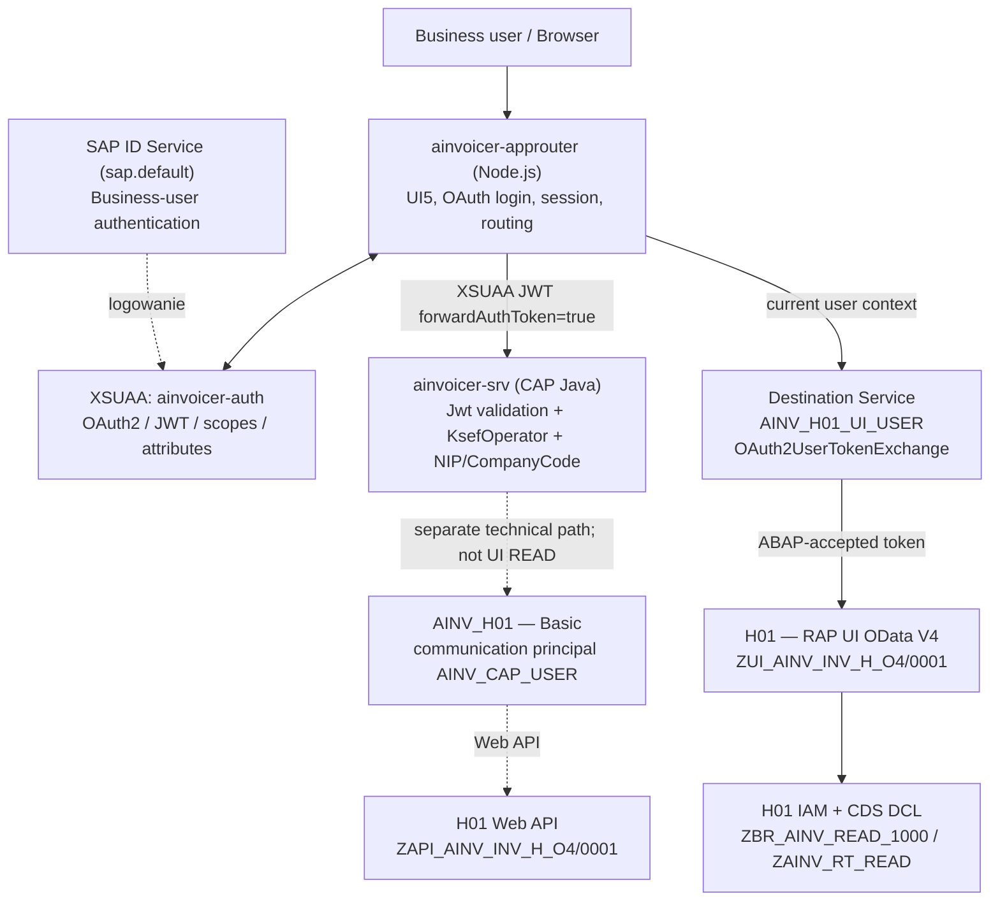
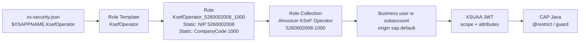

# CAP-07B.2 — rzeczywiste uwierzytelnianie i SSO AInvoicer (BTP CF EU20 ↔ SAP H01)

> **Wynik na 2026-11-10: FUNCTIONAL PASS; pełny SECURITY ACCEPTANCE — PENDING.**
> Użytkownik zalogował się do AInvoicer przez CF Approuter, CAP Java zwrócił poprawną odpowiedź OData, a RAP H01 udostępnił 4 syntetyczne faktury przez `OAuth2UserTokenExchange`, także w osobnej przeglądarce bez uprzedniej sesji H01. Skonfigurowano Role Collection i ograniczenia NIP/CompanyCode. **Nie udowodniono jeszcze jednoznacznie principal obsługującego konkretny request RAP ani izolacji dla drugiego, nieadministracyjnego użytkownika.** Nie należy utożsamiać tego wyniku z produkcyjną certyfikacją bezpieczeństwa.

[Project Home](../README.md) · [STATUS](../STATUS.md) · [ROADMAP](../ROADMAP.md) · [Runbook wdrożenia](BTP_FIRST_DEPLOYMENT_RUNBOOK.md) · [BTP Identity Setup](BTP_IDENTITY_SETUP.md) · [ADR-0006](../decisions/ADR-0006-btp-identity-xsuaa.md) · [ADR-0007](../decisions/ADR-0007-cap-persistence-hana-cloud.md) · [RAP IAM](RAP_UI_IAM_MODEL.md) · [Architektura bezpieczeństwa](../architecture/README.md)

## 1. Cel, zakres i klasyfikacja dowodów

Dokument opisuje **as-built configuration** z interaktywnej sesji właściciela środowiska 10 listopada 2026 r. Jest jednocześnie przewodnikiem utrzymaniowym: wyjaśnia zależności, kroki konfiguracji, kontrole, symptomy błędów, granice zaufania i zadania przed produkcją.

| Oznaczenie | Znaczenie w tym dokumencie |
| --- | --- |
| **LIVE / VERIFIED** | Zaobserwowane w BTP Cockpit/H01 albo przez rzeczywisty HTTP w sesji właściciela; dokładnie opisany zakres |
| **SOURCE / VERIFIED** | Potwierdzone w plikach aktualnego `main` podczas przygotowania przewodnika; nie dowodzi wdrożenia tego commita |
| **FUNCTIONAL PASS** | Działa użytkowy przepływ logowania, token exchange, odczytu CAP lub RAP |
| **NOT VERIFIED / PENDING** | Brak bezpośredniego dowodu albo scenariusz nie był wykonany |
| **BLOCKED** | Nie wykonano z uwagi na brak warunków, koszty, brak drugiego użytkownika lub bramkę bezpieczeństwa |

**Nie obejmował:** nowego deploymentu CF, restartów, tworzenia HANA Cloud, zmian KSeF SEND, SAP WRITE, grantów WRITE, danych produkcyjnych ani testu obciążeniowego. Użyto syntetycznych danych H01. Nie opublikowano sekretów, tokenów ani service keys.

**Ważne rozdzielenie stanów:** kod `main` w dniu przygotowania przewodnika zawiera już integrację INT-02 (inbound), ale uruchomiony w CF 10 listopada był **wcześniej wdrożony identity-smoke z 9 listopada**, nie nowy MTAR CAP-07C/INT-02. Repozytorium, lokalny build, instancja CF i system ABAP to osobne źródła stanu. Żadna zmiana Git nie aktualizuje automatycznie runtime BTP.

## 2. Infrastruktura i inventory LIVE

| Warstwa | Obiekt / parametr | Stan i odpowiedzialność |
| --- | --- | --- |
| Subaccount | `dev` (EU20); org `National Center for Cryptography_dev-v2xzij9s`, space `dev` | CF oraz instancja ABAP Environment H01 w **tym samym subaccount** (wariant propagacji A) |
| CF Application | `ainvoicer-approuter` | Node.js / `@sap/approuter`, 1/1 Running, 256 MB; punkt wejścia do UI5 i reverse proxy |
| CF Application | `ainvoicer-srv` | CAP Java / Spring Boot, backend API KSeF i kontrola JWT; binding XSUAA |
| XSUAA | `ainvoicer-auth`, service `xsuaa`, plan `application` | Status `Usable`, dwa service bindings: `ainvoicer-approuter` i `ainvoicer-srv`; bez service keys |
| Destination Service | `ainvoicer-destination`, plan `lite` | Binding aplikacji; odczyt konfiguracji destinations |
| Subaccount Destination | `AINV_H01_UI_USER` | HTTP/Internet, `OAuth2UserTokenExchange`; połączenie UI business user do RAP H01 |
| Subaccount Destination | `AINV_H01` | HTTP/Internet, `BasicAuthentication` z communication user `AINV_CAP_USER`; **tylko** CAP → H01 Web API, **nie** UI READ |
| ABAP Environment | instancja `dev` / H01 | IAM, CDS DCL, RAP OData V4, syntetyczne faktury |
| Trust | `Default identity provider`, origin `sap.default`, OIDC | Aktywny SAP ID Service; **nie zaobserwowano** dodatkowego trust IAS w Trust Configuration subaccountu |
| Database | SAP HANA Cloud/HDI | **NIE wdrożono**; bieżący CF to świadomie ograniczony `identity-smoke` (H2 in-memory, nietrwała) |

CF Approuter route (potwierdzona w Cockpit):

`https://ainvoicer-v2xzij9s-approuter.cfapps.eu20-001.hana.ondemand.com`

H01 UI (dashboard): `https://<h01-id>.abap-web.eu20.hana.ondemand.com/ui#Shell-home`. H01 API origin dla Destination: `https://<h01-id>.abap.eu20.hana.ondemand.com`. **Nie mylić `.abap-web.` z `.abap.`** — ścieżka usługi RAP jest dopinana przez Approuter.

Na ekranie CF zaobserwowano ostrzeżenie, że stack `cflinuxfs4` jest deprecated; migracja na wspierany stack należy do osobnego, kontrolowanego wdrożenia.

## 3. Architektura i granice zaufania

### 3.1. Diagram as-built



**Interpretacja strzałek:**

- **Browser → Approuter:** logowanie i sesja przeglądarki; żadnych client secrets w SAPUI5.
- **Approuter → CAP:** przekazanie JWT XSUAA (`forwardAuthToken: true`); CAP weryfikuje token i autoryzuje dane/akcje.
- **Approuter → H01 RAP UI:** osobna destination z wymianą tokenu użytkownika; **nie** przekazuje surowego JWT CAP do H01, **nie** używa `AINV_CAP_USER`.
- **CAP → H01 Web API:** osobny principal komunikacyjny z osobnym kontraktem i uprawnieniami; nie jest to business-user SSO.
- **CAP → KSeF:** osobna domena poświadczeń, JWT/sekretów KSeF — nie jest częścią XSUAA ani tego testu.

### 3.2. Dwie aplikacje, jedna instancja XSUAA

| Komponent | Binding `ainvoicer-auth` wykorzystuje do | Czego **nie** robi |
| --- | --- | --- |
| `ainvoicer-approuter` | Inicjuje OAuth login, utrzymuje sesję, egzekwuje ochronę tras, przekazuje token CAP | Nie implementuje biznesowej logiki KSeF ani nie zastępuje autoryzacji backendu |
| `ainvoicer-srv` | Odczytuje konfigurację XSUAA z bindingu, waliduje JWT i role/atrybuty, realizuje CAP OData | Nie używa cookie sesji H01 jako metody autoryzacji |

Binding do usługi oznacza dostęp aplikacji do jej konfiguracji runtime (np. przez `VCAP_SERVICES`), a nie drugą instancję XSUAA. Nie logować `VCAP_SERVICES`, `cf env` ani danych uwierzytelniających.

### 3.3. Cztery niezależne konteksty autoryzacji

1. **XSUAA/CAP:** `$XSAPPNAME.KsefOperator` + `xs.user.attributes.taxpayerNips`/`companyCodes`; ograniczanie danych w CAP.
2. **H01 RAP UI:** token zaakceptowany przez H01, business user, IAM App, Business Catalog, Business Role, Restriction Type/Fields i CDS DCL.
3. **H01 Web API:** communication user `AINV_CAP_USER` przez `AINV_H01`; nie podmienia się nim użytkownika UI.
4. **KSeF 2.0:** credential podatnika i token KSeF, niezależne od loginu BTP. W tej sesji żadnego wywołania KSeF SEND nie wykonano.

**SSO ≠ wspólny JWT do wszystkich backendów.** XSUAA token dla CAP ma innego odbiorcę niż token przyjmowany przez ABAP Environment.

## 4. Kontrakt kodu w repozytorium

| Artefakt | Rola / istotna konfiguracja |
| --- | --- |
| [`cap-java/xs-security.json`](../../cap-java/xs-security.json) | `tenant-mode: dedicated`, scope `$XSAPPNAME.KsefOperator`, role template `KsefOperator`, obowiązkowe atrybuty `taxpayerNips` i `companyCodes` (`valueRequired: true`) |
| [`mta.yaml`](../../mta.yaml) | `ainvoicer-auth` jako managed `xsuaa/application`, binding obu aplikacji; `ainvoicer-destination` jako `destination/lite`; kod pełnego MTA przewiduje HDI, **nie używać do obecnego smoke bez analizy** |
| [`approuter/xs-app.json`](../../approuter/xs-app.json) | `authenticationMethod: route`; ścieżki CAP, RAP, UI5 CDN i zasoby statyczne |
| [`deploy/btp-dev-eu20.mtaext`](../../deploy/btp-dev-eu20.mtaext) | Prefiks hosta CF dla środowiska EU20 |
| [`deploy/scripts/identity-smoke.mjs`](../../deploy/scripts/identity-smoke.mjs) | Generowanie bez-HANA MTAR z `existing-service`; zmiany w repo nie zmieniają już wdrożonej instancji |
| [`docs/guides/RAP_UI_IAM_MODEL.md`](RAP_UI_IAM_MODEL.md) | Własności restrykcji i model autoryzacji H01 |

Trasy z `approuter/xs-app.json`, odczytane z `main`:

| Przychodząca ścieżka | Cel | Uwierzytelnienie |
| --- | --- | --- |
| `/odata/v4/KsefService/*` | Inline destination `ainvoicer-cap` → CAP Java | `xsuaa`, `forwardAuthToken: true` w `mta.yaml`; CSRF protection |
| `/rap-ui/*` | Subaccount destination `AINV_H01_UI_USER` → `/sap/opu/odata4/sap/zui_ainv_inv_h_o4/srvd/sap/zui_ainv_inv_h_o4/0001/*` | `xsuaa` na trasie + token exchange do H01 |
| `/resources/*` | Inline destination `ui5` → `https://ui5.sap.com` | Zasoby publiczne |
| Inne ścieżki | Statyczny `approuter/resources` | `xsuaa`; brak legacy proxy `/sap/*` |

Ścieżki CAP i RAP **nie** są zamienne. Cztery faktury w RAP nie oznaczają czterech rekordów `InvoiceIntegrationStatus` w CAP.

## 5. Konfiguracja XSUAA i autoryzacji użytkownika (wykonane LIVE)

### 5.1. Provisioning i binding

W BTP Cockpit → **Services → Instances and Subscriptions** potwierdzono instancję `ainvoicer-auth`:

- usługa `Authorization and Trust Management` / `xsuaa`, plan `application`;
- status `Usable`, środowisko Cloud Foundry, space `dev`;
- `Bound Applications (2)`: `ainvoicer-approuter` i `ainvoicer-srv`, obie relacje `Created`;
- `Service Keys (0)` — do zwykłych bindingów nie tworzymy dodatkowych kluczy.

Instancja i CF zostały utworzone podczas **wcześniejszego deploymentu 2026-11-09**; w sesji CAP-07B.2 nie wykonywano ponownego deployu.

### 5.2. Scope → Role Template → Role → Role Collection → User



**Przebieg konfiguracji w Cockpit:**

1. `Security → Roles`: zweryfikowano application `ainvoicer-dev`, template `KsefOperator` oraz istniejącą ogólną rolę `KsefOperator` z pustymi wartościami. **Nie przypisywano tej ogólnej roli**.
2. `Create Role`: utworzono `KsefOperator_5260002008_1000` z `Source = Static` i pojedynczymi wartościami `taxpayerNips = 5260002008` oraz `companyCodes = 1000`. W kreatorze pole wielowartościowe wymagało zatwierdzenia każdej wartości klawiszem Enter.
3. Nie wybierano systemowych kolekcji `SAP_ALL` ani `AI_Launchpad_Admin`.
4. `Security → Role Collections`: utworzono `AInvoicer KSeF Operator 5260002008-1000` i dodano **jedną** właściwą rolę `KsefOperator_5260002008_1000`.
5. `Security → Trust Configuration`: potwierdzono jedyny widoczny `Default identity provider`: origin `sap.default`, `OpenID Connect`, `Active`, `Available for User Logon = Yes`. Nie utworzono nowego IAS trust.
6. `Security → Users`: potwierdzono business-user record z domyślnego IdP; przypisano mu wyłącznie dedykowaną kolekcję KSeF, bez tworzenia nowego użytkownika.

**Znaczenie atrybutów:** rola nie jest wyłącznie flagą dostępu. Jej statyczne wartości są podstawą zakresu danych. CAP używa list atrybutów z JWT; `KsefScopeUserInfoProvider` w [ADR-0006](../decisions/ADR-0006-btp-identity-xsuaa.md) zapobiega niepożądanemu iloczynowi kartezjańskiemu przy >1 NIP i >1 CompanyCode. Nie zastępować `Static` przez `Unrestricted` ani nie scalać wielu ról bez testu modelu par.

**Uwaga administracyjna:** podstawowa rola `KsefOperator` z pustymi atrybutami nadal była widoczna w Cockpit. Nie została użyta, ale warto ją przejrzeć przed produkcją, żeby uniknąć omyłkowych przypisań.

## 6. Konfiguracja Destination do H01 — dwa różne kanały

### 6.1. `AINV_H01_UI_USER` — nowa business-user Destination

BTP Cockpit → **Connectivity → Destinations → Create**. Rzeczywisty zestaw pól:

| Pole | Wartość / źródło |
| --- | --- |
| Name | `AINV_H01_UI_USER` |
| Description | `AInvoicer - H01 RAP Business User SSO` |
| Type / Proxy Type | `HTTP` / `Internet` |
| URL | API origin `https://<h01-id>.abap.eu20.hana.ondemand.com` (**bez** `/ui` i ścieżki OData) |
| Authentication | `OAuth2UserTokenExchange` |
| Client ID | `uaa.clientid` z **istniejącego service key instancji ABAP `dev`** |
| Client Secret | `uaa.clientsecret` z **tego samego service key** — wymagane |
| Token Service URL | wartość `uaa.url` z service key ABAP + `/oauth/token` |
| Token Service URL Type | `Dedicated` |
| Client Trust Store | domyślny |
| Dodatkowe opcje | Nie wprowadzać `HTML5.ForwardAuthToken` przy OAuth authentication; nie używać Basic, communication usera ani `sap-client` |

**Lokalizacja poświadczeń:** BTP Cockpit → **Services → Instances and Subscriptions → `dev` (ABAP Environment) → Service Keys**. Sekcja `uaa`. Nie brać klienta z `ainvoicer-auth` (CAP XSUAA), nie używać `AINV_CAP_USER`, nie publikować service key, `clientid`, `clientsecret` ani tokenów w repo, screenshotach i logach.

**Dlaczego działa wariant A:** oficjalne SAP Help *Routing via Destination* wskazuje `OAuth2UserTokenExchange` dla aplikacji i ABAP Environment **w tym samym subaccount**, a `SAMLAssertion` dla różnych subaccountów. Nie należy automatycznie przenosić tej konfiguracji między subaccountami lub na binding IAS `identity` bez ponownej analizy.

### 6.2. `AINV_H01` — osobna technical Destination

Istniejąca wcześniej `AINV_H01` używa `BasicAuthentication` i communication usera `AINV_CAP_USER`. Jest wykorzystywana wyłącznie przez kanał CAP → H01 Web API. **Nie zmieniono jej i nie wykorzystano do UI READ.** Podmiana byłaby regresją bezpieczeństwa: RAP mógłby egzekwować uprawnienia konta technicznego zamiast indywidualnej roli business usera.

### 6.3. Różnica między Check Connection a faktycznym SSO

Cockpit wyświetlił zielony wynik:

> `HTTP request (without authentication) ... succeeded.`

Potwierdza to wyłącznie osiągalność URL. **Nie** jest to test client credentials, OAuth token exchange, business principal, IAM ani DCL. Akceptacja wymaga rzeczywistych żądań przez Approuter.

## 7. IAM i autoryzacja RAP po stronie H01

W H01 otwarto **Maintain Business Users** i **Maintain Business Roles**. Konto testowe pełniło rolę `Initial Admin` i miało:

- `SAP_BR_DEVELOPER`;
- `SAP_BR_ADMINISTRATOR`;
- `ZBR_AINV_READ_1000` — właściwa biznesowa rola odczytu AInvoicer.

**Właściwa rola AInvoicer:** `ZBR_AINV_READ_1000` (Active / Authorization is up-to-date). W UI potwierdzono:

| Element | Wartość |
| --- | --- |
| IAM App | `ZAINV_UI_READ_EXT` (Active, External App) |
| Business Catalog | 1, powiązany z IAM App |
| Restriction Type | `ZAINV_RT_READ` — „AInvoicer read access by taxpayer and company” |
| Taxpayer restriction | `5260002008` |
| Company code restriction | `1000` |
| Read Access | `Restricted` |
| Write Access | `No Access` |
| Value Help Access | `Unrestricted` |
| Przypisani użytkownicy | 1 w testowanym stanie |

Szczegóły modelu: `ZAINV_RF_NIP`, `ZAINV_RF_BUK`, obiekt `Z_AINV_KSF` i DCL warstwy RAP opisuje [RAP_UI_IAM_MODEL.md](RAP_UI_IAM_MODEL.md). Business Role **nie** zastępuje DCL ani testów `ACTVT`; rola administratora w koncie testowym nie jest dobrym wzorcem dla testów najmniejszych uprawnień. Dla produkcji użyć dedykowanego business usera bez ról admin/developer.

### Rozdział obowiązków XSUAA vs H01 IAM

| Kto odpowiada | Co sprawdza |
| --- | --- |
| XSUAA / Role Collection | Czy użytkownik ma scope `KsefOperator` i atrybuty dla **CAP** |
| CAP Java | Ważność/podpis/audience JWT oraz autoryzację danych/operacji |
| Destination Service | Token exchange w kontekście użytkownika dla połączenia do H01 |
| H01 IAM + DCL | Business Role, dostęp do usługi RAP i ograniczenia odczytu po NIP/spółce |

Przypisanie kolekcji XSUAA **nie** nadaje uprawnień w H01; przypisanie Business Role H01 **nie** nadaje scope CAP.

## 8. Dziennik wykonania CAP-07B.2 — krok po kroku

| Nr | Co wykonano | Dlaczego | Dowód / rezultat |
| ---: | --- | --- | --- |
| 1 | Inspekcja `ainvoicer-auth` | Potwierdzenie rzeczywistego XSUAA i bindingów | `Usable`, `xsuaa/application`, 2 bound applications — LIVE |
| 2 | `Security → Roles`, odczyt template `KsefOperator` | Potwierdzenie wdrożenia deskryptora | `ainvoicer-dev` i template widoczne — LIVE |
| 3 | Inspekcja ogólnej `KsefOperator` | Sprawdzenie wartości atrybutów | Atrybuty bez `Source/Values`, nieprzypisana — LIVE |
| 4 | Utworzenie `KsefOperator_5260002008_1000` | Minimalny, jawny zakres uprawnień | `Static`: NIP `5260002008`, spółka `1000` — LIVE |
| 5 | Utworzenie Role Collection, dodanie jednej roli | Oddzielenie definicji roli od jej przyznania | Dedykowana kolekcja, 1 role, początkowo 0 users — LIVE |
| 6 | `Trust Configuration` | Ustalenie originu użytkownika | `sap.default`, OIDC, Active; IAS custom trust niewidoczny — LIVE |
| 7 | `H01 View Dashboard` i `User Account` | Ustalenie H01 principal w sesji administracyjnej | Business user `Initial Admin` w H01 — LIVE |
| 8 | `Security → Users`, przypisanie Role Collection | Nadanie uprawnienia CAP do testu | Kolekcja pojawiła się przy koncie business usera — LIVE |
| 9 | CF `Applications → ainvoicer-approuter` | Potwierdzenie runtime i route | `Started`, 1/1 `Running`, 256 MB, route EU20 — LIVE |
| 10 | Otwarcie `/index.html` | Sprawdzenie uwierzytelnionego UI5 | UI5 załadowane, początkowo RAP 500 — LIVE |
| 11 | Inspekcja `/rap-ui/$batch` i `/rap-ui/$metadata` | Rozdzielenie OData batch i proxy/auth | Oba HTTP 500; Approuter log `Bad credentials` — LIVE |
| 12 | `Connectivity → Destinations` | Wykrycie brakującego route target | `AINV_H01_UI_USER` nie istniała; `AINV_H01` była Basic technical — LIVE |
| 13 | Utworzenie `AINV_H01_UI_USER` | Business-user token exchange do H01 | HTTP/Internet, OAuth2UserTokenExchange; początkowo bez secret — LIVE |
| 14 | Uzupełnienie `Client Secret` i ponowny test | Naprawa `Bad credentials` | `/rap-ui/$metadata` zwróciło EDMX, UI odczytało 4 faktury — LIVE |
| 15 | GET `/odata/v4/KsefService/InvoiceIntegrationStatus?$top=5` | Sprawdzenie CAP z sesją XSUAA | Poprawny OData JSON `{"@context":"$metadata#InvoiceIntegrationStatus","value":[]}` — LIVE |
| 16 | Security Audit Log H01 | Poszlaki tożsamości użytkownika | `AU1` / logon HTTP jako business user w bliskim czasie testów, ale **brak korelacji request-id z RAP** — PARTIAL |
| 17 | Nowa sesja w odrębnej przeglądarce Chrome | Odrzucenie zależności od starej sesji H01 | Nowe logowanie do AInvoicer → 4 faktury (2 zakupowe, 2 sprzedażowe) — LIVE |
| 18 | H01 `Maintain Business Roles → Display Restrictions` | Weryfikacja minimalnej roli READ | `ZBR_AINV_READ_1000`, `ZAINV_RT_READ`, NIP i BUK zgodne, Write No Access — LIVE |

**Dokładna korekta incydentu:** po utworzeniu Destination pierwszy `Check Connection` był zielony, lecz GET przez Approuter zwracał HTTP 500. Log: `GET /rap-ui/$metadata ... 500 Bad credentials`. Właściciel wskazał **pominięty `Client Secret`**; po uzupełnieniu tego pola zarówno metadata, jak i UI zaczęły działać. Nie zmieniono wtedy kodu CAP/RAP ani nie wykonano redeployu.

**Poboczny incydent logowania:** pierwsza próba wejścia do H01 w trybie incognito zakończyła się ogólnym błędem SAP ID na `accounts.sap.com/oauth2/authorize`. `View Dashboard` w standardowym profilu działał. Nie ma dowodu, że przyczyną był brak IAS trust; w ramach tego sprintu nie zakładano nowego IAS.

## 9. Macierz testów i kryteria akceptacji

| Scenariusz | Wynik 2026-11-10 | Granica dowodu |
| --- | --- | --- |
| Instancja XSUAA i dwa bindingi | **LIVE PASS** | Potwierdzenie infrastruktury, nie token claims |
| UI5 za Approuter w zalogowanej sesji | **LIVE PASS** | Login/strona działają |
| CAP GET `InvoiceIntegrationStatus` | **LIVE PASS** | HTTP poprawny, kolekcja pusta; nie testowano filtrowania przy niepustych rekordach |
| Destination → H01 `$metadata` | **LIVE PASS** | OData EDMX |
| H01 RAP UI lista przez CF | **LIVE PASS** | 4 syntetyczne faktury; 2 AP / 2 AR |
| Fresh-browser login bez wcześniejszej sesji H01 | **FUNCTIONAL PASS** | Business-user SSO działa użytkowo; nie dowodzi subject na poziomie requestu |
| H01 Business Role + zakres NIP/spółka | **LIVE PASS — configuration** | Potwierdzenie wartości, nie negatywnej egzekucji DCL |
| H01 Security Audit Log `AU1` | **PARTIAL** | Czas i user zgodne, lecz brak request correlation; `method=X` nie jest dowodem OAuth exchange |
| Efektywny `sy-uname` / principal obsługujący konkretny RAP GET | **NOT VERIFIED** | Potrzebna autoryzowana, read-only diagnostyka H01 powiązana z żądaniem |
| Użytkownik B bez kolekcji XSUAA → CAP 403 | **NOT EXECUTED LIVE** | Testy offline istnieją, to nie jest LIVE |
| Użytkownik bez `ZBR_AINV_READ_1000` → brak danych / 403 | **NOT EXECUTED LIVE** | Konto A ma także admin/developer |
| Izolacja dwóch par NIP × CompanyCode, A/B i sesji | **NOT EXECUTED LIVE** | Brak bezpiecznego użytkownika B i fixtures poza zakresem |
| Niepoprawny JWT, zły audience, brak/expired token → 401 | **NOT EXECUTED LIVE** | Testy lokalne/CI nie zastępują live |
| READ bez ujawniania cookie/sekretów, logout, CSRF, log redaction | **PARTIAL / NOT VERIFIED** | Wymaga dedykowanej macierzy bezpieczeństwa |
| KSeF SEND, SAP WRITE, trwałość po restarcie | **NIE TESTOWANO — poza zakresem** | Wymagają odrębnej zgody i trwałej infrastruktury |

### Jak domknąć principal propagation bez ryzyka WRITE

Nie wnioskuj o `sy-uname` wyłącznie z AU1 albo z widoku czterech faktur. Preferowany dowód to autoryzowana, minimalna diagnostyka **read-only** w H01 (np. wywołanie kontrolnego released-safe endpointu zwracającego identyfikator bieżącego business usera albo ślad/request correlation w narzędziu audytowym), **przez tę samą trasę i Destination**, bez ujawniania tokenów. W razie dodania endpointu diagnostycznego: ograniczyć go do środowiska testowego, odpowiednio autoryzować, nie ujawniać pełnego kontekstu bezpieczeństwa i usunąć po akceptacji. Wymaga review i osobnej zgody na zmianę kodu/deploy H01; **nie zaimplementowano**.

## 10. Ograniczenia i dług bezpieczeństwa przed produkcją

1. **Stan runtime a `main`:** w CF jest starszy `identity-smoke` (H2 bez trwałości), a nowy MTAR CAP-07C/INT-02 **nie został tutaj wdrożony**. Lokalny build/CI nie stanowi dowodu aktualizacji CF. W runbooku opisano kontrolowane porównanie artefaktów, redeploy i rollback; każde wdrożenie/restart wymaga osobnej zgody.
2. **Brak HANA Cloud:** brak bezpłatnego dostępnego planu w zaobserwowanym marketplace, płatna HANA nie jest dopuszczona. Nie uruchamiać HDI, nie obiecywać trwałej historii ani audytu po restarcie. W smoke H2 jest celowo nietrwała.
3. **Bezpieczne flagi:** w runbooku i deskryptorach smoke wymagane są `AINV_KSEF_ENABLED=false`, `AINV_SAP_WRITE_ENABLED=false`, `AINV_SAP_WRITE_SWEEPER_ENABLED=false`, `AINV_DEPLOYMENT_IDENTITY_SMOKE=true`, `SPRING_SQL_INIT_PLATFORM=h2`; UI5 CF SEND/AI/Scanner/Voice/TTS OFF. **Efektywnych wartości środowiska nie ujawniano przez `cf env` w tej sesji** — przed dowolnym redeployem sprawdzić w bezpieczny sposób.
4. **Szerokie role użytkownika testowego:** `Initial Admin` ma `SAP_BR_ADMINISTRATOR` i `SAP_BR_DEVELOPER`. To niedopuszczalny substytut testu least privilege.
5. **Ogólna rola `KsefOperator` bez wartości:** nie przypisywać, przejrzeć potencjalne błędne przypisania.
6. **Trust/IdP:** zaobserwowano `sap.default`, nie utworzono IAS trust. Wybrany model XSUAA pozostaje zgodny z ADR-0006; decyzja o IAS/AMS wymaga osobnego przeglądu i testu `OAuth2UserTokenExchange`.
7. **CF stack:** `cflinuxfs4` deprecated — zaplanować migrację z testem regresji CF i zgodą na deploy.
8. **Sekrety i operacje:** service key ABAP `uaa` jest źródłem klienta OAuth; dostęp ograniczyć RBAC, przeprowadzać rotację i aktualizację Destination w oknie serwisowym. Nie przechowywać w Git/issue/logach/CI; nie kopiować service key do zewnętrznych usług. Uważać na publiczne screenshoty paneli z Client ID i hostami.
9. **CAP security:** we wcześniejszym wdrożeniu identity-smoke zaobserwowano ekspozycję publicznego indeksu CAP; poprawka CAP-07C pozostawała niewdrożona. Przed produkcją wymagana osobna weryfikacja endpointów, statusów HTTP oraz nowego artifactu.
10. **Dane:** testowe 4 faktury są syntetyczne; brak dowodu działania produkcyjnego procesu FI/MM/SD, KSeF SEND, pełnego E2E i długotrwałej persystencji.

**Werdykt:** dokument może służyć jako operacyjna, wersjonowana instrukcja, lecz **aplikacja nie jest production-ready**. Zamyka się etap konfiguracji funkcjonalnej, nie bramkę security go-live.

## 11. Runbook operacyjny i diagnostyka

### 11.1. Szybkie kontrole bez zmian środowiska

| Pytanie | Gdzie i jak | Oczekiwane |
| --- | --- | --- |
| Czy XSUAA istnieje? | BTP Cockpit → Services → Instances and Subscriptions → `ainvoicer-auth` | `Usable`; bound apps 2 |
| Czy login aplikacji działa? | Publiczny URL Approuter (z Cockpit Mapped Routes) | Autoryzowany dostęp do UI5 |
| Czy CAP działa? | GET `/odata/v4/KsefService/InvoiceIntegrationStatus?$top=5` | OData JSON; przy smoke `value: []` dopuszczalne |
| Czy RAP działa? | GET `/rap-ui/$metadata` | HTTP 200 EDMX |
| Czy dane są widoczne? | AInvoicer → All Invoices | 4 syntetyczne rekordy w potwierdzonym stanie 2026-11-10 |
| Czy Destination jest właściwa? | Connectivity → Destinations → `AINV_H01_UI_USER` | HTTP/Internet/`OAuth2UserTokenExchange` |
| Czy zakres H01 jest poprawny? | H01 → Maintain Business Roles → `ZBR_AINV_READ_1000` → Display Restrictions | `ZAINV_RT_READ`, NIP i BUK zgodne |
| Czy Role Collection jest przyznana? | Security → Users → Role Collections | Dedykowana kolekcja użytkownika |

Żądania GET są wyłącznie odczytowe; **nie używać akcji `requestSend` ani żadnej operacji SAP WRITE do diagnostyki SSO**.

### 11.2. Mapa błędów i pierwsza diagnoza

| Symptom | Pierwsza hipoteza | Bezpieczna kontrola |
| --- | --- | --- |
| `/index.html` 401/redirect | Brak sesji lub problem OAuth login | Trust Configuration, stan `ainvoicer-auth`, cookie/session bez ujawniania wartości |
| `/rap-ui/$metadata` 500 `Bad credentials` | Niekompletne `Client Secret` / `Client ID` / token URL, problem token exchange | Porównać **lokalnie** z `uaa` service key ABAP; przeczytać log Approutera; nie przesyłać wartości |
| `Check Connection` PASS, ale RAP 500 | Reachability ≠ authentication | Test prawdziwego GET przez Approuter; nie traktować zielonego checku jako SSO |
| `/rap-ui/$metadata` 404 | Niepoprawna ścieżka proxy, SRVB lub URL | `xs-app.json`, API origin `.abap.`, publikacja `ZUI_AINV_INV_H_O4/0001` |
| RAP 403 lub brak danych | Business Role/DCL albo niewłaściwy principal | H01 IAM, restrictions, połączenie request→principal; bez konta technical |
| CAP 401 | Brak/zły JWT, zły audience albo session | Binding XSUAA, logi CAP, test pozytywny i negatywny |
| CAP 403 | Brak `KsefOperator` lub niedozwolona para | Role Collection, atrybuty JWT odczytane **bez publikowania tokenu**, guard CAP |
| CAP 200 z `value: []` | Pusta/nietrwała H2 lub filtrowanie zakresu | Nie traktować jako problem, jeżeli w smoke brak operacji |
| SAP ID error w incognito | Błąd flow OAuth/cookies/IdP; przyczyna nieustalona | Start z właściwego adresu appl, korelacja IdP; bez zmiany trust na ślepo |

### 11.3. Odczyt CF CLI (opcjonalnie, operator we własnym terminalu)

```bash
cf target
cf apps
cf services
cf app ainvoicer-approuter
cf app ainvoicer-srv
cf logs ainvoicer-approuter --recent
```

W logach szukać `correlation_id` i `Bad credentials`, porównywać czas żądania. **Nie** uruchamiać do publikacji w czacie: `cf env`, `cf service-key`, dumpów `VCAP_SERVICES`, nagłówków `Authorization` i cookie.

### 11.4. Reprodukcja / onboarding bezpiecznego operatora

1. Ustal subaccount, org/space, IdP i wymagany zakres NIP/BUK oraz rzeczywiste role H01.
2. Utwórz wyspecjalizowaną rolę z template `KsefOperator` i **jedną** parą wartości `Static`; nie używaj `Unrestricted`.
3. Utwórz dedykowaną Role Collection, dodaj tylko tę rolę i przypisz właściwemu business userowi BTP.
4. W H01 nadaj odpowiednio ograniczoną Business Role (bez admin/developer), sprawdź IAM restrictions i DCL.
5. Sprawdź `AINV_H01_UI_USER` i zgodność OAuth Client ID/Secret/URL z service key **ABAP**, bez eksportu credentiali.
6. Przeprowadź nowe logowanie w izolowanej przeglądarce, GET CAP, GET RAP, testy negatywne A/B i bezpośrednią identyfikację principal.

Nie kopiuj zakresu `5260002008/1000` na nowych użytkowników bez uzasadnionej autoryzacji biznesowej.

## 12. Kontrolowane zmiany, deployment i rollback

Ta sesja **nie** wdrażała nowego artefaktu. Źródła procedur: [`BTP_FIRST_DEPLOYMENT_RUNBOOK.md` `3.1](BTP_FIRST_DEPLOYMENT_RUNBOOK.md) oraz [CAP-07C hardening](../journal/2026-11-09-cap-07c-autonomous-hardening.md).

Przed przyszłym wdrożeniem właściciel musi zatwierdzić: commit i wersję MTAR, docelowy CF target, dwie istniejące usługi `ainvoicer-auth`/`ainvoicer-destination`, trasy, konfigurację smoke, bezpłatność usług i zachowany poprzedni MTAR. Skrypt `npm run build:btp:smoke --prefix deploy` buduje artefakt lokalnie, **nie** jest zgodą na `cf deploy`. Nowa wersja może zmieniać zachowanie runtime; konieczne ponowne testy JWT, RAP, CAP i bezpieczeństwa.

**Nie wykonywać** `cf deploy`, `cf restart`, `cf stop`, `cf create-service`, `cf delete-service`, zmian Business Role ani KSeF/SAP WRITE bez odrębnej zgody właściciela. Rollback poprzedniego smoke także wymaga decyzji — starszy artefakt ma znane ograniczenia (m.in. publiczny indeks) i H2 nie przenosi danych między restartami.

## 13. Definition of Done dla pełnego CAP-07B security acceptance (pozostało)

- [ ] Autorytatywnie powiązać konkretne żądanie `/rap-ui/Invoices` z H01 business user / principal (nie wyłącznie `AU1` z podobnego czasu).
- [ ] Użyć drugiego business usera B **bez** roli administratora/developera i z inną autoryzowaną parą lub bez roli H01.
- [ ] LIVE CAP: brak kolekcji `KsefOperator` → 403; obcy NIP/BUK → brak danych; kontrola fail-closed wielu par.
- [ ] LIVE H01: brak `ZBR_AINV_READ_1000` → brak danych/403; sprawdzić izolację DCL z danymi obu zakresów.
- [ ] Anonimowy/niepoprawny/wygasły/obcy JWT → 401; brak bypass przez direct `ainvoicer-srv`.
- [ ] Dwie przeglądarki A/B, logout/session expiry, poprawna izolacja cookie i CSRF.
- [ ] Ponowna walidacja po wdrożeniu **zatwierdzonego** nowego MTAR, bez regresji restrykcji i wycieków.
- [ ] Oddzielny production readiness review: trwała HANA/HDI (jeśli dopuszczona kosztowo), rotacja sekretów, konta least privilege, observability, audyt, retencja danych, backup/DR i pełne procedury KSeF.

**Status do raportowania:** `CAP-07B.2 FUNCTIONAL PASS / SECURITY ACCEPTANCE PENDING`. Nie oznaczać `GO-LIVE READY`.

## 14. Źródła i dokumenty referencyjne

### AInvoicer (repo — źródło architektury/implementacji)

- [ADR-0006 — tożsamość XSUAA i fail-closed](../decisions/ADR-0006-btp-identity-xsuaa.md)
- [BTP Identity Setup](BTP_IDENTITY_SETUP.md)
- [BTP First Deployment Runbook](BTP_FIRST_DEPLOYMENT_RUNBOOK.md)
- [RAP UI IAM Model](RAP_UI_IAM_MODEL.md)
- [RAP UI LIVE Connection](RAP_UI_LIVE_CONNECTION.md)
- [CAP-07C Hardening](../journal/2026-11-09-cap-07c-autonomous-hardening.md)
- [STATUS](../STATUS.md) / [ROADMAP](../ROADMAP.md)
- Dowody LIVE: screenshoty BTP Cockpit, H01 i HTTP oraz log `Bad credentials` przekazane przez właściciela podczas interaktywnej sesji 2026-11-10; **nie zamieszczono surowych credentiali ani dumpów tokenów**.

### SAP (oficjalne wytyczne; sprawdzone 2026-11-10)

- [Protecting Your Application — lifecycle `xs-security.json` → role → role collections → users](https://help.sap.com/docs/btp/sap-business-technology-platform/protecting-your-application)
- [Building Roles and Role Collections for Applications](https://help.sap.com/docs/btp/sap-business-technology-platform/building-roles-and-role-collections-for-applications)
- [Using an Application Security Descriptor File](https://help.sap.com/docs/CP_AUTHORIZ_TRUST_MNG/ae8e8427ecdf407790d96dad93b5f723/0a69484539d64567ba17269f6e5ba88d.html)
- [Routing via Destination — ABAP Environment / OAuth2UserTokenExchange w tym samym subaccount](https://help.sap.com/docs/btp/sap-business-technology-platform/routing-via-destination)
- [Creating a Service Key for the ABAP System](https://help.sap.com/docs/sap-btp-abap-environment/abap-environment/creating-service-key-for-abap-system)
- [Creating a Destination to the ABAP System — `uaa` values i `/oauth/token`](https://help.sap.com/docs/btp/sap-business-technology-platform/e597948462fe45c98c10269bbe3603d6.html)
- [Check Connection — powodzenie bez uwierzytelnienia potwierdza tylko reachability](https://help.sap.com/docs/cloud-transport-management/sap-cloud-transport-management/creating-destinations-for-deployment-of-references-of-sap-btp-abap-environment)

---

**Proweniencja i ograniczenia:** sekcje LIVE opierają się na obserwacjach właściciela z 2026-11-10; sekcje SOURCE na kodzie i dokumentacji w `main` w momencie utworzenia tego pliku. Zmiany konfiguracji BTP/H01 mogą unieważnić wyniki bez zmiany Git. Wszelkie późniejsze aktualizacje powinny podawać datę obserwacji, wersję artefaktu, kontekst testowy i zakres potwierdzenia; nie nadpisywać historycznych wyników bez nowego dowodu.
