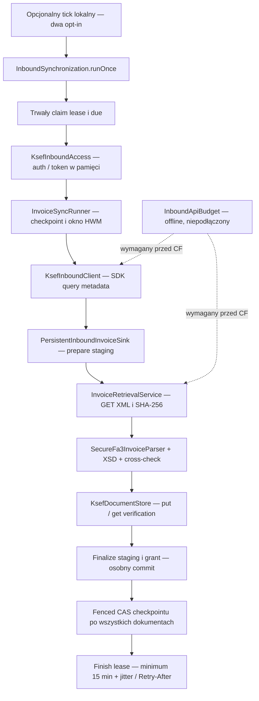

# Synchronizacja INBOUND — gotowość do automatyzacji

[STATUS](../STATUS.md) · [ROADMAP](../ROADMAP.md) · [Dziennik](../journal/2026-11-14-ksef-in-03b-worker-readiness.md)

**Scheduler przygotowany offline, domyślnie OFF. CF NO-GO.** Nie wykonano KSeF HTTP,
SAP WRITE, CF/HANA, G1 LIVE, deploymentu ani zmian LAB/storage. Baza: `origin/main=7a47ac92d07fa8b66868e7293eb4f4bc2a07a6e0`.
Pliki z równoległego KSEF-STOR-03 nie są częścią tej gałęzi ani dowodem gotowości storage.

## Istniejący przepływ i DI



`KsefInboundConfiguration` po jawnym lokalnym opt-in tworzy CQN repositories, adapter auth,
klienta/retrieval i koordynatora. Runner, sink, parser i walidator są celowo tworzone per przebieg;
nie są brakującymi beanami. SDK i auth pochodzą z istniejącej konfiguracji KSeF.
Read model `KsefInboundReadConfiguration` jest niezależny od transportu i schedulera.

| Komponent / warunek | Stan implementacji | Dowód / ograniczenie |
| --- | --- | --- |
| Metadata → XML → hash → parser/XSD → store → staging → checkpoint | IMPLEMENTED | TESTED OFFLINE: mock SDK, loopback HTTP, CQN/H2; brak MF LIVE |
| Warunkowe DI synchronizacji | IMPLEMENTED | TESTED OFFLINE: lokalny opt-in rejestruje koordynator bez startup auth/HTTP |
| Checkpointy i lease | IMPLEMENTED | TESTED OFFLINE: lock, pierwszy INSERT, CAS, fencing, cooldown, restarty; HANA nieweryfikowana |
| Retry odczytów / Retry-After | IMPLEMENTED | TESTED OFFLINE: sekundy/RFC1123, max prób, długi termin propagowany do lease |
| Idempotencja dokumentu i grantów | IMPLEMENTED | TESTED OFFLINE: częściowe okno, błąd store, crash po put; checkpoint nie wyprzedza storage |
| `InboundApiBudget` | IMPLEMENTED BUT NOT WIRED | TESTED OFFLINE: 39 testów, rolling windows i in-flight; brak wywołań z klienta SDK |
| `InMemoryApiBudgetRepository` | IMPLEMENTED | Jeden współdzielony obiekt w jednej JVM; restart/nowy obiekt zeruje stan |
| Repozytorium budżetu między JVM | MISSING | BLOCKED: wymaga zatwierdzonego kontraktu persystencji i migracji; brak nowych CDS w IN-03B |
| Budżet wszystkich endpointów | MISSING | Metadata/GET, auth/challenge/status/redeem/refresh/certyfikaty nie przechodzą przez wspólny limiter |
| Wywołujący `runOnce` scheduler w bazowym main | MISSING | W IN-03B dodany lokalny opt-in; nie jest wdrożonym workerem CF |
| Zegar `InboundSyncScheduler` w IN-03B | IMPLEMENTED | TESTED OFFLINE: OFF, brak startup I/O, konkurencja, bezpieczny raport błędu |
| Automatyzacja CF | BLOCKED | Zachowany `KSEF_INBOUND_CLOUD_ACTIVATION_NOT_READY`, także po dostarczeniu durable store |
| Trwały store | IMPLEMENTED BUT NOT WIRED | Istnieje `ContentAddressedDocumentStore.forScope` / `DurableInboundDocumentStore`, testowany z Azurite; brak beana providera, domyślny komponent to LocalTestDocumentStore; to nie dowód HANA/CF |
| HANA BLOB dla INBOUND | BLOCKED | Równoległy KSEF-STOR-03 Claude Code: adapter, wiring i durability wymagają odrębnego review/testów |
| JWT | IMPLEMENTED | Sesja per przebieg, token tylko w pamięci, redacted toString; nie należy do encji/DTO/logu schedulera |
| Operator resume / health / odzyskanie permitów | MISSING | Nie odblokowywać automatycznie BLOCKED ani nie odzyskiwać slotów przez sam TTL |

## Scheduler i granice gotowości

Obie flagi mają domyślnie `false`: `ainv.ksef.inbound.enabled` oraz
`ainv.ksef.inbound.scheduler.enabled`. Sama flaga schedulera nie tworzy synchronizacji.
Lokalny opt-in wymaga także dotychczasowej konfiguracji TEST/NIP/initial-from/store/auth.
Nie dodano akcji OData, endpointu HTTP, startup runnera ani flag deploymentowych.

`KsefInboundSchedulerConfiguration` rejestruje `@EnableScheduling` i jeden zegar tylko przy obu flagach.
`@Scheduled(initialDelayString="PT15M", fixedDelayString="PT15M")` oznacza pierwszy tick po 15 minutach,
a następny 15 minut po zakończeniu poprzedniego. Tick przed `ApplicationReadyEvent` lub po zamknięciu
kontekstu zwraca `NOT_READY`; listener gotowości wyłącznie uzbraja zegar, nie wywołuje synchronizacji.
Nie ma catch-up ani zmiany trwałego due w schedulerze.
`AtomicBoolean` odrzuca równoczesny tick w tej JVM; `runOnce` osobno musi uzyskać lease z DB.
To zegar zgrubny: due z jitterem może pominąć najbliższy tick i opóźnić pracę do kolejnego;
nie ma gwarancji przebiegu dokładnie co 15 minut ani wykonania dokładnie w chwili Retry-After.
Przegrany claim/cooldown nie wykonuje auth ani HTTP. Błąd raportowany jest jako stałe `FAILED`, bez
exception/cause, numeru faktury, NIP, XML, URL i JWT. Zegar nie implementuje własnego retry ani HWM.

To przygotowanie do lokalnych kontrolowanych testów. **Nie jest zgodą na jego włączenie ani dowodem
gotowości CF.** Profile `cf/cloud/prod/production` lub obecność `VCAP_APPLICATION` zachowują guard
dotychczasowej synchronizacji: brak durable store → `KSEF_INBOUND_DURABLE_STORE_REQUIRED`,
durable store → `KSEF_INBOUND_CLOUD_ACTIVATION_NOT_READY`. Obie flagi true tego nie obchodzą.

### Lease / recovery — istniejące gwarancje i luka

Claim jest zatwierdzony przed `access.open`. Lease trwa 10 min, claim utrwala due ≥15 min,
finish dodaje ≥15 min i jitter albo późniejszy Retry-After. Checkpoint commit sprawdza token i
wygaśnięcie pod blokadą w tej samej transakcji co CAS. Stary worker nie zwolni lease następcy.
Crash odtwarza okno od zatwierdzonego HWM; istniejące STORED/granty są deduplikowane.
Storage/DB nie mają wspólnego ACID; orphan po put pozostaje możliwy i bezpieczny dla HWM.

**Pozostała luka:** brak renew i sprawdzenia lease przed każdą stroną/retry/auth/refresh. Worker
zatrzymany na >10 min może dokończyć I/O; po trwałym due inna JVM może przejąć ten sam zakres.
Fencing chroni checkpoint, ale nie gwarantuje wyłączności całego HTTP po expiry. AtomicBoolean
dotyczy jednego obiektu schedulera, nie wielu JVM ani bezpośrednich wywołań koordynatora.
Nie deklarujemy braku nakładania I/O w CF ani exactly-once. Przed CF wymagane jest ograniczenie
pracy/odnawianie i kontrola własności bezpośrednio przed każdą próbą, także podczas retry i auth,
plus rozstrzygnięcie niepewnych wywołań starego workera. Już rozpoczętego HTTP sam lease nie cofnie.

## API Budget — kontrakt do osobnego zatwierdzenia

Obowiązuje [IN-03A](KSEF_IN_03A_GLOBAL_API_BUDGET.md). Nie rejestrujemy in-memory jako fallbacku CF.
Żaden z nowych plików nie deklaruje globalnego budżetu jako gotowego. Cooldown scope nie ogranicza
burstów stron/GET ani współdzielonego ruchu auth/OUTBOUND.

Minimalny proponowany kontrakt, **bez implementacji schematu**:

| Rekord / operacja | Wymaganie |
| --- | --- |
| Coordinator per environment | PK środowiska, version/CAS lub row lock, policy revision, DB time watermark, blockedUntil, epoch/health |
| Attempt per environment + permit UUID | Context, operation, backend egress group, chargedAt, inFlight, owner/epoch; bez credentiali/XML |
| `transact` | Jeden commit dla wszystkich rolling windows i maxConcurrent; pierwszy INSERT chroniony PK; ALLOW dopiero po potwierdzonym commit |
| `acquire` | Bezpośrednio przed KAŻDĄ próbą SDK, wewnątrz retry; DEFER/REJECT = zero HTTP i brak postępu HWM |
| `complete` | Potwierdza dokładnie własny permit, nalicza czas zakończenia i wydłuża globalny cooldown; niepewność zatrzymuje dispatch wszystkich instancji |
| Recovery | Brak automatycznego zwolnienia in-flight przez TTL; dowód zatrzymania starego dispatch i kontrolowana rekoncyliacja |
| Polityka | Łączne okna aplikacji i endpointowe per kontekst/egress/operacja, wspólne dla ról; limity i NAT wymagają weryfikacji |

Obecny enum obsługuje wyłącznie metadata i XML. Auth/status/challenge/certyfikaty/refresh wymagają
rozszerzenia kontraktu i wspólnego punktu kontroli. Redeem nie wolno objąć zwykłym retry odczytu.
Clock musi być związany z autorytatywnym czasem DB w tej samej transakcji; lokalny zegar JVM nie
stanowi dowodu globalności. Wymagane testy ≥2 niezależnych JVM na HANA: reserve, wyścig pierwszego
INSERT, limity graniczne, restart, 429 i niepewny commit/complete, stary worker po utracie lease.

Proponowane rekordy zmieniłyby G1 (dodatkowe tabele/PK). Wymagają osobnego zatwierdzenia migracji,
wdrożenia i nowej wersji katalogu. **IN-03B zachowuje obecne CDS i 15/5/6/15.**

## G1 po BlobService

Niezależna kompilacja niezmienionego CDS (`cds.compile.to.hana`, plain mapping) i test CSN potwierdzają:
CORE 14 tabel / 4 widoki / 6 UNIQUE; OWNER LAB 1 tabela z 9 kolumnami i PK(ID);
OWNER LAB OData dokładnie `BLOBSERVICE_DOCUMENTS`, klucz CDS ID i media `content: LargeBinary`.
Fizyczna definicja to siedem kolumn, w tej kolejności:

```sql
VIEW BlobService_Documents AS SELECT
  KsefDocuments_0.ID,
  KsefDocuments_0.fileName,
  KsefDocuments_0."MIMETYPE",
  KsefDocuments_0.content,
  KsefDocuments_0.sha256,
  KsefDocuments_0.createdBy,
  KsefDocuments_0.createdAt
FROM customer_cap_java_KsefDocuments AS KsefDocuments_0
```

Walidator wymaga **15 tabel / 5 widoków / 6 UNIQUE / 15 PK**, bez obcych obiektów. Nie używa `>=`.
Jeden SELECT nadal ma pięć parametrów schematu; dla piątego widoku pobiera z `SYS.VIEWS`
`IS_VALID || ':' || TO_NVARCHAR(DEFINITION)` do DETAIL zamiast `-`. Pozostałe rodzaje wierszy bez zmian.
Pełny zgodny eksport ma **70 wierszy**. Brak uprawnień/definicji/obcięcie/nieobsługiwany zapis SQL → STOP.

Lexer rozwiązuje niecytowane nazwy do uppercase i zachowuje case cytowanych; sprawdza dokładny SELECT,
kolejność kolumn, zgodny alias i jedyną tabelę źródłową. Dopuszcza nagłówek VIEW/CREATE VIEW, dokładną
listę kolumn, opcjonalny końcowy średnik i kwalifikację bieżącym schematem. Nie usuwa filtrów/JOIN,
nie akceptuje obcego schematu ani dodatkowego SQL. Katalogowy format definicji HANA i widoczność
pozostają do pomiaru G1; odmienny format wymaga analizy, bez automatycznego luzowania reguł.
SQL sprawdza metadane, nie odczytuje CONTENT. Typy wynikają z dokładnej projekcji tabeli LAB.

Raport ma osobne CORE / OWNER_LAB / OWNER_LAB_ODATA. `--core-only` pozostaje jawnym historycznym
14/4/6 i odrzuca zarówno tabelę, jak i widok LAB. Import Console zawsze emituje `OWNER-REPORTED`;
pomiar sterownika taska `SCRIPT_MEASURED`. Żadnego z tych dowodów LIVE tu nie uzyskano.
Terser 5.44.1 (devDependency tylko generatora) minifikuje AST przed Brotli; runtime pozostaje Node+hdb.
Testy wykonują rozpakowany program dla kompletu scenariuszy negatywnych. Limit command 4096 zachowany.
Aktualny hash/rozmiar i wyniki znajdują się w [dzienniku](../journal/2026-11-14-ksef-in-03b-worker-readiness.md).

## Plan późniejszej aktywacji — osobne zakresy

1. Review IN-03B i CI dokładnego HEAD. Osobna zgoda właściciela na read-only G1 metodą Console lub
   pojedynczym taskiem według [procedury G1](CAP_HANA_02G1_CATALOG_RECONCILIATION.md); MATCH nie autoryzuje G2–G9.
2. Osobno zatwierdzić schemat/globalny budżet, nowy kontrakt G1 i integrację limiterów/lease, a także
   KSEF-STOR-03 (adapter HANA BLOB, izolacja, idempotencja, trwały commit i recovery). Security sign-off nadal PENDING.
3. Po testach HANA/multi-JVM: oddzielne review zniesienia guardu, zgoda na wydanie i kontrolowany
   pojedynczy odczyt syntetyczny KSeF TEST; później osobna decyzja o schedulerze. SEND/SAP WRITE poza zakresem.

## Testy offline

| Wymagany scenariusz | Test / warstwa |
| --- | --- |
| Scheduler OFF, jedna flaga nie włącza transportu | `KsefInboundConfigurationTest` |
| Brak HTTP na starcie, delayed task, wolny start i close | `KsefInboundConfigurationTest`, `InboundSyncSchedulerTest` |
| Brak lease, dwóch koordynatorów, cooldown bez ponownego auth | `CqnInboundPersistenceTest` — rzeczywiste CQN/H2, mock SDK/auth |
| Nakładające ticki w JVM, błąd bez treści wyjątku, kolejny tick po błędzie | `InboundSyncSchedulerTest` — latch i mock |
| Odroczenie Retry-After, checkpoint bez zmian | `CqnInboundPersistenceTest`, `InvoiceRetrievalServiceTest`, HTTP contract klienta |
| Storage failure, częściowe okno, hash/parse/quarantine, brak postępu HWM | `CqnInboundPersistenceTest`, `InvoiceSyncRunnerTest` |
| Crash po put i restart/recovery | `InboundProcessRecoveryTest` — dwie JVM, lokalna plikowa H2 i syntetyczny XML |
| Budżet, granice okien, in-flight, błąd DB, konkurencja | `InboundApiBudgetTest` — 39 testów; współdzielony obiekt JVM, nie HANA |
| CF fail-closed z oboma opt-in i durable store | `KsefInboundConfigurationTest`, sondy zapakowanego CF JAR |
| Piąty widok, obcy szósty, błędny SQL/source/schema/case i brak metadanych | `hdi-catalog-readonly.test.mjs`; również dokładnie spakowany runtime |
| Pozostałe kontrakty CORE/LAB | Ten sam test G1: nazwy 15 tabel/5 widoków/6 indeksów, wszystkie PK i kolumny LAB; rzeczywista kompilacja CDS w pamięci |

Końcowe liczby Maven/Node/build/CI oraz jawne skipy są w [dzienniku](../journal/2026-11-14-ksef-in-03b-worker-readiness.md).
H2, mock SDK, loopback i Azurite są dowodami offline; nie potwierdzają CF/HANA/KSeF LIVE.

## Źródła sprawdzone 14.11.2026

Wersje projektu: CAP Java 5.2.0, Boot 4.1.1, SDK MF 3.0.29 (bez aktualizacji).
[CAP Persistence](https://cap.cloud.sap/docs/java/cqn-services/persistence-services),
[Spring scheduling](https://docs.spring.io/spring-framework/reference/integration/scheduling.html),
[SDK v3.0.29](https://github.com/CIRFMF/ksef-client-java/blob/v3.0.29/ksef-client/src/main/java/pl/akmf/ksef/sdk/api/DefaultKsefClient.java),
[limity MF](https://github.com/CIRFMF/ksef-api/blob/main/limity/limity-api.md),
[SYS.VIEWS](https://help.sap.com/docs/SAP_HANA_PLATFORM/4fe29514fd584807ac9f2a04f6754767/2102bf28751910149d0a817a65699956.html).
Dokumentacja nie zastępuje testu wdrożonego KSeF/HDI. Brak requestów do API KSeF w tej sesji.
