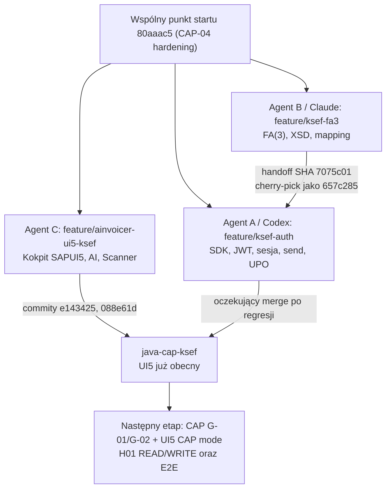

# AInvoicer — praca trzech agentów równolegle: model i rzeczywisty przebieg

> **Cel dokumentu:** utrwalić *jak* trzy niezależne sesje agentowe rozwijały AInvoicer równolegle 29.10.2026, jakie miały granice odpowiedzialności, jak przekazano artefakty i które wyniki są potwierdzone lokalnie lub LIVE. Dokument jest zarówno historią eksperymentu, jak i runbookiem ponownego użycia wzorca. Nie jest dowodem wdrożenia produkcyjnego.
>
> **Punkt obserwacji GitHub:** 29.10.2026; `java-cap-ksef` = `088e61dcfbe12ee20d9058464719a614826cbff3`, `feature/ksef-auth` = `2e1f33be8f87d88993b930297a8ef3c75f41584d`, `feature/ksef-fa3` = `7075c0117ec828f92724b7eb087bafa8d4c584b9`, `feature/ainvoicer-ui5-ksef` = `732fa14e90f4d98b9f1879e9aff74a876873085e`. Branże są ruchome: przed kolejnym merge sprawdź aktualne SHA, drzewo i CI.

## 1. Dlaczego trzech agentów?

Priorytetem sprintu było równoległe przygotowanie **działającego KSeF 2.0 TEST** i **użytecznego kokpitu Fiori**, bez czekania na zakończenie każdego etapu. Zamiast dawać wszystkim agentom ten sam globalny prompt, podzielono produkt na trzy względnie niezależne strumienie z jasno ograniczonym ownership:

| Strumień | Agent / branch | Zakres i pliki | Zakazane kolizje |
| --- | --- | --- | --- |
| A: integrator/backend | Codex, `feature/ksef-auth` | CAP Java, oficjalny KSeF Java SDK, auth/JWT, sesje, send/status/close/UPO, outbox, Maven, testy HTTP LIVE; ostateczne połączenie generatora B | Bez przebudowy SAPUI5, bez autoryzowanego SAP H01 WRITE, bez PROD |
| B: generator dokumentów | Claude Code, `feature/ksef-fa3` | `cap-java/srv/src/main/java/customer/cap_java/ksef/fa3/**`, oficjalne XSD, FA(3), walidacje, mapper i testy; bez niezależnej wysyłki | Bez edycji POM, klas auth/workera/outboxa, DB, SAPUI5, ABAP |
| C: frontend | oddzielna sesja agentowa, `feature/ainvoicer-ui5-ksef` | `sapui5/ainvoicer/**`, tabela KSeF, filtry, szczegóły, reguły akcji, mocki, utrzymanie AI/Scanner/Legacy FI, testy UI | Bez zmian CAP, SDK, ABAP; bez fikcyjnego „sukcesu” KSeF |

Orkiestrator nie był czwartą aplikacją ani autonomicznym daemonem. **Był nim kontrakt pracy**: osobne worktrees/branche, właściciel integracji A, handoff B→A, mock-first dla C, testy i udokumentowane punkty przekazania. Decyzje scalania do `java-cap-ksef` pozostają kontrolowane przez właściciela projektu.

### Schemat



## 2. Izolacja pracy

Wykorzystano osobne **Git worktrees** (ta sama historia Git, inne katalogi/branche), więc jednoczesne edycje i buildy nie nadpisywały `pom.xml`, `Main.controller.js` i `schema.cds`. Zalecany wzorzec na przyszłość:

```powershell
git fetch origin
git worktree add ../AInvoicer-auth -b feature/ksef-auth origin/java-cap-ksef
git worktree add ../AInvoicer-fa3 -b feature/ksef-fa3 origin/java-cap-ksef
git worktree add ../AInvoicer-ui5 -b feature/ainvoicer-ui5-ksef origin/java-cap-ksef
git worktree list
```

Powyższe komendy są **szablonem dla nowych branchy**, nie instrukcją ponownego tworzenia tych już istniejących; wybierz świeże nazwy lub użyj istniejącego worktree. W rzeczywistym sprincie wszystkie trzy strumienie rozpoczęły z `80aaac5`. Każdy agent miał osobne testy i dziennik. Wspólne dokumenty `docs/STATUS.md`, `docs/ROADMAP.md`, `docs/README.md` mogły konfliktować i wymagały ręcznej syntezy.

### Kontrakt przekazania między agentami

1. **B→A:** gotowy commit SHA, API `Fa3InvoiceXmlService.prepare(...)`, `byte[]` dokładnego XML, hash SHA-256, wersja XSD, wyniki Maven, ograniczenia (NIP, PartyData, duże `maxOccurs`). A nie kopiuje plików ad hoc z cudzego worktree, lecz integruje commit.
2. **A→C / backend→UI:** publikowany kontrakt OData (nie wewnętrzny `AinvoicerH01`), nazwy pól, autoryzacja, statusy, warunki akcji, endpointy i błędy. Jeśli API brak, C implementuje czytelny tryb mock i **nie aktywuje fałszywych akcji**.
3. **C→A / UI→backend:** lista luk API G-01…G-12, przede wszystkim G-01 (bezpieczna lista nagłówków i szczegółów) i G-02 (zaufana akcja requestSend); patrz [przewodnik UI](SAPUI5_KSEF_COCKPIT.md#9-backend-contract-gaps-dla-agenta-a).
4. **Integrator→właściciel:** wyniki testów `MOCK` vs `LIVE`, SHA commitów, co zmerge'owano, nierozwiązane problemy; nie deklaruje LIVE PASS na podstawie unit testu.

## 3. Chronologia realnych commitów i integracji

| Etap | Commit | Faktyczny rezultat |
| --- | --- | --- |
| Wspólny start | `80aaac5` | Po CAP-04 hardening; baseline trzech worktrees |
| A: SDK / workflow | `74d33a7` | Auth, SDK, worker, sesje, live harness i lokalne dowody KSeF TEST |
| B: generator FA(3) | `7075c01` | Deterministyczny XML, XSD, reguły domenowe, mapper i testy |
| B→A | `657c285` | A cherry-pickował B; konflikt wyłącznie `docs/STATUS.md`, źródła generatora zachowane |
| A: integracja komponentów | `2e1f33b` | Połączenie generatora i snapshotów z outboxem, testy 141/141 |
| C: kokpit do bazy | `e143425` | Funkcje SAPUI5 są już w `java-cap-ksef` |
| C: dokumentacja do bazy | `088e61d` | Przewodnik UI i luki G-01…G-12 są już w `java-cap-ksef` |
| C: pozostała drobna poprawka | `732fa14` | Fail-fast runnera browser-test, **jeszcze nie** w `java-cap-ksef` w punkcie obserwacji |

Ważne: gałąź A nie zawiera commitów UI, a `java-cap-ksef` nie zawiera jeszcze commitów A. **Nie wykonuj bezrefleksyjnego merge A i potem oddzielnego merge B:** przeniesiesz te same pliki FA(3) drugi raz. Preferowany jest **jeden merge A** oraz drobny cherry-pick UI `732fa14` (albo fast-forward C, jeśli stan nadal jest identyczny).

Historia i szczegóły: [Agent A](../journal/2026-10-29-agent-a-ksef-sdk.md), [Agent B](../journal/2026-10-29-agent-b-fa3.md), [Agent C](../journal/2026-10-29-agent-c-ui5.md).

## 4. Testy i granice dowodów

| Strumień | Raportowany wynik | Czego to nie dowodzi |
| --- | --- | --- |
| A | `mvn clean verify -Dcds.cds.skipVersionCheck=true` **141/141 PASS** po integracji B | Nie jest testem H01 READ/WRITE, SAPUI5→CAP, deploymentu CF/HANA ani ponownej wysyłki z generatora B |
| A / LIVE KSeF TEST | Auth XAdES, biznesowy auth 200, JWT/redeem/refresh, jedna syntetyczna faktura, biznesowy status 200, numer `1234563218-20261029-7DC8A1C00000-CD`, zamknięcie sesji, UPO 5528 B, udane RESUME | Wysyłano oficjalny syntetyczny fixture, nie fakturę z H01; nie ma kryptograficznego sprawdzenia podpisu UPO ani pełnego produkcyjnego lifecycle |
| B | **30/30** testów FA(3); integracja A po cherry-pick także PASS | Nie wykonano osobnej wysyłki do MF z nowego generatora |
| C | `npm run build` PASS, QUnit **44/44**, OPA **13/13**, smoke w Chrome headless | Kokpit jest w trybie demo/mock, nie działa jeszcze na publicznym API CAP; live Python/Node AI i Scanner nie były ponownie sprawdzane |

Powyższe są **wynikami udokumentowanymi przez agentów**, a nie testami ponowionymi z poziomu tego dokumentu. Szczegóły i odpowiednie granice: [runbook KSeF](KSEF_TEST_RUNBOOK.md), [FA(3)](FA3_XML_GENERATION.md), [SAPUI5](SAPUI5_KSEF_COCKPIT.md).

**Zabezpieczenie testów LIVE:** tylko TEST, nie PROD/DEMO, wyłącznie syntetyczne dane, jedna nowa faktura w uzgodnionej iteracji; utrata odpowiedzi nie uruchamia drugiego SEND. Odtwarzanie przez `RESUME`, stały identyfikator operacji, marker `send-attempt.json`. Nie wolno skasować markera ani plikowej bazy tylko po to, aby obejść idempotencję. Auth/claim/close muszą działać zgodnie z procedurą i ograniczeniami runbooka.

## 5. Ryzyka przekrojowe i rozstrzygnięcia

- **Git:** dwa niezależne początki od `80aaac5`; zmerge'owany UI zmienił `docs/README.md` i `docs/STATUS.md`, więc merge A może mieć konflikt dokumentacji. Ręcznie zachowaj wyniki wszystkich agentów, nie wybieraj automatycznie jednej wersji.
- **Zależności:** SDK `pl.akmf.ksef-sdk:ksef-client:3.0.29` zbudowano z przypiętego tagu oficjalnego repo i opublikowano do *lokalnego* Maven repo (Gradle/JDK 21); CAP kompiluje się na JDK 25. Czysty CI/CF wymaga reprodukowalnego pozyskiwania artefaktu SDK i zatwierdzenia sposobu dystrybucji.
- **XSD:** walidator B upraszcza w pamięci 12 dużych `maxOccurs` z powodu kosztów JAXP, A kontroluje oryginalne limity przy granicy wysyłki. Przy zmianie schematu trzeba sprawdzić oba mechanizmy.
- **Tożsamość i dane SAP:** syntetyczne NIP-y istniejącego seeda H01 mają problemy sumy kontrolnej; brakuje pełnego `PartyData` do FA(3). Nie fałszować potwierdzeń ani nie obchodzić walidacji.
- **Bezpieczeństwo UI/API:** UI nie powinno korzystać bezpośrednio z wewnętrznego `AinvoicerH01` ani tworzyć surowego `KsefOperations` jako zamiennika `requestSend`. API CAP musi filtrować po autoryzowanym NIP/CompanyCode i nie ufać kontekstowi przesłanemu przez przeglądarkę.
- **SAP writeback:** `ApplyKsefResult` ma kontrakt i testy EML/mock, ale rzeczywisty HTTP WRITE H01/communication user i DCL NIP nadal wymagają weryfikacji i jawnie dopuszczonego testu na dedykowanej fakturze.
- **Trwałość:** lokalny H2 i `LocalTestDocumentStore` nie wystarczają do skalowania na CF; potrzebne HANA i zarządzany storage, również procedury disaster recovery i weryfikacja UPO.

## 6. Proponowana sekwencja scalania i bramki akceptacyjne

Stan z punktu obserwacji:

1. **C:** w `java-cap-ksef` jest już UI; wystarczy zintegrować `732fa14` po sprawdzeniu diff i ponownie uruchomić skrypt testów. Nie mergować ponownie `e143425` i `088e61d`.
2. **A:** scalić `feature/ksef-auth` do `java-cap-ksef` jedną kontrolowaną operacją; rozwiązać ewentualne konflikty dokumentacji, nie nadpisywać UI.
3. **B:** nie mergować osobno — jego kod w A przez `657c285`. Po merge A wykonać porównanie źródeł FA(3) z `7075c01`, zamiast powielać commity.
4. Uruchomić **Maven clean verify**, **UI5 build**, QUnit i OPA oraz smoke w trybie mock; LIVE KSeF/SAP nie są domyślnymi testami CI.
5. Sprawdzić brak sekretów w diff, zgodność wersji SDK, schematu CDS, wystawianych API i konfiguracji bezpieczeństwa; dopiero potem oznaczyć integrację jako zaakceptowaną.
6. Nie deklarować gotowości produkcyjnej: lista G-01/G-02, approuter/XSUAA, H01 auth i realny UI→CAP E2E pozostają do wykonania.

Przykładowe komendy do uruchomienia przez **integratora w lokalnym worktree** (nie uruchamiaj na zabrudzonym drzewie bez weryfikacji; nie robią automatycznego push):

```powershell
git fetch origin
git switch java-cap-ksef
git status --short
git merge --no-ff origin/feature/ksef-auth
# w razie konfliktów: ręczna synteza docs/README.md / STATUS.md, potem git add i commit
git cherry-pick 732fa14e90f4d98b9f1879e9aff74a876873085e
cd cap-java
mvn clean verify '-Dcds.cds.skipVersionCheck=true'
cd ../sapui5/ainvoicer
npm ci
npm run build
# osobno uruchom serve-mock, potem test:unit / test:opa zgodnie z przewodnikiem SAPUI5
```

**Nie jest to zapis wykonania merge**, tylko zalecana procedura. Przy współbieżnej pracy sprawdź aktualny HEAD przed jakąkolwiek próbą push.

## 7. Kolejny sprint: spięcie pionowego scenariusza SAPUI5 → CAP → KSeF TEST

Nie powtarzać teraz dużego sprintu SDK/FA(3). Najkrótsza ścieżka do używalnego produktu:

- **G-01 (backend CAP):** bezpieczna projekcja listy/szczegółów faktur z RAP, rzeczywista autoryzacja tenant/NIP/CompanyCode, pagination/filter/sort; weryfikacja, że DCL RAP `where TRUE` nie pozwala komunikacyjnemu użytkownikowi zbyt dużo odczytać.
- **G-02 (backend CAP):** operacja `requestSend`, która bierze InvoiceUUID z UI, sama odczytuje fakturę SAP, weryfikuje Direction/NIP/CompanyCode, pobiera autoryzowane PartyData i tworzy snapshot + outbox, bez zaufania do NIP/operacji dostarczonych przez UI. W pierwszym kroku uruchomić przygotowanie bez nowego LIVE SEND; kolejną syntetyczną fakturę wysłać tylko w nowym, zatwierdzonym eksperymencie.
- **Frontend C:** przełączyć `dataMode` z mock na CAP dopiero po G-01 i odpowiednim proxy/approuter; włączyć Send dopiero po G-02 i testach braku uprawnień, bez przeglądarkowego JWT.
- **H01 / CAP-04D:** osobno przetestować rzeczywistego communication usera i RAP `ApplyKsefResult` na wyznaczonej syntetycznej fakturze; NIE robić z tego warunku rozpoczęcia G-01.
- **Następnie:** dokument storage na HANA/CF, odbiór zakupów, monitoring/recovery i dalsze mapowanie FI/MM/SD.

## 8. Checklista przyszłego multi-agent sprintu

1. Ustal jeden integracyjny branch, bazowy SHA, wyłącznego właściciela POM i kontraktów oraz granice dla każdego agenta.
2. Załóż osobne worktrees. Nie pozwalaj dwóm agentom pisać jednocześnie do tych samych plików.
3. Zdefiniuj handoff na poziomie publicznych interfejsów, typów, testów, SHA i wymaganych uprawnień, nie na poziomie opisów „skończone”.
4. Każdy agent prowadzi swój dziennik i raportuje `LOCAL PASS`, `MOCK PASS`, `LIVE PASS`, `BLOCKED` oddzielnie.
5. Integrator cherry-pickuje/merge'uje tylko po testach; czyta diff, rozwiązuje konflikt dokumentacji, sprawdza testy przekrojowe.
6. LIVE akcje są wykonywane tylko w zadanym środowisku, na jawnie dopuszczonych danych, ze stałą idempotencją. Inny agent nie wysyła równolegle tej samej faktury.
7. Po integracji wykonaj jeden pełny build, sprawdź manifesty i uprawnienia oraz udokumentuj wynik *dla aktualnego merge commit*.
8. Zachowaj możliwość audytu: odnośniki do commitów, build/test evidence, decyzji ADR, ograniczeń i komend reprodukcji.
