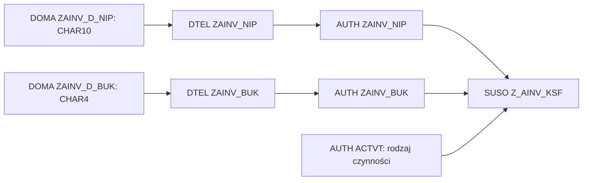
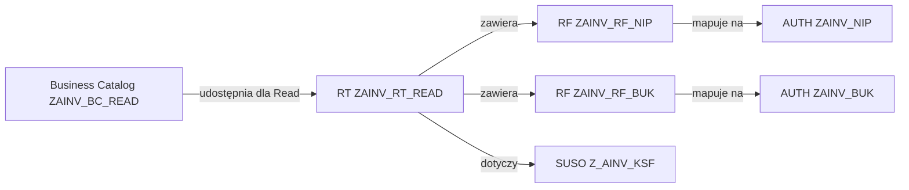
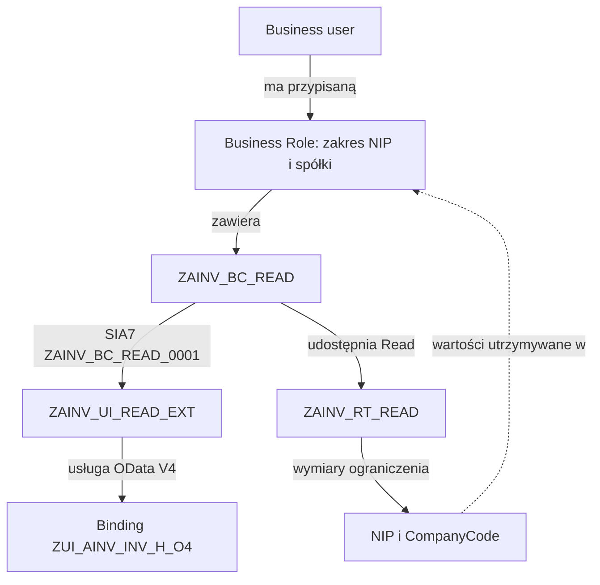
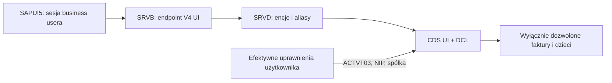

# RAP UI — jak działa dostęp do faktur

[Project Home](../README.md) · [STATUS](../STATUS.md) · [Procedura konfiguracji i testów](RAP_UI_LIVE_CONNECTION.md) · [Dziennik](../journal/2026-10-30-abap-06-ui5-06.md) · [ADR-0005](../decisions/ADR-0005-rap-business-status-cap-integration-status.md)

Przygotowaliśmy w H01 obiekty techniczne i konfigurację developerską, dzięki którym administrator może nadać business userowi odczyt usługi RAP UI ograniczony do NIP i CompanyCode. Użytkownik utworzył/zmienił obiekty w ADT; agent sprawdził zapisany stan przez MCP i przygotował dokumentację. Nie przydzielano ról przez agenta.

**Stan kończący ten krok:** binding, model ograniczeń, IAM App, katalog i przypisanie aplikacji do katalogu są zapisane. **Rola biznesowa, jej efektywne zakresy i przypisanie użytkownika nie zostały zweryfikowane.** Ostatni READ UI przez developer OAuth MCP: HTTP200 i pusta kolekcja. To nie jest jeszcze gotowy LIVE dostęp użytkownika SAPUI5.

## Co rzeczywiście potwierdzono w H01

**Ponowna inspekcja ABAP-07 (2026-10-30):** odczytano App, katalog, RT, RF, assignment, SUSO, trzy CDS/DCL i SRVD/SRVB. App/katalog/RT nadal opublikowane; SUSO zawiera już referencję ZAINV_RT_READ. UI metadata200, trzy kolekcje200/0 w developer OAuth; ATC7/7 bez ustaleń. Rola biznesowa, aktywacja roli, zakres Read/Write, inne role, przypisanie business usera i odświeżenie jego sesji: **BLOCKED / niezweryfikowane**. Samo RT/SIA7 ani roleID w XML katalogu nie są dowodem istnienia Business Role. [Wyniki i ograniczenia narzędzi](../journal/2026-10-30-abap-07-ui5-07.md).

| Obiekt / typ | Potwierdzony stan |
| --- | --- |
| ZAINV_D_NIP / DOMA | active, CHAR10, długość wyjściowa10; bez stałych wartości |
| ZAINV_D_BUK / DOMA | active, CHAR4, długość wyjściowa4; bez stałych wartości |
| ZAINV_NIP / DTEL | active, typeKind=domain, wskazuje ZAINV_D_NIP |
| ZAINV_BUK / DTEL | active, typeKind=domain, wskazuje ZAINV_D_BUK |
| ZAINV_NIP, ZAINV_BUK / AUTH | istniejące pola autoryzacyjne, używane przez Z_AINV_KSF; ich obecność potwierdzono wcześniej |
| ZAINV_RF_NIP / SIA5 | zapisane Authorization Field=ZAINV_NIP, supportsRanges=false |
| ZAINV_RF_BUK / SIA5 | zapisane Authorization Field=ZAINV_BUK, supportsRanges=false |
| ZAINV_RT_READ / SIA2 | zawiera oba RF i Authorization Object Z_AINV_KSF; publishStatus=p |
| ZAINV_UI_READ_EXT / SIA6 | typ EXT; usługa OData V4 ZUI_AINV_INV_H_O4; Z_AINV_KSF: ACTVT03, NIP5260002008, BUK1000; publishStatus=p |
| ZAINV_BC_READ / SIA1 | zawiera ZAINV_RT_READ: readAccess=true, writeAccess=false, f4Access=false; publishStatus=p |
| ZAINV_BC_READ_0001 / SIA7 | łączy katalog ZAINV_BC_READ z aplikacją ZAINV_UI_READ_EXT |
| ZUI_AINV_INV_H_O4 / SRVB | V4, wersja0001, published=true; URL z bindingu, bez zgadywania |

W XML instancji IAM App pole ZAINV_BUK ma wartość1000 i dodatkowy pusty wpis fieldValue. Nie traktujemy pustego wpisu jako wildcard ani dowodu rozszerzenia uprawnień. Przy finalnym przeglądzie w ADT sprawdzić listę wartości i usunąć pusty wiersz, jeśli rzeczywiście występuje w edytorze. Ostateczne zakresy i tak trzeba potwierdzić na roli i użytkowniku.

ABAP-07 potwierdził ten sam pusty wpis. XML oznacza pustą dolną i górną granicę, nie znak `*`; sam odczyt nie rozstrzyga, czy generator pomija ten wiersz, czy nadaje literalną wartość początkową. Nie jest to dowód wildcard ani przyczyny pustej kolekcji. Bezpieczna korekta **przez upoważnionego właściciela w ADT**: otworzyć istniejącą App → Authorizations → instancja0001 Z_AINV_KSF → wartości ZAINV_BUK; porównać zapis z edytorem, zachować1000 i usunąć wyłącznie potwierdzony pusty wiersz. Sprawdzić diff (bez nowej instancji/ACTVT16), zapisać/opublikować w zleconym zakresie, ponownie odczytać XML i wykonać macierz business usera. Agent nie zmieniał App ani uprawnień.

Metadane katalogu nie zawierają całej listy aplikacji w tym samym dokumencie. Dlatego przypisanie potwierdzono oddzielnym odczytem **SIA7**. Pusty wynik narzędzia Object Relations dla katalogu nie oznaczał braku przypisania — odczyt SIA7 potwierdził oba końce relacji.

## Domena, element danych i pole autoryzacyjne

Te trzy obiekty mogą wyglądać podobnie, lecz pełnią różne funkcje:

| Warstwa | Odpowiedzialność | Czego samo istnienie obiektu nie zapewnia |
| --- | --- | --- |
| Domain ZAINV_D_NIP / ZAINV_D_BUK | techniczny typ i długość: CHAR10 / CHAR4 | nie nadaje uprawnień, nie sprawdza sumy kontrolnej NIP |
| Data Element ZAINV_NIP / ZAINV_BUK | semantyka, etykiety i powiązanie z domeną | nie przypisuje użytkownikowi NIP ani spółki |
| Authorization Field ZAINV_NIP / ZAINV_BUK | nazwane pole, do którego porównujemy wartości w sprawdzeniu autoryzacji | nie zawiera samodzielnego nadania dla użytkownika |

DTEL i AUTH mają u nas te same nazwy, ale są **różnymi typami obiektów**. Przy otwieraniu przez Ctrl+Shift+A trzeba wybrać właściwy typ. RF to kolejny osobny obiekt, nie nowa kopia AUTH.

W trakcie konfiguracji Restriction Field wystąpił błąd **Missing metadata for authorization field ZAINV_NIP**. Live odczyt wykazał, że DTEL miały bezpośrednio CHAR10/CHAR4, bez domen. Instrukcja ADT dla Authorization Field wymaga DTEL opartego na domenie. Użytkownik dodał domeny i zmienił istniejące DTEL, zachowując ich techniczne typy/długości. Po tej zmianie zgłosił poprawne działanie RF; agent potwierdził domeny active, powiązania DTEL i zapisane powiązania RF. Nie przebudowywano tabel faktur i nie zmieniano DCL.



Strzałki pokazują budowanie kolejnych warstw na wcześniejszych definicjach. SUSO grupuje pola ACTVT/NIP/spółka. Sprawdzenie jednej instancji autoryzacji wymaga zgodności potrzebnych pól łącznie; nie wystarczy sam dozwolony NIP przy obcej spółce.

## Restriction Field i Restriction Type

**Restriction Field** udostępnia pole autoryzacyjne jako pole ograniczeń w IAM. ZAINV_RF_NIP mapuje się na AUTH ZAINV_NIP, a ZAINV_RF_BUK na AUTH ZAINV_BUK. Administrator może dzięki temu wskazywać konkretne wartości podczas utrzymania roli. Supports ranges=false oznacza, że w tych polach nie włączono obsługi przedziałów.

**Restriction Type ZAINV_RT_READ** wiąże oba pola ograniczeń z Z_AINV_KSF. Opisuje zestaw wymiarów, po których można ograniczać dostęp. Zapisanie RT nie przyznaje nikomu uprawnienia. RT trzeba udostępnić przez katalog, a wartości dla konkretnego zakresu utrzymać w roli biznesowej.



## IAM App, przypisanie i Business Catalog

**IAM App ZAINV_UI_READ_EXT** określa usługę, do której ma prowadzić nadanie, oraz jej obiekty autoryzacyjne i czynności. Typ EXT nie tworzy nowej aplikacji SAPUI5; jest to artefakt kontroli dostępu. Dodana usługa wskazuje opublikowany binding ZUI_AINV_INV_H_O4. ACTVT03 oznacza odczyt/display; w tej instancji nie skonfigurowano ACTVT16 dla zapisu wyniku KSeF.

**Business Catalog ZAINV_BC_READ** jest pakietem dostępu dostępnym administratorowi podczas tworzenia roli. Łączy aplikację z dostępnymi ograniczeniami. W obecnej konfiguracji RT udostępniono dla Read; Write oraz F4 są wyłączone. F4 oznacza kategorię dostępu do podpowiedzi wartości, a nie klawisz wymagany do otwierania usługi. Samo włączenie Read w katalogu nie przypisuje jeszcze roli żadnemu użytkownikowi.

**Business Catalog App Assignment ZAINV_BC_READ_0001** to osobny obiekt SIA7 zapisujący relację katalog ↔ IAM App. Powstał podczas kreatora dodawania aplikacji do katalogu. Nie jest kolejną aplikacją ani rolą.

Publish Locally aplikacji/katalogu udostępnia ich konfigurację do użycia w bieżącym systemie. Nie jest przypisaniem użytkownika ani publikacją do wszystkich środowisk.

**Wartości w IAM App a wartości w roli:** odczytana App ma ACTVT03/NIP5260002008/BUK1000. Nie oznacza to nieprzekraczalnego limitu wszystkich przyszłych ról. Dla pól objętych Restriction Type wartości utrzymywane w roli mogą zastępować odpowiadające im wartości App. Dlatego trzeba świadomie ustawić Read=Restricted i obie wartości w roli oraz sprawdzić sumę innych nadań użytkownika. Obiekty IAM są definicją modelu; wynik efektywnych uprawnień potwierdza test runtime.

## Business Role i użytkownik — pozostały krok administracyjny

Business Role grupuje katalogi, zawiera rzeczywiste zakresy i jest przypisywana do business userów. Proponowana rola testowa: **ZBR_AINV_READ_1000**; jej istnienia ani przypisania nie potwierdzono w tej sesji.

W Maintain Business Roles H01 administrator dodaje katalog ZAINV_BC_READ, ustawia Write=No Access i Read=Restricted, wprowadza NIP5260002008/CompanyCode1000, a następnie przypisuje wskazanego business usera. Potrzebny jest przegląd innych ról tego użytkownika: nadania się sumują i inna rola może rozszerzać jego zakres. To rola ABAP, odrębna od Role Collection w BTP Cockpit i od KsefOperator/claims po stronie CAP.



To diagram zależności konfiguracyjnych, nie sekwencja wywołań sieciowych. Aplikacja nie odpytuje po kolei obiektów DOMA/AUTH/SIA podczas każdej faktury; korzysta z efektywnych autoryzacji zbudowanych na podstawie konfiguracji.

## Binding, Service Definition i DCL — co dzieje się przy odczycie

**Service Definition ZUI_AINV_INV_H_O4 (SRVD)** wybiera widoki UI i nadaje im aliasy Invoices, InvoiceItems, InvoiceReferences. **Service Binding o tej samej nazwie (SRVB)** udostępnia definicję jako endpoint OData V4 UI. Są to dwa osobne obiekty mimo wspólnej nazwy.

Rzeczywista ścieżka UI:

```text
/sap/opu/odata4/sap/zui_ainv_inv_h_o4/srvd/sap/zui_ainv_inv_h_o4/0001/
```

Widoki ZC_AINV_INV_H_UI, ZC_AINV_INV_I_UI i ZC_AINV_INV_REF_UI czytają istniejący model faktur. Są odrębnymi zwykłymi widokami SELECT z własnym DCL i #MANDATORY. Usługa UI nie jest proxy listy w CAP. Odczyt biznesowego wyniku KSeF pozostaje w RAP.

**DCL wykonuje właściwe filtrowanie rekordów w backendzie.** Dla nagłówka warunek wymaga ACTVT03 oraz właściwej pary:

```text
OUTBOUND: SellerNip + CompanyCode
INBOUND:  BuyerNip  + CompanyCode
```

DCL dzieci dziedziczą warunek nagłówka przez _Parent. Model ma chronić także bezpośredni odczyt pozycji i referencji, nie tylko nawigację z listy; efekt wymaga testów właściwymi użytkownikami. Ograniczenie w UI5 jest wyłącznie filtrem widoku i nie zastępuje DCL.



Przykład: rola ma NIP5260002008/spółka1000. DCL może dopuścić OUTBOUND, gdy sprzedawca ma ten NIP i faktura ma tę spółkę; dla INBOUND sprawdza NIP nabywcy. Zgodny NIP przy CompanyCode2000 nie spełnia tej jednej pary uprawnień. To model do sprawdzenia runtime, nie deklaracja przeprowadzonych testów negatywnych.

HTTP200 z pustą kolekcją oznacza poprawną odpowiedź zapytania bez widocznych rekordów; może wynikać z DCL, filtrów lub braku danych. Nie dowodzi awarii bindingu ani samodzielnie nie potwierdza poprawności izolacji. Ostatni własny test MCP po publikacji katalogu nadal zwrócił HTTP200/0; nie korzystano z sesji business usera o nowo potwierdzonej roli.

## Dlaczego dwa API faktur

| Kanał | Konsument i odpowiedzialność |
| --- | --- |
| ZUI_AINV_INV_H_O4 | SAPUI5/business user; odczyt danych faktury i zapisanego wyniku KSeF, własne DCL/IAM |
| ZAPI_AINV_INV_H_O4 | CAP/principal komunikacyjny; integracyjny READ i odrębnie autoryzowany ApplyKsefResult |

Ten podział wynika z ADR-0005: inne tożsamości, uprawnienia i zakresy operacji. Samo słowo UI w bindingu nie zastępuje DCL ani kontroli mutacji; readonly wynika z wystawionego modelu UI. Nadanie roli ABAP nie daje automatycznie roli KsefOperator w CAP. Agent nie wykonywał SEND, writebacku ani zmian IAM; te obiekty tworzył użytkownik w ADT.

## Co pozostało i jakie są granice dowodów

1. Potwierdzić rolę biznesową, jej ograniczenia i przypisanie użytkownika w H01; zalogować go ponownie i wykonać READ metadata/nagłówków/dzieci.
2. Zaliczyć macierz obcego NIP, obcej spółki, bezpośrednich dzieci i dwóch tożsamości. Obecne cztery faktury w jednym zakresie nie wystarczają do wszystkich przypadków negatywnych; nie tworzono nowych faktur.
3. Dopiero potem podłączyć UI5 do zweryfikowanego endpointu i tożsamości business usera, z Send OFF. Test CAP→KSeF/SAP WRITE wymaga odrębnego zlecenia.

Inspekcja active/published/zapisanych powiązań nie jest jeszcze testem efektywnych uprawnień. Nie eksportowano tych zmian przez abapGit do abap/src; pliki Git nie są nowym snapshotem SAP. Buildów aplikacji nie uruchamiano w tej dokumentacyjnej kontynuacji.

## Źródła SAP

- [Authorization Basics — role, katalogi, pola i aplikacje IAM](https://help.sap.com/docs/sap-btp-abap-environment/abap-environment/authorization-basics).
- [Defining Authorization Fields — wymaganie domeny](https://help.sap.com/docs/abap-cloud/abap-development-tools-user-guide/defining-authorization-fields).
- [Defining Restriction Fields](https://help.sap.com/docs/abap-cloud/abap-development-tools-user-guide/defining-restriction-fields).
- [Defining Restriction Types — powiązania i wartości z roli](https://help.sap.com/docs/abap-cloud/abap-development-tools-user-guide/defining-restriction-types).
- [Business Catalog z Restriction Types](https://help.sap.com/docs/sap-btp-abap-environment/abap-environment/creating-business-catalog-with-restriction-types?version=Cloud).
- [Maintain Business Roles and Access Restrictions](https://developers.sap.com/tutorials/abap-environment-access-mgmt).
- [Service Binding](https://help.sap.com/docs/abap-cloud/abap-rap/service-binding).
